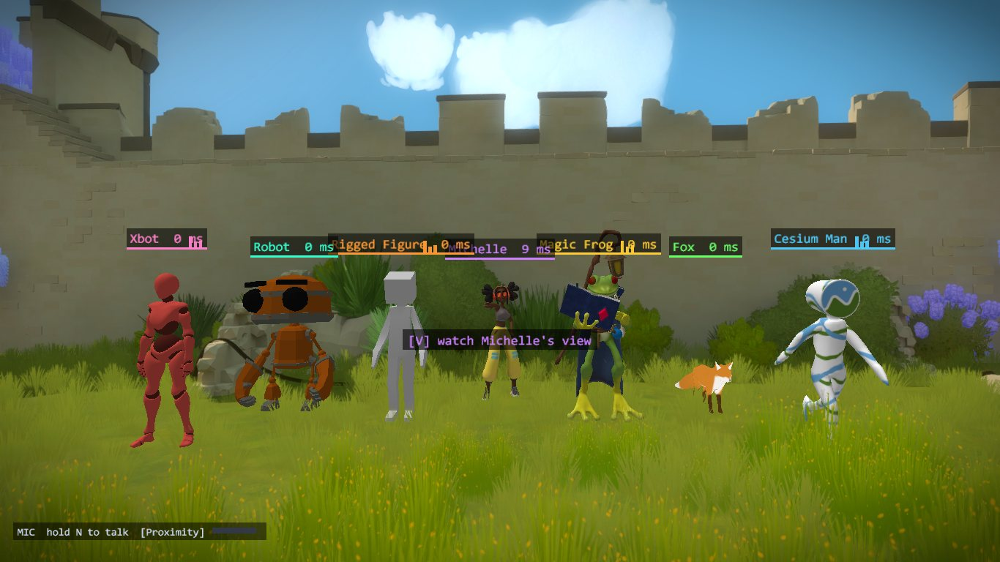
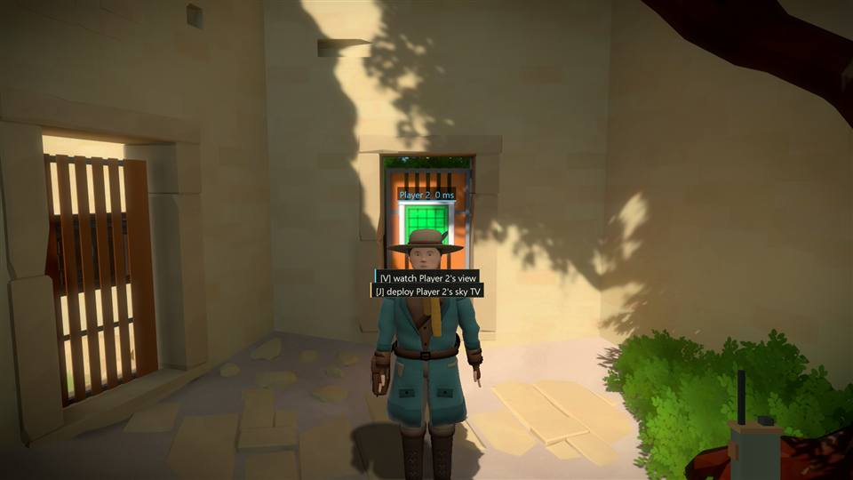

# witness-coop

Co-op for The Witness (Steam app 210970, build 11370412). **Dev preview, not playable with friends yet.** Two copies of the
game on one PC can see each other as puppets, and when one player solves a panel the other game marks it solved and opens the
door it gates. The first two tutorial door puzzles and a panel-to-panel power-on chain have automated bots; power-off switches, lasers, plates
and bridges are not synced, and there is no installer or release.
Built with the [Co-op Anything](https://github.com/cranebeaker/coop-anything) playbook; research notes live in
`games/the-witness/NOTES.md` there.

No game files are in this repo. You need your own copy of The Witness, Steam build 11370412
(`witness64_d3d11.exe` SHA-256 `8d672d444df6a6df7130f25a517bdab1af92731fe2138dc5b324d519561d55a5`).

[](docs/SHOWCASE.md)

**[See the showcase](docs/SHOWCASE.md)** for pictures of every feature.

## What works

The adventurer has [24 procedural emotes and proximity speech gestures](docs/GESTURES.md), with game-free pose checks, sync simulation and a software preview. Hold `G` for the wheel, use `Tab` to change its page, and hold `F1` for the binding guide. Live visual quality remains unverified.

Chat, pings, emotes, drawing, voice (with channels: proximity, radio, an open line, one on one), see-through players, a race mode, a lobby in the launcher (invite friends, see and talk to them before and after the game), saves that say who played and a new game that starts with chosen parts of the map done are described in [features.md](features.md); pictures of all of it are in [the showcase](docs/SHOWCASE.md).

- **Player model.** Each player sees the other as an animated, skinned character (glTF `.glb`), drawn into the game's frame by a
  hook on the Direct3D 11 `Present` call. It stands at the other player's feet, faces where they look, plays a walk clip at a rate
  matched to their measured speed (and an idle or run clip when the model has one), and is hidden by walls and doors: the proxy reads
  the game's own depth buffer (4x MSAA, reversed depth stored as `0.0597 / distance`, found by watching which depth view the game
  binds) and discards the model's pixels that are behind it. The original adventurer is the only character, with idle, walk and run clips and three fidgets.
  It blinks, glances at a player who comes near, carries its head where its player looks, breathes (harder after a run), swings its scarf and
  gear and coat as it moves, acts with its brows in the emotes, is lit with a normal map, roughness and metalness and a sun shadow on the ground, and its footsteps are heard where it walks: [the life layer, shading and shadow](docs/LIFE.md).

  
  See [asset credits](assets/models/CREDITS.md) and the [migration details](#character-migration) below.
- **Shared panels and doors.** A detector watches all 594 `Machine_Panel` and 327 `Door` entities. A solved panel is sent to the
  other game and written there as solved; an opened door is opened there by calling the game's own door function, so the
  door animates and collides as in single-player. Events are numbered, received in sequence and resent until acknowledged.
  If an entity is temporarily missing or a door call is refused, its acknowledged event stays queued and retries on the render
  thread; other entities can still progress. Successful changes are applied once. A restarted game gets the whole state again.
  The restart catch-up scenario checks this after the original panel/door events have already been acknowledged.
- **Panel power-on progression.** Activating a panel is a separate reliable event from solving it. The peer calls the game's
  panel power-on function on the render thread; its normal frame updates animate the brightness. A powered target remains
  unsolved. Power state participates in startup stability, has its own echo guard, and is included in restart catch-up.
  This currently shares power-on progression; power-off switching is not replicated.
- **Safe start.** Nothing is detected, resent or applied until the world is stable (camera valid and identical panel and door
  counts on three scans three seconds apart); after applying a remote change the entity is suppressed for 5 s so it is not
  sent back.
- **Optional Back TV ("POV TV").** A small CRT TV strapped to the adventurer's back displaying that player's point of view to nearby players as a 128x96 snapshot stream (5 Hz, RLE compressed) with dynamic harness sway, antenna wobble, and phosphor power-on/off animations. Double opt-in: viewer toggle (`pov_tv=1`, F10) and streamer consent (`pov_tv_consent=1`, F11) default off; on-screen HUD indicator signals broadcasting. See [POV TV design and verification](docs/POV_TV.md).

Not done: power-off switching, plates, lasers, bridges, a real network (localhost only), late join into a game
with progress (restart catch-up, a first-time late join and a same-process save reload are in the suite), puzzles beyond the first two tutorial doors, the first black/white tutorial panel and one cable-driving maze (`0x293`), crouch/prone poses (the game has none), lighting that matches the game's, models with several textures or materials, and shadows.

## Quick guide (hold F1)

Hold **F1** in the game or launcher to show a three-column guide; release it to return.
The in-game guide and menus use a proportional Segoe UI font from a padded 2x atlas,
measured wrapping, warm surfaces and amber selection borders. Chat wraps to its panel,
and long input scrolls to keep the cursor visible. `make -C proxy/ui test` checks text
metrics, wrapping, fitting and guide bounds with three mutants, and the dev map's detail pane
(`proxy/ui/detail_layout.h`: every line and button of a selected panel inside its pane, the text at
10 px or more, at eleven screen sizes from 1024x768 to 3840x2160 including 21:9) with two mutants. The focused live layout
check is `tools/qa.sh probe tools/qa_cozy.py`; it renders the live UI scene into D3D11
render targets (over a copy of the current game frame) at
1024x768, 1280x720, 1920x1080, 2560x1440, 3440x1440 and 3840x2160. Add `--native`
to capture the actual 1280x720 game back buffer instead; larger native windows can be
limited by the desktop work area.

It covers the current mod bindings, co-op and race features, host/join flow, shared state,
networking and troubleshooting. The game uses its existing text renderer; both views share
`common/guide.h` and `common/bindings.def`. Configurable keys come from that binding table,
including custom keys; the launcher shows its current settings (restart the game to apply).
F1 works in chat, menus and launcher text fields too, and losing focus dismisses the guide.

This revision had no default F1 action. An existing custom `key_*=F1` assignment moves to
**F2**, leaving F1 for help. If F2 is occupied, it uses the first free key in F12,
then 0 through 9. The guide shows the resulting key. The launcher loads this migration into
its settings fields; Save settings persists it. The DLL also applies it when reading an old cfg.
The launcher rejects duplicate keys, fixed mod shortcuts and WASD for configurable mod actions.

`make -C common test` runs the game-free guide/binding tests and four mutants: omitted key,
colliding keys allowed, F1 migration disabled, and toggle instead of hold. It checks custom
bindings, repeat/release/focus loss and the three-column line budget. Build both views with
`make -C proxy` and `make -C launcher launcher`.

The game opens on the monitor the launcher is on (windowed: centred there; full screen: that monitor). The launcher
passes the work area of its monitor in `WITNESS_MONITOR`, and the mod places the game's window when the game creates it.
`tools/qa.sh launcher` checks it with the launcher moved off the primary monitor, and a mutant launcher that does not pass it must fail.

## Try it (two copies on one PC)

Requirements: Windows with the Steam build above; WSL2 with `make` and MinGW-w64 (`x86_64-w64-mingw32-g++`); Windows Python 3
(default `python.exe`, override with `PYW`); Python 3 in WSL. Nothing here installs anything for you.

**Test copies.** Optional machine configuration belongs in ignored `local/env.sh`.
Set `PYW` to Windows Python. For concurrent QA, configure `WITNESS_RESOURCES` to
an external provider implementing the interface in [docs/RESOURCES.md](docs/RESOURCES.md).
It supplies isolated copies, ports, process registration and cleanup. The public
repository has no required workstation service or private checkout path.

The proxy goes into two disposable copies of the install, never the real one:

```
cp -a "<Steam library>/steamapps/common/The Witness" local/witness-1
cp -a "<Steam library>/steamapps/common/The Witness" local/witness-2     # (then set WITNESS_DIR1/2, configure an external resource provider)
tools/install.sh       # builds the DLL, checks both exe hashes, renames AnselSDK64.dll to AnselSDK64_real.dll, installs the proxy
tools/restart.sh       # starts both with -skip_config_dialog -windowed -new_game, side by side
tools/restart.sh B     # restart only B with a fresh world, keeping A and its progress running (also accepts A)
```

Each copy is 3.9 GB. **The game keeps its saves in `%APPDATA%\The Witness` whatever folder the exe runs from**, so a copy does not
isolate them: starting a New Game from a copy rewrote an existing save there. Back that folder up first.
A hand test: walk player A (left window) to the first panel at the end of the start tunnel and solve it; the door opens in B
as well (B's `local/witness-2/witness_proxy.log` says `remote panel 0x64 applied as solved`, `remote door 0x34eda opened`).

## Experimental groups (2–16 players)

The `coop16` branch adds a configured full mesh of up to 16 players: independent reliable streams and ACKs,
all remote poses and avatars, player selection on the map, and shared panel, door, panel-power and cable state.
Group cable mutations carry logical versions so concurrent changes and old snapshots converge consistently.
Detection follows the requested power level while the cable glow fades; a genuine local reversal is still sent during
a remote echo-guard window. New commands are detected before restart snapshots are built.
The two-player `peer=<port>` configuration uses protocol v6. Group mode uses distinct v7 packet tags; every member must
use the updated DLL and list every other member, with distinct player IDs and UDP endpoints.

Generate configurations from a JSON roster, for example:

```json
[{"id":1,"host":"127.0.0.1","port":48001},
 {"id":2,"host":"127.0.0.1","port":48002},
 {"id":3,"host":"127.0.0.1","port":48003}]
```

```sh
python3 tools/group_config.py roster.json local/group-configs
```

Copy each generated `player-<id>.cfg` to `witness_coop.cfg` beside that player's DLL in a disposable game copy.
Each config has `id`, `listen`, and one `peer=<id>,<IPv4 address>,<port>` line per other member (15 lines for a
16-player group). Keep `save_dir=instance` to isolate saves. Launch and install the copies as described above;
`tools/restart.sh` generates two-player configs, so it does not preserve group configs.
Group partner video displays the lowest-ID remote player's stream. Avatar choice is still local.

Validation so far: the eight-player game-free test covers lossy links, reordering, duplicates, independent ACKs,
a temporarily unreachable receiver, progression from every player, all remote poses, cable conflicts and a peer restart.
Five group mutants must fail, including recovery after 4,200 changes while one receiver is unreachable. `python3 tools/test_group_config.py` checks the 16-entry roster capacity and invalid rosters.
The production Windows UDP layer also passed an eight-client fake-world integration test with 25% loss,
cable on/off and a restarted client (`make -C proxy/core transport-test`; no game or resource provider slots).
A two-real-game group run passed a normal input-driven bot solve, door sync, progress originating on both clients,
pose/avatar submission, packet loss, restart catch-up, empty queues and byte-identical real saves.
`tools/qa_group_render.sh` also passed with one real game and seven lightweight protocol clients: seven actual D3D
avatar submissions with distinct positions, one moving gait and six stationary gaits, bidirectional panel progression,
a normal local bot solve and drained queues under 25% packet loss. Its shared-avatar-state mutant was caught.
This uses one game slot; it does not count as eight real game processes. The `modelstate` command writes the latest
render frame's submitted IDs, positions and gait speeds to `witness_models.json` for these checks.
Eight-real-game QA is **pending** while other resource provider tests occupy the available RAM: `tools/qa_group.sh 8` first checks resource provider activity and RAM, then leases only this
worktree's slots, runs a normal bot solve, checks every world's process memory, originates progress on every client,
and verifies restart recovery and drained queues. It refuses insufficient RAM rather than displacing another test. Groups of three or more also defer while another sweep or suite is live, so a client restart cannot make occupied test capacity look temporarily free.
Sixteen live clients and remote-PC networking have not been tested.

## How it works

The exe loads `AnselSDK64.dll` from its own folder. `proxy/` builds a replacement whose nine exports are stubs that load the
renamed original (`AnselSDK64_real.dll`) by full path on first use and jump to the real function (export forwarders in a `.def`
file made the loader fail with "AnselSDK64_real.dll not found"). `DllMain` only starts threads.

| Part | File | What it does |
|---|---|---|
| Network | `coop.cpp` | Protocol v6 UDP: pose at 30 Hz (`WTP6`, 40 bytes), reliable events (`WTE6`, 32 bytes: epoch, sequence, kind with bit 8 set for snapshot events, entity), cumulative acks (`WTA6`, 24 bytes); lengths include checksums. A peer session change starts a new epoch and full state resend |
| Overlay | `overlay.cpp` | Patches slot 8 (`Present`) of the swap-chain vtable (found through a dummy device), draws the player model (`model_gpu.cpp`, `model/`) or the flat puppet; also runs queued game commands and remote events between frames |
| Model | `model/model.{h,cpp}`, `model_gpu.cpp`, `depth.cpp` | `model/` is game-free C++ (glTF loading with cgltf and stb_image, skeletal animation, CPU skinning, camera maths, the remote player's walk state) with its own T0 test; `model_gpu.cpp` is the D3D11 skinned-mesh renderer with a GPU occlusion query; `depth.cpp` patches the context vtable (`OMSetRenderTargets`) to find the game's scene depth buffer |
| State | `state.cpp` | Detector thread (10 Hz) and the applier; echo guard and stable-world gate |
| Input | `input.cpp`, `game.cpp` | Injects keys, mouse and clicks into the game's own input pump, teleports the player, takes screenshots, parses `witness_cmd.txt` |
| Hooks | `hooks.cpp`, `config.cpp` | Import-table hooks installed from `DllMain` (memory patching only): `SHGetFolderPathW` (save folder), `CreateFileA/W` (`data-pc.zip` share mode); settings read lazily from the cfg |
| Game calls | `game.cpp` | Door opening at `base + 0x8E4B0`; panel power-on at `base + 0xC2890`, both type-checked and called on the render thread; `witness_cmd.txt` for development |

Build 11370412 facts the code relies on (module-relative): entity table `[[base+0x62D0A0]+0x18]` indexed by the mod's entity IDs
(table indices, including zero); entity
`+0x08` points to a type descriptor (`Machine_Panel` `0x62E670`, `Door` `0x62DE70`); camera position `0x6304C0`, angles `0x6303EC`;
the world projection's scale terms are the floats at `0x649910` (x, negative) and `0x649924` (y): `cot(half vertical fov)` and that divided by the aspect, rebuilt every frame from the saved option `user_fov_vertical` (float at `0x6208BC`, default 54 degrees); the overlay reads them (`proxy/gamecam.cpp`) so its lines, puppets and ink follow the player's field of view and window shape (`old_projection=1` restores the old fixed 60 degrees, a test twin);
a panel is solved when the float at `+0x294` is `1.0` and the int at `+0x298` is `1` (a solve also sets `+0x278`, `+0x280`, `+0x290`);
a door is open when the word at `+0x1D0` is `1.0`. The game's stored target IDs use a separate namespace: subtract the table
base ID at `[[base+0x62D0A0]+0x08]` (observed `1`) to get a table index. Writing those fields into another game does not start a door: its opening is
started by the function call. Panel requested power is at `+0x2A4`; the visible level at `+0x2A0` follows it in the engine. Sources and the evidence for each are in the hub notes.

`witness_coop.cfg` (next to the DLL): `id`, `listen`, `peer` (UDP ports on localhost), optional `peer_host`. Instance isolation (all
off by default, so a player's own game is unchanged): `save_dir=instance` (the game's save folder, `%APPDATA%\The Witness`, becomes
`<game folder>\appdata`, or give a path; the owner's real saves are then never touched), `cap_fps=N` (frame cap), `share_zip=1`
(see above), `force_active=1` (the game believes its window is always active: full speed, and it accepts injected input, without taking the focus or the mouse; the real cursor is replaced by a virtual one). Test-only switches: `drop_first_event=1`, `no_resend=1`, `no_echo_guard=1`, `no_resync_on_restart=1`, `skip_entity_zero=1`, `no_panel_power=1`, `no_cable_sync=1`, `no_cable_off=1`, `no_off_snapshot=1`, `no_snap_reassert=1`, `no_cable_arbiter=1`, `no_power_link=1`, `no_target_dispatch=1`. The log is `witness_proxy.log` next to the DLL.

Keys added with the lobby and the race (all optional): `game_mode=race` (nothing of the world is shared, see features.md) with `race_goal=panel:<hex>|count:<n>` and `race_countdown_ms=` (default 5000), `voice_channel=proximity|radio|global|direct:<player>` and `key_voice_channel=` (default `H`), `see_through=0|1` and `ghost_alpha=`, and for the launcher `lobby_port=` and `lobby_advertise=`; test switches `race_emits=1`, `race_applies=1`, `no_race_hud=1`, `no_voice_channel=1`, `no_voice_channel_key=1`, `voice_no_self=1`. `racestat`, `ghoststat` (in `modelstat`) and the channel in `voicestat` are the readouts the tests use.
Optional back TV settings: `pov_tv=0|1` (enable viewing back TV on the nearest player, default 0; hotkey F10), `pov_tv_consent=0|1` (consent to streaming POV snapshots to subscribing viewers, default 0; hotkey F11). Commands `tv 0|1`, `tvconsent 0|1`, and `tvstate` control and inspect TV state. Aim at a nearby player and press J to deploy their stationary audience screen: it goes up 3 m in front of you with its picture facing you, and the three stools stand where you are (turn round to sit). While the mod measures the ground under it (a few seconds: it drops your player onto each point) your picture is held still and the others keep seeing you where you stood (`tv_probe_show=1` is the test mutant that shows the jumps). The picture is 256x144 at 5 frames a second (dithered 8-bit colour, up to about 185 KB/s to each viewer). Press J again to retract it. Aim at a wooden audience stool and press K to sit facing the screen; K or movement stands up. `key_tv_deploy` and `key_tv_seat` are configurable through the common controls table. Use flat, open ground for the stools (they take the wearer's ground height, so on a slope or a cliff edge some of them hover or sink). If two players take the same stool in the same instant, the one with the higher player id stands up again. `tools/qa.sh seats` runs the two-client seat scenarios (simultaneous seating with its mutant, the wearer or the deployer leaving while the other sits, the hidden ground measurement with its mutant); `tools/qa.sh seats terrain` measures the stools against the real ground and fails today on uneven spots.

### Character migration

The proxy always loads `witness_models/adventurer.glb` beside the DLL. Old `model=` (including `none` and external paths), `character=`, `model_by_player=`, `key_character=` and `no_model_select=` settings are ignored. The launcher preserves these unknown lines when saving, but offers no model selector. F6, F7, C and the old `model` / `character` commands no longer select a model. `tools/install.sh` replaces the disposable copy's model directory with the bundled adventurer.

Existing game saves are unchanged. Campaign `.coop.txt` metadata still reads and preserves historical character strings for compatibility; new player entries record `adventurer`. These strings never select an asset.

Fit overrides remain available for diagnostics: `model_height=<m>`, `model_speed=<m/s>` and `model_yaw=<degrees>`. The bundled sidecar sets eye alignment, walk/run speed and the eyelids' closing stretch (`lid_close=`).
Lighting: `model_sun=` (default 0.55), `model_ambient=` (0.30), `model_shadow=` (0.55; 0: no shadow), `model_shading=0` (the old flat shading); `no_model_life=1` turns the life layer off (a test mutant). The other players' footsteps are heard through the voice mixer: `footsteps=0` silences them, `footstep_volume=` (percent) scales them. See [docs/LIFE.md](docs/LIFE.md). Depth settings are `depth_bias=<fraction>` and `depth_near=<m>` (default `0.0597`); model mutants are `no_model_depth=1`, `no_model_gait=1`, and `no_modelstat_queue=1`. While paused the proxy hides its overlays (`no_pause_hide=1` and `pause_wrong_flag=1` are test mutants).

Protocol v6 adds a fixed 12-byte versioned appearance record to presence (36 bytes total). Pose, event, ACK, ping, social, presence and line packet magics changed so older peers are ignored. Group pose/event/ACK use distinct version-7 tags; all clients must update together. The stable-world gate and reliable event semantics are unchanged. The removed model-name field does not return. See [appearance design and verification](docs/APPEARANCE.md).

`tools/showcase.sh [N]` captures N adventurers in a group; the [showcase page](docs/SHOWCASE.md) labels older pictures separately.

Both peers must use the updated DLL. Protocol v2 added panel power-on and v3 adds cable lighting (event kind 4: a cable is lit when `+0xC4` and `+0xC8` are 1.0; applied through the game's own `exe+0x175EE0`, the call its target dispatcher at `exe+0xC24F0` makes for a cable target); each version uses new packet magics, so older peers are ignored.
Protocol v4 introduced cable power-off (event kind 5, the game's own `exe+0x175E50`, which sets the requested level `+0xC8` to 0 and lets the glow fade). A cable that was lit and goes dark is announced; a snapshot also lists default-lit cables that were switched off, so a fresh peer learns them; a peer's snapshot never relights a cable this player switched off (this player answers with the off state); and when both players switch the same cable at the same moment the lower player id wins, so both worlds end the same.

Progress that undoes itself is shared too (event kinds 6 and 7). A timer panel that resets (the Shadows door timers `0x334DB`/`0x334DC`: about 20 s after the solve the game sets `+0x278`, `+0x280`, `+0x290` and `+0x294` back to 0 and leaves `+0x298`) is announced as un-solved, and the other game writes the same fields; before this the other game kept them solved for good. A door that shuts is announced as closed, and the other game calls the same door function with a target of 0, unless its door is already on its way shut (`+0x1D4`, where the door is going, is 0: the timed door `0x19B24` shuts by itself in both games). A save loaded again is still told apart by the world's generation, so a load never goes out as a run of un-solves. T0: `proxy/core/tests/unsolve_sync.cpp` (lost first send, refused call, no echo, the timed door shutting in both, a reload) with the twins `no_unsolve_sync`, `no_door_close_sync`, `no_apply_retry` and `no_reload_sync`. Checked in the game on 2026-10-30: the timer panel solved on A reset on A and on B, and the door shut on both.
Applying a remote panel solve also does what the game's target dispatcher (`exe+0xC24F0`) does for targets that have no event of their own (lasers, pressure plates, gauges and the like), and a panel powered by a remote event gets its source back-link at `+0x2C8` like a native solve.

Without `force_active` the game runs unthrottled only while its window is the active one (otherwise about 10 fps) and ignores keys and
mouse buttons. It also takes the foreground by itself while loading (`tools/restart.sh` runs a guard that hands the focus back).

**In-process control** (what the bots use; no window needs the focus and the desktop is never touched). The proxy polls
`witness_cmd.txt` (next to the DLL, one command per line, the whole file is taken at once, one input event is executed per frame):

| Command | Effect |
|---|---|
| `key W|A|S|D|SPACE|ENTER|ESC down|up` | a key press as the game's own key messages (holding `W` for 3 s walks the player about 9 m) |
| `mouse <dx> <dy>` | relative mouse motion as raw input (0.0025 rad per count when looking; 3.6 counts per pixel on a puzzle) |
| `button L|R down|up` | a mouse click as `WM_LBUTTONDOWN`-style messages at the window centre (the virtual cursor) |
| `tp <x> <y> <z> <yaw> <pitch>` | put the player there and face that way (the camera is 1.69 above the player entity) |
| `shot <name>` | back buffer to `shots\<name>.bmp`, also while the window is unfocused or covered (`tools/bmp2png.py` converts) |
| `door <hexid>` | open that Door entity with the game's own function |
| `stats` | log the input counters |
| `modelstat` | log the model's state: pixels that passed the depth test (GPU occlusion query), animation clip and time, measured speed, pose |
| `tvstate` | dump POV TV state JSON (`witness_tv.json`): enabled, consent, subscribers, frame hash, sway, visible pixels |
| `fakepose <x> <y> <z> <yaw>` / `fakepose off` | test hook: draw the peer at this eye position instead of where it is (a player cannot be teleported behind a closed door, but the depth test must be checked there) |
| `probe` / `depthview on|off` | diagnostics: log the game's depth at a few pixels; draw the depth buffer instead of the model |

## Testing every puzzle, or one puzzle

The island has 594 placed panels. `tools/sweep.sh` (resource provider mode: leases two slots, starts both games) and `tools/sweep.py run` teleport to each one with the
dev menu, draw a solution through the in-process mouse and take the game's own solved flag as the verdict. Nothing is marked solved by a dev action.
`tools/puzzle.sh` does the same for one puzzle, for a tester: `puzzle.sh list [text]` (size, rules, solver status), `show ID`, `go ID [A|B]` (teleport,
then play it yourself), `solve ID [A|B]` (teleport and draw the solution). The ids are the hex ids the dev menu shows.

Where the line comes from, in this order: the game's stored solution (97 panels carry one from the first frame: the plain-looking grids whose rule is
not in the cell decorations, and a few more), a plain path (mazes, lines), or `tools/psolve` (game-free, C++, T0 tests with a mutant per rule:
`make -C tools/psolve test`): dots (black, blue, yellow), gaps, squares, stars, triangles, polyominoes with rotation and negatives, erasers (also on
dots) and symmetry, on grids. A panel no solver covers yet is reported as `no solver` with the reason, never forced.

Four panels in the Keep are floor puzzles: their line is drawn by walking over pressure plates (one plate per node and per edge of the graph; an edge without a plate cannot be walked), so `tools/win/wwalk.py` holds the player over the plates of the solution in order instead of drawing with the mouse. `sweep.py` and `puzzle.sh solve` choose by themselves (`tools/win/wplates.py` lists which panels have plates). A panel is only started once the game has powered it (`+0x2a4` is 1.0): solving the panel upstream powers it, so the sweep goes in passes and waits for power. `sweep.py gating <graph.json>` says what powers the panels it could not try, `sweep.py report` summarizes, `sweep.py export <file>` writes the results as json.

The bot (`tools/win/wdraw.py`, header has the measured details): aims the camera at the panel, enters it, finds the start circle by projecting the
panel's nodes with a pinhole camera (its size in metres is scanned), and walks the line edge by edge closing the loop on the panel's traced-node count.
Results of a run: `<run folder>\sweep_results.<shard>.json` (one record per panel: `solved`, `failed` with the reason, `no solver`); the master list of
panels (taken from a fresh game, because it holds the stored solutions) is `<run folder>\panels.json`. Only the first call of `sweep.py` needs a fresh game.

## Playing the game through with N bots

`tools/playthrough.sh N [--goal credits|all] [--minutes M] [--fps F] [--drop PCT]` plays the game in its own order with N real games in
one co-op world (one game alone for N=1), and records what happened. The order comes from Archipelago's vanilla logic for the game
(`tools/playthrough/data/WitnessLogicVanilla.txt`, MIT, source in `data/SOURCE.md`): every region, panel, door and laser, and what each needs.
Its 584 panel ids are the game's own entity ids. `tools/playthrough/logic.py` derives the open doors, lit lasers and reachable regions
from the solved panels. `planner.py` hands each free bot a different panel that is available. Panels that open the most new work go first,
so N bots open the world N ways at once. The credits route is 238 panels (pruned from 584 and cached in `data/credits_route.json`).
`python3 tools/playthrough/test_playthrough.py` and `test_variants.py` are the game-free tests, with 9 mutants.

A bot moves only to a panel the logic says is reachable and the game says is powered (the dev menu's teleport), draws the solution with
in-process input (`tools/win/wdraw.py`, `wwalk.py` for the floor plates), and takes the game's own solved flag as the verdict.
Some panels have two exits or two starts and only one of them powers what the panel is cabled to (the tutorial gate's latch needs Back Left's
other exit). For those, `solver.variants()` lists one solution per start/end pair. When a line gets stuck on a panel whose prerequisite could
have been solved another way, the bot redraws the prerequisite the next way (`WDRAW_REDRAW=1`) and tries again.

Co-op is checked on every solve: the panel must turn solved in every other world, and the time each peer took is recorded. The worlds are
compared every few rounds; a difference still there 5 s later is a persistent divergence, otherwise in flight (a door moving).
Output in `<run folder>/playthrough/<start>/`: `events.jsonl` (solves with the time split, failures with the drawing trace and a shot,
propagation, divergences, redraws, blockers) and `summary.json`. When nothing is left that a bot can do, the run names the panels that block the goal.

## Automated checks

**T0, no game needed:** the sync logic lives in `proxy/core/` (`sync_core.{h,cpp}`, pure C++17, talks to the game only through a `World` interface; `state.cpp` is the game adapter). `make -C proxy/core test` (needs a clone of the Co-op Anything hub for its fuzzer; `HUB=<dir>`, defaults to a sibling `coop-anything` checkout; override with `HUB`) fuzzes two cores over a lossy link with a fake world: 500 sessions must pass, and each of 10 bug twins (no resend, no echo guard, no dedupe, ...) must be caught. About 3 seconds.

The same command also runs deterministic application regressions: acknowledged events survive a missing panel, a missing door,
or repeated refused door calls, then apply without another network packet and without echoing. An unrelated door must still open,
wrong entity types must be rejected, and each retry case must catch the `noApplyRetry` bug twin. These simulate adapter failures;
they do not demonstrate a late-loading entity or a refused call in the real game.

Power-on regressions also run in T0: dropped first sends, refused power-on calls, no echo, keeping the target unsolved,
and restoring power to a restarted receiver after the original events were acknowledged. Disabled power sync, no retry,
no echo guard and no restart resync each have a twin the regression must catch.

**Model code, no game needed:** `make -C proxy/model test` (also run by `make -C proxy/core test`) loads the bundled adventurer and checks skinning against the bind pose, that the walk loops, quaternion interpolation, that the camera matrix agrees with the projection the puppet always used, the placement of the figure (feet, height, facing, left/right), the walk state (speed, idle, teleports, clip choice by name) and that the normal and material maps load; 15 mutants cover matrix order, looping, quaternion normalisation, placement, gait, blending, run timing, joint limits, eye fitting, skins, flat colours and emote matching. The life test (`life_test.cpp`, 12 mutants) covers the blink, the glance, the view pitch, breathing, the cloth pendulums, the coat's skirt clearing the legs through the walk, the fidget scheduler, the brows' acting with emotes, and the body's turn lag, sideways half-turn and reverse walk ([docs/LIFE.md](docs/LIFE.md)). `proxy/core/tests/run_protocol.py` additionally checks protocol migration with three mutants.

**T2, two real games:**

`tools/qa.sh` restarts both games for each scenario, and a bot plays player A through the proxy's in-process control (teleports to the
first panel, aims, clicks to enter the puzzle, traces the line, clicks to finish), with no window focused and no desktop input, and `tools/state_diff.py` compares the
solved panels and open doors read from both games' memory. Scenarios marked MUTANT are deliberately broken and must fail.
With no arguments (or `--all [filter ...]`) it runs the whole suite in parallel shards through `tools/qa_par.sh`, one resource owner and
two slots per shard, as many shards as the provider has room for (2 free slots and about 4 GB of free RAM each above the provider's own RAM floor, started 90 s apart, at most `QA_SHARDS_MAX`,
default 4; it waits up to `QA_WAIT` seconds for room instead of failing). The shards take scenarios from one queue, longest first by the
typical seconds in `tools/qa_durations.json` (`tools/shard.py`, tested game-free by `tools/test_shard.py`), and the run ends with a table of
scenario, shard, seconds and result and the total wall time. `tools/qa.sh --serial` runs the suite on one pair of games.

`tools/qa.sh model` runs the adventurer suite (`tools/suite_model.py`, `tools/win/wmodel.py`): visibility, idle/walk/run animation, measured speed, render-thread statistics, occlusion behind the first door, blinking, the glance at a near player and the sun shadow on the floor. It also checks migration from a removed model name. Mutants disable gait, read statistics on the command thread, draw through walls, turn the life layer off and turn the shadow off. The updated live scenarios require a fresh verifier run; no old model-selector results apply to this version.

Last full run from this repo (2026-10-22, one machine, localhost, build 11370412, about 8 minutes now that the bot teleports instead of
walking 46 m). Every scenario also checks that the owner's real save folder is byte-identical, that the instance's saves were
redirected, that the real mouse is not grabbed (system clip rectangle is the whole screen) and that the frame cap holds:

```
baseline                                 PASS   identical (1 panel, 10 doors); B sent nothing back; no resend needed
lost first send of every event           PASS   identical; A resent all 11 events
MUTANT: no resend + lost first send      PASS   games diverged (panel 0x64 and door 0x34eda only on A), as required
MUTANT: frame cap off                    PASS   game A read 1123 fps (uncapped), as required
MUTANT: echo guard off                   PASS   B echoed its 2 events back, as required
ALL OK
```

Two Witness agents (separate worktrees, so separate slots, ports and folders) ran the baseline **at the same time** beside an MDK2
agent's own QA (34 of 34): all passed, and a monitor sampling the foreground window every 0.2 s (1,648 samples) never saw a game own it.
An earlier run of the in-process suite passed while the bot had done nothing (two untouched games are "identical"); the suite now
requires the bot to report the panel solved.

The suite found one real bug in an earlier run: a default-open door (`0x338d5`) powered up on player B a few seconds *after* the
"world stable" gate, so B sent an event with nobody having solved anything and the baseline check ("B sends nothing") would have
failed. The gate now also needs the same set of solved panels and open doors on three scans, and changes during the first 15 s after
the gate are folded into the baseline (the log says `changed during start-up, folded into the baseline`). It happened once in about nine
starts and did not recur in the final run, so the fix is in place but not shown to trigger.

`tools/qa.sh 'restart catch-up'` runs two additional scenarios: B is restarted into a fresh new game after both copies have the
first panel solved and A's original events are acknowledged. The survivor must retain its PID and progress; the new process
must recover all solved panels and opened doors with no echo. The mutant disables the survivor's full-state resend and must
leave the first panel and its door missing on B. Assertions read both processes' state and require a complete entity census.
Targeted run on 2026-10-22: both scenarios PASS; clean state identical (1 panel, 10 doors), mutant missing exactly panel
`0x64` and door `0x34eda`. Real saves unchanged, instance save redirect and cursor checks passed, and A ran at 30.0 fps.

`tools/qa.sh 'second tutorial door'` runs the first-panel bot then `wbot2.py`, which naturally solves Tutorial Bend (`0x182`)
by tracing up and left. Both games must contain both solved panels and open doors `0x34eda` and `0x0`; the mutant skips entity
zero during A's scan and must leave exactly that door missing on B. This caught a real adapter bug: scanning from ID 1
excluded the second tutorial door even though table index zero is valid. The second bot uses a calibrated standing point and
cursor path for the resource provider's 1920x1080 back buffer; other resolutions are untested. `tools/win/wpanel.py <pid> <hex id>` reads a
panel's graph for extending the bot to more puzzles.
Targeted run on 2026-10-22: clean and mutant both PASS (command exit 0). Clean has 2 solved panels and 11 open doors on both
sides; mutant lacks only door `0x0` on B. Save isolation, free cursor and 30.0 fps checks passed. The clean check failed before
the scanner fix, with that same missing door.

`tools/qa.sh 'panel power chain'` solves black/white tutorial panel `0x18af`, which powers panel `0x1b`. The target must
become powered in both games while remaining unsolved. The clean scenario then restarts only B and checks solved panels,
doors and powered panels again after catch-up. The mutant disables A's power events and must leave only `0x1b` unpowered
on B. `state_diff.py` now compares powered panels as well as solved panels and open doors; a panel counts as powered only
when both requested power and visible level are 1. The bot is calibrated for a 1920x1080 back buffer.
Targeted run on 2026-10-22: both scenarios PASS (exit 0). Clean, including fresh-B catch-up, matched 2 solved panels,
10 open doors and 238 powered panels; the mutant left only `0x1b` unpowered on B (237 there). Both kept the target unsolved.
Save hashes, instance saves, free cursor and 30.0 fps checks passed.

`tools/qa.sh 'cable chain'` solves maze `0x293`, whose lit cable powers maze `0x295` in the same garden, then solves `0x295` and lights its cable; both cables, both panels and the powered panels must match on B, a fresh B must recover them, and the mutant without cable sync leaves both cables dark on B. That is a second cable-driving panel (the chain scenario also covers the single maze `0x293`, whose own scenario was folded into it; no walking bot was needed: its neighbours are reachable by teleport; panels such as `0x3505` and `0x290` are not, a teleport to them is refused and the player returns to the spawn point).

`tools/qa.sh 'bot-free effects'` needs no bot. It makes panel `0x32f5` solved on A with the test command `solve` (its fields plus the game's target dispatcher, as a native solve does), so its laser `0x32f9` switches on (`+0x12c` goes from 0 to -1.0). B must end with the same laser state and so must a fresh B; the mutant without the dispatcher call leaves the laser off on B. `tools/qa.sh 'panel power chain'` now also compares the target's source back-link (`+0x2C8`) and has a mutant that leaves it unset. The same scenario switches the default-lit cable `0x18458` off on A with the test command `cableoff`; it must go dark on B and stay dark on a fresh B. One mutant removes the dispatcher call and the power-off sync on B (the laser stays off and the cable stays lit there), another removes the off snapshot on A (a fresh B shows the cable lit again).

**Dev menu, partner view, saves** (`dev_menu=1` in `witness_coop.cfg`; the resource provider tools turn it on; a normal install has it off):
- `F8` opens the dev menu: a map of the island with every panel (green solved, amber powered, grey off), the doors, and both players (you as a cyan pointer, the other player in orange); a list of 31 spots to teleport to; wheel to zoom, right-drag to pan, click a dot to select it. A selected panel shows what it targets, which panels target it, the chain upstream and downstream, and buttons: teleport in front of it, solve it (and run its target), power it, run its target, open its door, light or darken its cable. `F4` opens the nearby-puzzles page (the puzzles within a radius of you, nearest first, same details and buttons). `Tab` switches pages, `Esc` or `F8` closes. While it is open the game gets no keyboard or mouse input (key-ups still pass so nothing sticks). A teleport is checked a moment later and retried at other heights and distances when the game puts the player back at its spawn point.
- `F9` shows the other player's screen in a corner (small, large, off). Each game sends a 480x270 JPEG of its own screen about 5 times a second in UDP chunks (a lost chunk drops that picture); the other game decodes it and draws it. It sees what the other player is looking at or tracing, including panels.
- The Saves page makes a save point (the game's save file, copied after the pause menu opens so the game writes it) and restores one through the pause menu. The game lists saves by the time stored inside them, newest first, so the restore removes the stale copies in the instance save folder and picks the second entry (the first is the save the game just wrote of the running world). The game's save only keeps progress made through its own solve code (each solved panel has a traced solution line), so progress made by the dev tools is kept in a list of solved panels next to the save and put back after the load. Only panels the dev tools solved go in the list: a panel solved by play stays out of it even when "complete N" covers its spot, so the scenario's mutant (no save file copied) really loses panel 0x64. A preset is that list alone: apply it to a new game to start from a given amount of progress ("complete the first N spots" makes one). Loading needs the player to be out of the intro tunnel.
- Test commands in `witness_cmd.txt`: `menu map|nearby|saves|toggle`, `menuat X Y`, `menusel HEXID`, `menudo teleport|solve|power|run|door|cableon|cableoff`, `partner on|large|off|stats`, `partnershot NAME`, `savepoint NAME`, `savepreset NAME`, `restore NAME`, `complete N`. Scenarios: `dev menu` (teleport, input taken while open, solve and cable actions reach B), `partner view` (B's received picture matches A's screenshot: mean difference 5.3 against 83.8 for the control), `preset apply` and `save point restore` (a fresh pair restored to 16 solved panels and 18 open doors, with a mutant that skips the save file).

Not covered by the suite: a real network, more than two players, puzzles beyond the first two tutorial doors, the first black/white tutorial panel and the two chained mazes, the other target types (plates, gauges, bridges, record players: only the laser is checked, and its panel is made solved by command rather than played), the `:slider_cable` cables, a switch-off caused by a real in-game lever (the off call is made by command), loading a different save slot, saves, fullscreen, non-16:9 windows.

The probes in `tools/win/` (`wread.py`, `wsnap.py` + `wdiff.py` for before/after memory diffs, `wnames.py`, `wstatedump.py`, `wfps.py`) are
read-only; `wkeys.py`, `wshot.py`, `wplace.py`, `wfocus.py` and `launch.py` drive the windows.

## License

MIT, see LICENSE.

Handheld radio: hold **R** for session radio, **F1** for configured keys, and use
the **F5** player list for voice volume/mute. See [radio controls and verification](docs/radio.md).
