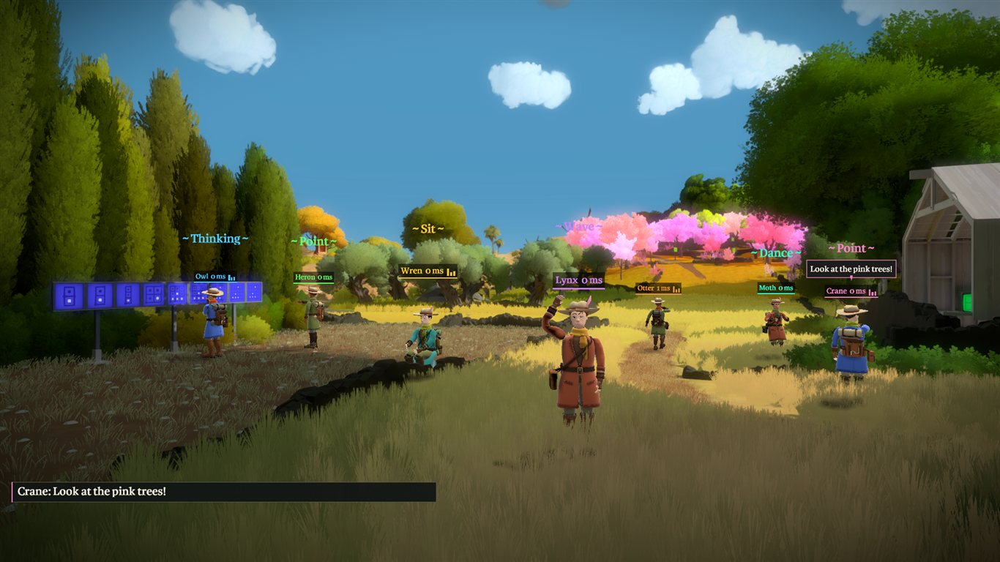

# The Witness Co-op

A co-op mod for The Witness. You and your friends walk the same island, see each other, and share progress: when
one of you solves a panel it's solved for everyone, and the doors and cables it powers open and light up in every
game. You can talk, chat, point at things, draw on the world, and race each other if you'd rather compete.

Each player runs their own copy of the game. The mod keeps the worlds in step.

More pictures: [the showcase](docs/SHOWCASE.md).

> **This is a beta.** Expect a few rough edges, and please [report what you find](#reporting-a-bug).

## What you need

- **The Witness on Steam, the current version** (build 11370412). Every player needs their own copy.
  Other stores (GOG, Epic) aren't supported yet. Setup checks your copy before it changes anything.
- **Windows**, or Linux and Steam Deck through Proton (see [Steam Deck and Linux](#steam-deck-and-linux)).
- **Everyone on the same version of the mod.** The launcher tells you if you aren't and offers to update.

## Install

1. Download **`Witness-Coop-Setup.exe`** from the [latest release](https://github.com/TommoDotCommo/witness-coop/releases).
   It's one file with everything in it. Run it directly, not from inside a zip.
2. Setup finds The Witness in your Steam libraries (or use Browse), checks the game version, and shows what it will
   add. Click **Install**.
3. When it's done, press **Play** in Setup, or just press Play on The Witness in Steam from now on. The co-op launcher
   opens first and starts the game for you.

Setup adds three things to the game folder: `dsound.dll` (the mod), `witness_launcher.exe` and a `witness_models`
folder. It doesn't rename or change any of the game's own files, so Steam updates and "Verify integrity of game files"
leave the mod alone. Your saves aren't touched.

Setup also offers a desktop shortcut, a Windows Firewall rule for the game and launcher, and letting invite links open
the launcher. All three are optional and Uninstall removes them.

**If Windows warns you.** The files aren't code-signed yet, so Windows may say "Windows protected your PC". Click
**More info**, then **Run anyway**. If your antivirus quarantines a file, compare it against the `.sha256` file on
the release page. If it matches, it's a false positive. You can also install from the zip by hand (below) and skip
Setup entirely.

### Without Setup

Download `witness-coop-<version>.zip` from the same release. Close the game, open its folder (in Steam: right-click
The Witness > Manage > Browse local files) and copy in `dsound.dll`, `witness_launcher.exe` and the `witness_models`
folder. That's the whole install.

If there's already a `dsound.dll` from another mod in there, rename it to `dsound.chain.dll` first. The co-op mod
loads it straight after itself.

To uninstall by hand, delete those three things again (and rename `dsound.chain.dll` back if you had one).

### Mod managers

- **Vortex:** install the `game-thewitness-<version>.zip` extension from the release so Vortex knows The Witness, then
  install `witness-coop-<version>.zip` as a mod. Update and remove it through Vortex.
- **Mod Organizer 2:** copy `game_thewitness.py` from [`modmanagers/mo2`](modmanagers/mo2) into MO2's
  `plugins/basic_games/games/` folder and restart MO2. MO2 isn't reliable at loading DLLs from the game's root folder,
  so if the launcher says co-op isn't loaded, use the Root Builder plug-in or copy the three files in by hand.

### Uninstall

Run `Witness-Coop-Setup.exe` again and choose **Uninstall**. It removes only the files it installed and puts back
anything it moved aside. Your settings and logs (in `%LOCALAPPDATA%\witness-coop`) and your saves stay.

## Playing together

One person hosts, everyone else joins. Everyone opens the launcher (Play in Steam does that) and goes to the **Play** tab.

### Through Steam (easiest over the internet)

**Host:** choose **Host a game**, then **Through Steam**, then **Open lobby**. Invite friends through the Steam overlay,
with **Invite friend** next to your friends list in the launcher, or by reading out the lobby number.

**Friends:** accept the invite in Steam (or **Join Game** on the host in your friends list). If the launcher isn't open,
Steam starts it for you, straight into the lobby. You can also paste the lobby number into **Join a friend**.

Steam relays the connection when it has to, so nobody needs to open ports. Lobbies are friends-only.

### Same network, Tailscale, or a direct connection

**Host:** choose **Host a game**, then **Direct**, then **Open lobby**. The lobby's **Friends can join by** column checks
each way in (same network, Tailscale, internet, Windows Firewall) and tells you what to fix if one isn't working.
**Copy invite** copies a message you can paste to friends.

**Friends:** choose **Join a friend**. Games on your network and on your Tailscale tailnet show up in the list on their
own. Otherwise paste whatever the host sent you into the box: the whole invite message, the link, the `WIT-` code, an
IP address or a computer name.

For a direct game over the internet the launcher asks your router to open the ports (UDP 47100 for the lobby, 47001
for the game) while you host. If your router won't do that, or your internet provider shares your address with other
customers (the launcher will tell you), use Steam or Tailscale instead.

### In the lobby

You can chat and talk before the game starts. The host picks what to play: co-op or a race, continue or a new game,
and for a new game, which parts of the island should already be done. Everyone ticks **Ready**, the host presses
**Start game**, and all the games start together. When you quit the game you're back in the lobby.

Up to 16 players can be in a lobby. Friends can also join a game that's already under way: their world catches up with
everything that's been solved once it has loaded.

### Randomized puzzles

The launcher's **Randomizers** tab gives the island new puzzles, made by randomizers built into the mod:

- **Sigma's Randomizer: Normal**: new puzzles on most panels, each area keeping its own kind of symbols. A good first
  randomized game.
- **Sigma's Randomizer: Expert**: much harder puzzles, some needing approaches the base game never asks for.
- **Variety Randomizer**: each area gets its own combination of symbols, including new ones such as arrows.

Each comes with a seed (a number: the same seed gives the same puzzles) and options: a new seed for each new game,
shuffling which panel is where, colour-blind friendly colours, and faster doors, bridges and elevators.

In a lobby the host's choice is everyone's, so all of you play the same puzzles; the lobby shows it under **Puzzles**.
A continued game keeps the puzzles it was started with, and the Saves tab shows them for each save. The puzzles are
made when the game starts, which takes a few seconds. If someone's game ends up with different puzzles, the game says
so; start again from the lobby.

The randomizers are the work of sigma144, jbzdarkid, Penguin12335, NewSoupVi and others: see
[Credits](#credits-and-licence).

## Controls

Hold **F1** in the game or the launcher to see every key, including any you've changed. The co-op keys use the same
defaults as the other mods made with the [Co-op Anything](https://github.com/cranebeaker/coop-anything) playbook.

| Key                      | What it does                                                                                     |
| ------------------------ | ------------------------------------------------------------------------------------------------ |
| `T`                      | Chat (Enter sends, Esc cancels)                                                                  |
| `V` or middle mouse      | Ping the spot you're looking at. Everyone sees a marker with your name and the distance          |
| `B` or mouse side button | Push to talk                                                                                     |
| `Y`                      | Next voice channel: proximity, open line, or private to one player                               |
| Hold `H`                 | Emote wheel. Move the mouse to pick, let go to play it. `Tab` changes page                       |
| Hold `X`                 | Draw on the world in your colour (`Shift`+`X` clears your drawings, mouse wheel changes colour)  |
| `Z`                      | Drawing canvas: a pen you move across the screen for precise lines on a panel (Backspace undoes) |
| Hold `Tab`               | Player panel: mute, set volume, watch someone's view, leave                                      |
| `[` and `]`              | Watch the previous or next player's view                                                         |
| `F9`                     | Size of the picture of another player's screen: small, large, off                                |
| `F3`                     | Faster mouse while tracing a puzzle (toggle)                                                     |
| `F2`                     | Mark a problem for a bug report (see [below](#reporting-a-bug))                                  |

You can change any of these in the launcher under **Settings > Controls**.

**With a controller,** the co-op actions are on the View button, which the game doesn't use. Tap it to ping, hold it for
the player panel, and while holding it: D-pad up for emotes, D-pad down for chat, D-pad left and right to watch other
players, RB for quick chat (Ready, Wait for me, Over here...), Y for the quick guide. Voice chat is push-to-talk when
you're on the keyboard and an open mic when you're on a pad.

**Set Steam up for a controller first.** The Witness's own Steam controller setting turns your pad into keyboard and
mouse, so the game (and the co-op buttons) never see a controller. In Steam, open the controller settings for The
Witness (on a Steam Deck: press the Steam button in the game, then Controller settings), choose the current layout,
open **Templates** and pick **Gamepad**. On a Steam Deck, set the back buttons while you're there: **L4** to
**Select** (the View button, so you can ping and open the player panel) and **R4** to the keyboard key **B** (push to
talk). On Windows with an Xbox or PlayStation pad you can instead turn Steam Input off for the game (The Witness >
Properties > Controller > Disable Steam Input).

That layout also comes ready-made in the zip, as `steam-input/witness-coop_deck.vdf`, for anyone who manages Steam
Input files themselves.

When you emote, the camera swings round behind you so you can see your own character do it. You can turn that off
under **Settings > Players and interface**.

## What's shared and what isn't

Shared between everyone: solved panels, the lines you draw on a panel (other players see your line as you trace it),
doors opening and closing, panels powering on, cables lighting up, lasers turning on, and what a puzzle moves: bridges,
elevators, ramps, water levels, the windmill and the like, which start moving in every game at the same moment. Timed
puzzles that reset themselves reset for everyone.

Each player calls and rides their own boat, and plays the theatre's videos for themselves. If anything else ends up
different between your games, press **F2** and [report it](#reporting-a-bug).

**Race mode** shares nothing on purpose. Everyone plays their own world while still seeing, chatting and talking to
each other. A countdown starts everyone at the same moment, and the first to the goal wins (a chosen panel, such as the
last one on the mountain, or a number of panels).

## Updating

The launcher checks for a new release once a day. When there is one you'll see a banner on the Play tab with
**Update** and **What's new**. Updating downloads the release, checks it against its checksum, and replaces only the
mod's own files. It never touches the game's files. Everyone in a game needs the same version.

If you installed with Vortex, update through Vortex instead.

## Troubleshooting

**Setup says my game isn't the supported version, or the game says "Co-op is off".**
The mod only works with one build of The Witness (Steam build 11370412). In Steam, right-click The Witness >
Properties > Betas and make sure no beta is selected, then Installed Files > Verify integrity of game files, and run
Setup again. If Steam is already on the newest version, the game has been updated since this mod was released. The
game still runs normally with co-op switched off, and co-op comes back with a mod update. Copies from GOG or Epic
aren't supported yet.

**My friend's game doesn't show up in Join a friend.**
The list only finds games on your own network or your Tailscale tailnet. For anything else, use a Steam lobby, or ask
the host for the invite and paste it in. If Windows asks about the firewall, allow the launcher and the game on private
networks (Setup's firewall option does this for you).

**I can't hear anyone.**
Check **Settings > Voice and sound**, check you haven't muted or deafened yourself in the lobby, and check the player
panel (hold `Tab`) for muted players. If you're on a private voice channel (`Y`), only that player hears you.

**Something is different in my friend's game.**
Make sure you're both in co-op mode and not a race, and give a freshly loaded world a few seconds to catch up. If it
stays different, press **F2** and report it.

## Steam Deck and Linux

- Run `sh install-linux.sh install` from the unpacked zip. It finds the game, checks the build, installs the files and
  tells Proton to load the mod's `dsound.dll` (the game needs to have run once under Proton first). If that last step
  can't be done, set the launch option `WINEDLLOVERRIDES="dsound=n,b" %command%` on The Witness in Steam.
- Play in Steam then opens the launcher, Game Mode included. On a Deck it fills the screen and works with the controls.
  Typing a name or an invite needs the Steam keyboard (Steam + X).
- Pick Steam's **Gamepad** template for The Witness and set the back buttons as described under
  [Controls](#controls); the game's own controller setting only sends keyboard and mouse.

## Reporting a bug

1. Press **F2** the moment something goes wrong. That saves the last minute of the game and marks the same moment in
   every other player's log too.
2. Open the launcher, go to **About**, and press **Send diagnostics**. A zip appears on your desktop. Your computer
   name, user name, IP addresses and Steam IDs are replaced in it. It holds no saves or game files, and nothing is
   uploaded: you attach it yourself.
3. Open a [bug report](https://github.com/TommoDotCommo/witness-coop/issues/new?template=bug.yml) and attach the zip.
   One from every player is best, the host's first.

## Privacy

The mod doesn't collect anything about you. What does leave your PC:

- Once a day, the launcher asks GitHub for the list of releases. You can turn this off under **Settings > Launcher**.
- While **Join a friend** is open, it asks your local network and your Tailscale devices for games (if you use
  Tailscale). The question contains no name, address or version.
- When you host, invites include your network addresses so friends can connect (your internet address only if your
  router opened the port). You can leave the internet address out under **Settings > Network**.
- During a game, your position, voice and chat go to the other players, and a small picture of your screen goes to
  anyone who chooses to watch you. Over Steam this traffic may pass through Steam's relay servers.

When the launcher comes to the front it looks at your clipboard for a Witness invite, so it can offer to join. Nothing
from the clipboard is kept or sent.

## Credits and licence

Made with the [Co-op Anything](https://github.com/cranebeaker/coop-anything) playbook. The adventurer character was
made for this mod and is public domain ([credits](assets/models/CREDITS.md)). The mod is MIT licensed (see
[LICENSE](LICENSE)).

The randomizers are the [Witness Random Puzzle Generator](https://github.com/NewSoupVi/The-Witness-Randomizer-for-Archipelago)
as maintained for Archipelago by NewSoupVi: [sigma144's randomizer](https://github.com/sigma144/witness-randomizer)
(Normal and Expert), [Penguin12335's Variety](https://github.com/Penguin12335/Variety-Randomiser) and
[jbzdarkid's original](https://github.com/jbzdarkid/witness-randomizer), with work by blastron, Jarno458, hatkirby,
ReverM and others (MIT licence, copyright 2018 jbzdarkid). The order in which the game needs its panels solved, for a new
game with parts already done, comes from [Archipelago](https://github.com/ArchipelagoMW/Archipelago)'s logic for The
Witness (MIT licence). Their licences are in [THIRD-PARTY-NOTICES.txt](dist/THIRD-PARTY-NOTICES.txt), which comes with
the download, and the launcher's Randomizers tab shows them too. None of these authors made or checked this co-op
version: report problems with it here.

This is a fan project. It isn't affiliated with or endorsed by Thekla, Inc., and doesn't include any of the game's
files. You need your own copy of The Witness.

For how the mod works inside the game, see the [developer notes](docs/DEVELOPMENT.md).
