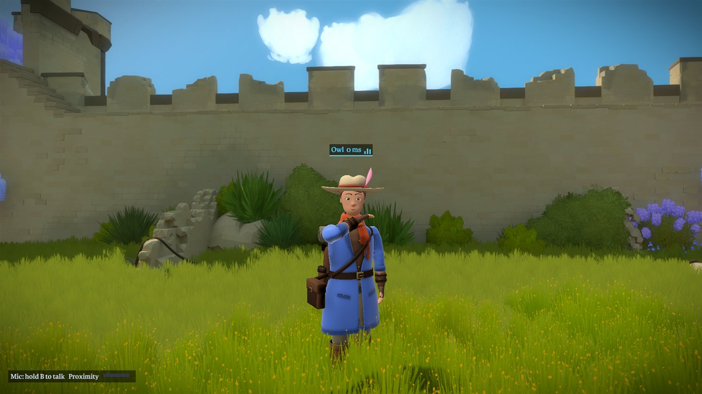
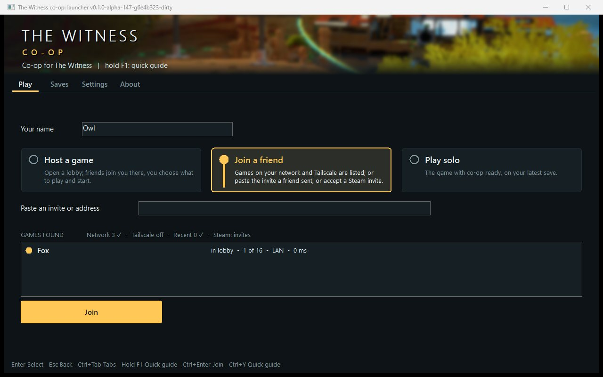
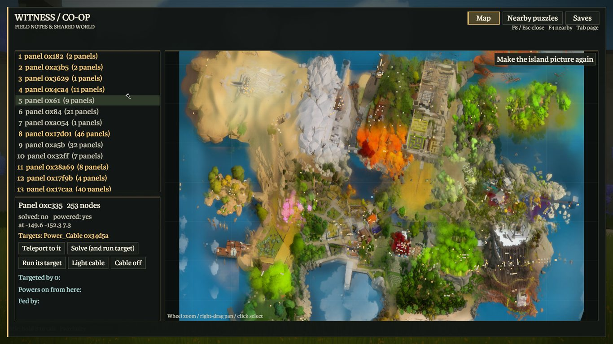
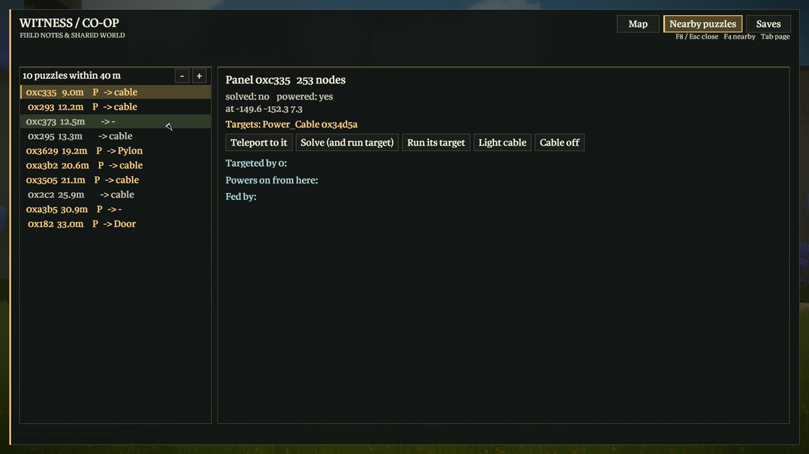
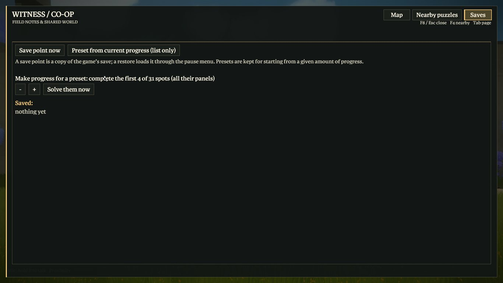
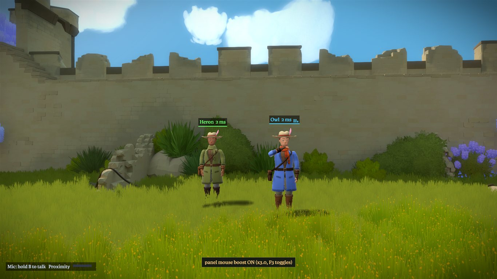

# Developer notes

How the mod is built, how it works inside the game, and how it is tested. Players do not need any of this: the
[README](../README.md) covers installing and playing.

This file was the README until the beta. The sections below are kept as they were written while each part was built,
so they are dense and record the evidence for each claim (dates, scenario names, mutants). Addresses and offsets are for
Steam build 11370412 (`witness64_d3d11.exe` SHA-256 `8d672d444df6a6df7130f25a517bdab1af92731fe2138dc5b324d519561d55a5`).
Research notes for the game live in the [Co-op Anything](https://github.com/cranebeaker/coop-anything) hub,
`games/the-witness/NOTES.md`.

Contents: [the mod in detail](#the-mod-in-detail) · [quick guide](#quick-guide-hold-f1) · [install internals](#install-internals) ·
[launcher](#the-launcher) · [updating](#updating) · [finding each other](#playing-with-friends-finding-each-other-and-the-invite) ·
[Steam](#play-over-the-internet-steam-no-port-forwarding) · [mod managers](#mod-managers-vortex-mod-organizer-2-by-hand) ·
[Steam Deck and Linux](#steam-deck-and-linux-proton-untested) · [build check](#the-build-check) · [making a release](#making-a-release) ·
[dev setup](#try-it-two-copies-on-one-pc) · [groups](#experimental-groups-216-players) · [logs and crashes](#logs-and-crashes) ·
[how it works](#how-it-works) · [character migration](#character-migration) · [new game with progress](#new-game-with-parts-of-the-map-completed) ·
[puzzle sweep](#testing-every-puzzle-or-one-puzzle) · [playthrough bots](#playing-the-game-through-with-n-bots) · [automated checks](#automated-checks) ·
[feature checks](#feature-checks)

## The mod in detail

The adventurer has [24 keyframed emotes and a proximity speech gesture](GESTURES.md), authored as text clips in `assets/emotes/` and played with overlap, follow-through and planted-feet weight shifts; a game-free [animation quality gate and dailies renderer](ANIMATION.md) checks every clip on the real character. Hold `H` for the wheel, use `Tab` to change its page, and hold `F1` for the binding guide. While you emote the view moves back behind and a little above you so you see your own figure do it (setting: Third-person view when emoting; `proxy/thirdperson.cpp`, checked by `tools/qa.sh thirdperson`). Live visual quality remains unverified.

Chat, pings, emotes, drawing, voice (with channels: proximity, an open line, one on one; the handheld radio and its channel are experimental), see-through players, a race mode, a lobby in the launcher (invite friends, see and talk to them before and after the game), saves that say who played and a new game that starts with chosen parts of the map done are described for players in the [README](../README.md); pictures of all of it are in [the showcase](SHOWCASE.md).

- **Player model.** Each player sees the other as an animated, skinned character (glTF `.glb`), drawn into the game's frame by a
  hook on the Direct3D 11 `Present` call. It stands at the other player's feet, faces where they look, plays a walk clip at a rate
  matched to their measured speed (and an idle or run clip when the model has one), and is hidden by walls and doors: the proxy reads
  the game's own depth buffer (4x MSAA, reversed depth stored as `0.0597 / distance`, found by watching which depth view the game
  binds) and discards the model's pixels that are behind it. The adventurer is the only character, with idle, walk and run clips and four fidgets. Its head, face, eyes,
  hair and hands are sculpted from signed distance fields in a stylized direction and held to a measured design by a character gate: [the art bible and pipeline](CHARACTER.md).
  It blinks, glances at a player who comes near, carries its head where its player looks, breathes (harder after a run), swings its scarf and
  gear and coat as it moves, acts with its brows in the emotes, is lit with a normal map, roughness and metalness and a sun shadow on the ground, and its footsteps are heard where it walks: [the life layer, shading and shadow](LIFE.md).

  
  See [asset credits](../assets/models/CREDITS.md) and the [migration details](#character-migration) below.
- **Shared panels and doors.** A detector watches all 594 `Machine_Panel` and 327 `Door` entities. A solved panel is sent to the
  other game and written there as solved; an opened door is opened there by calling the game's own door function, so the
  door animates and collides as in single-player. Events are numbered, received in sequence and resent until acknowledged.
  If an entity is temporarily missing or a door call is refused, its acknowledged event stays queued and retries on the render
  thread; other entities can still progress. Successful changes are applied once. A restarted game gets the whole state again.
  The restart catch-up scenario checks this after the original panel/door events have already been acknowledged.
- **Panel power-on progression.** Activating a panel is a separate reliable event from solving it. The peer calls the game's
  panel power-on function on the render thread; its normal frame updates animate the brightness. A powered target remains
  unsolved. Power state participates in startup stability, has its own echo guard, and is included in restart catch-up.
  This currently shares power-on progression; power-off switching is not replicated.
- **Safe start.** Nothing is detected, resent or applied until the world is stable (camera valid and identical panel and door
  counts on three scans three seconds apart); after applying a remote change the entity is suppressed for 5 s so it is not
  sent back.
- **Optional Back TV ("POV TV"), experimental, off by default.** The whole TV family (back TV, sky TV, audience seats, TV camera consent) runs only with `experimental_tv=1` (launcher: Settings, Launcher, *Experimental: TV features*; applies at the next start). A small CRT TV strapped to the adventurer's back displaying that player's point of view to nearby players as a 128x96 snapshot stream (5 Hz, RLE compressed) with dynamic harness sway, antenna wobble, and phosphor power-on/off animations. Double opt-in: viewer toggle (`pov_tv=1`, F10) and streamer consent (`pov_tv_consent=1`, F11) default off; on-screen HUD indicator signals broadcasting. See [POV TV design and verification](POV_TV.md).

- **Treehouse bridges.** After its target dispatch the game's solve handler tells the panel's `Bridge` (`+0x2C0`) that the panel is solved
  (exe+0x84910, the panel's engine id), which grows the next section and carries the next panel out. A remote solve does the same
  (`GameBridgeAdvanceNow`; `tools/qa.sh bridge`, twin `no_bridge_advance=1`). Before 2026-11-07 the other game had the panel solved and the next one
  powered but no bridge to reach it.
- **A remote solve does what the solver's solve did.** The game's solve handler, after the solved fields, runs exe+0xB7F80: about 70
  behaviours chosen by the panel's name (`+0x58`): the Swamp's sliding and rotating bridges and floodgate, the Quarry ramps and lifters, the
  windmill, the Town's coloured lights, the Desert's water levels, elevators, the Monastery shutters... It returns whether the panel's
  target is then dispatched. Several read the line that was drawn (`+0x228` count, `+0x230` records of 13 dwords): which exit a sliding
  bridge or floodgate control was left by. So a remote solve (state.cpp `applyPanelSolvedLine`) first writes the solver's final line into the
  panel's trace buffer (grown with the game's own allocator, exe+0x2E7FA0; the line is not sent back as this player's), then marks the panel,
  runs the reactions, dispatches the target only when they ask for it, and tells the Bridge. Left out on a remote solve: the ending and
  final elevator, the theatre videos, the boat, the timed challenge and the sound-room birds (`RemoteReactSkipped`). A solve event carries a
  bit when the solver has a finished line, and the receiver waits up to 1.5 s for that line (`kLineWaitMs`). What the reactions change at
  once (a linked panel, a door told to move, a cable) is taken as remote by the core (`marks`/`absorb`), not sent back.
  Doors are reported when they are told to move (`+0x1D4`), not when they arrive (`+0x1D0`): a sliding bridge took 40 s and the Caves
  elevator 12 s to reach the other game before. A cable still fading in keeps its known state, so a remote one is not sent back once lit.
  Tests: `make -C proxy/core test` (`solve-react`: line, no echo, door at once, no wait without a line, fading cable; twins
  `noSolveLine`, `noReactEchoGuard`, `doorDetectByPosition`, `noCableFadeHold`), `tools/qa.sh react` (the line reaches the other panel's trace;
  the Swamp rotating bridge and the Town lights; twins `no_remote_line_write=1`, `no_remote_react=1`). What a remote solve still misses can be
  measured: `tools/qa.sh probe tools/react_sweep.py [hexid ...]` solves each named panel the game's own way on A (the test-only command
  `nativesolve`) and lists every entity field that changed in one game and not the other (`tools/win/wreact_sweep.py`).

- **The teleport hold yields to the game's emergency reset.** The hold (`GameHover`, used by the dev menu's teleport and the `hover` command)
  writes the player's position about every millisecond. A player held inside the world's geometry is reset by the game to the nearest reset
  marker; holding against that made the game reset every frame (thousands of `emergency reset player` lines in its log) and twice it crashed
  rebuilding the ground at the marker (exe+0x2D03EC). The hold now lets go when the game moves the player more than 1.5 m sideways
  (`tools/qa.sh hover`: the player ends away from the bad spot and the resets stop; twin `hover_fights_reset=1`, it stays pinned). A test that holds a player in the
  air far from any ground (the voice and radio scenarios) asks for `hover ... firm`, which holds through the game's resets as before.

Not done: power-off switching by a real in-game lever, crouch/prone poses (the game has none), lighting that matches
the game's, models with several textures or materials. Sixteen live clients and play between two real PCs have not been run by the suite.

## Quick guide (hold F1)

Hold **F1** in the game or launcher to show a three-column guide; release it to return.
The in-game guide and menus use a proportional font from a padded 2x atlas: the game's own menu face, Karmina Bold, read at start from the
player's `data-pc.zip` into memory (`common/gamefont.h`: the member's bytes XOR 0xFF, a private GDI font, nothing written; `make -C common gamefont-test`),
or Segoe UI when that fails or `ui_font=segoe` is set (the `fontstat` command logs which and why),
capitals centred in the line box (the atlas puts them low in their cell: the 'H' is measured at start and every glyph drawn that much higher,
logged as `ui: capitals in cell rows`; `tools/qa.sh ui centre` measures the emote wheel's labels in their buttons at 1080p and 1440p, twin `ui_cap_shift_off=1`),
measured wrapping, warm surfaces and amber selection borders. Chat wraps to its panel,
and long input scrolls to keep the cursor visible. `make -C proxy/ui test` checks text
metrics, wrapping, fitting and guide bounds with three mutants, and the dev map's detail pane
(`proxy/ui/detail_layout.h`: every line and button of a selected panel inside its pane, the text at
10 px or more, at eleven screen sizes from 1024x768 to 3840x2160 including 21:9) with two mutants. The focused live layout
check is `tools/qa.sh probe tools/qa_cozy.py`; it renders the live UI scene into D3D11
render targets (over a copy of the current game frame) at
1024x768, 1280x720, 1920x1080, 2560x1440, 3440x1440 and 3840x2160. Add `--native`
to capture the actual 1280x720 game back buffer instead; larger native windows can be
limited by the desktop work area.

It covers the current mod bindings, co-op and race features, host/join flow, shared state,
networking and troubleshooting. The game uses its existing text renderer; both views share
`common/guide.h` and `common/bindings.def`. Configurable keys come from that binding table,
including custom keys; the launcher shows its current settings (restart the game to apply).
F1 works in chat, menus and launcher text fields too, and losing focus dismisses the guide.

This revision had no default F1 action. An existing custom `key_*=F1` assignment moves to
**F2**, leaving F1 for help. If F2 is occupied, it uses the first free key in F12,
then 0 through 9. The guide shows the resulting key. The launcher loads this migration into
its settings fields; Save settings persists it. The DLL also applies it when reading an old cfg.
The launcher rejects duplicate keys, fixed mod shortcuts and WASD for configurable mod actions.

`make -C common test` runs the game-free guide/binding tests and four mutants: omitted key,
colliding keys allowed, F1 migration disabled, and toggle instead of hold. It checks custom
bindings, repeat/release/focus loss and the three-column line budget. Build both views with
`make -C proxy` and `make -C launcher launcher`.

The game opens on the monitor the launcher is on (windowed: centred there; full screen: that monitor). The launcher
passes the work area of its monitor in `WITNESS_MONITOR`, and the mod places the game's window when the game creates it.
`tools/qa.sh launcher` checks it with the launcher moved off the primary monitor, and a mutant launcher that does not pass it must fail.

## Install internals

Players do not build anything: [Releases](https://github.com/TommoDotCommo/witness-coop/releases) has **one file**,
`Witness-Coop-Setup.exe`, that carries everything (and, for manual installs and Linux, a zip with the same files).
Setup finds The Witness in the Steam libraries (or takes a folder), checks that the exe is the supported build (SHA-256 above;
any other build is refused with a plain explanation and nothing is changed), and adds the proxy `dsound.dll`, `witness_launcher.exe` and
`witness_models\`. **No file of the game is renamed or changed**: the game imports DirectSound (`dsound.dll`) but does not ship it, so Windows loads the
mod's copy from the game folder, and the mod hands every DirectSound call to Windows' own `dsound.dll` (loaded by full path from the system folder).
Every file Setup writes gets a `.coop-receipt.json` beside it, so Uninstall removes exactly what it installed and never a file it did not;
your co-op settings (`witness_coop.cfg`), the logs and the saves stay. A Steam update or *Verify integrity of game files* leaves `dsound.dll` alone (Steam does not know it).

- **Nothing is written into the game folder while you play.** Your co-op settings (`witness_coop.cfg`), the proxy's log (`witness_proxy.log`), the update
  schedule and the race result live in `%LOCALAPPDATA%\witness-coop\`. A `witness_coop.cfg` that an earlier version left beside the exe is moved there once
  (copied, compared, then removed). One exception, for test tools and the lab's per-instance copies: a `witness_coop.cfg` beside the exe that carries one of the
  instance keys (`save_dir`, `force_active`, `run_unfocused`, `diag_dir`) is an explicit per-instance override; then all of those files stay beside the exe, exactly as
  before, so two copies on one PC (or a copy next to a player's own) keep separate settings. The mod never creates that file. (`common/userdata.h`, tested by
  `make -C common userdata-test`.)
- **Mod managers.** The package has `coop-mod.json` (what it is: id `witness-coop`, Steam app 210970, the supported build with its SHA-256, the proxy and the
  chain file, the Proton override `dsound=native,builtin`, and every game-folder file with its SHA-256) at the zip root and in its top folder, and every
  `.dll` and `.exe` carries a version resource (product name *The Witness Co-op*, the release version). Copying the files of the package into the game folder
  is a complete install. Setup tells who put them there: **Setup** (receipts beside the files), **Vortex** (a managed file with more than one hard link, no
  receipt: Setup shows *Installed by Vortex: update or remove it there*, changes nothing and still offers Play; the launcher says the same instead of
  updating), or **by hand** (the files match a release, no receipt: Setup adopts them with receipts, after which they update and uninstall like any Setup
  install). The release script also writes `NEXUS-<version>.txt`, the copy note for the identical zip on Nexus Mods.
- **Setup from a script.** `Witness-Coop-Setup.exe status [--json] [<game folder>]`, `install <game folder> --yes`, `uninstall <game folder> --yes` (the same
  words in `install-linux.sh`) run without a window and end with: 0 done, 1 failed, 2 usage, 3 unsupported game build, 4 the game is running.
- **Setup window.** Every install found (Steam libraries via `libraryfolders.vdf` and `appmanifest_210970.acf`, GOG by registry and known folders, Epic by its
  manifests, the uninstall list) is a card with its store, the build check and who installed co-op; Browse finds others. Three ticked options: a desktop
  shortcut, Windows Firewall rule *The Witness Co-op (UDP)* for the game and the launcher on Private and Public networks (one administrator prompt), and
  *Open invite links in the launcher* (a per-user `witness-coop://` handler that starts `witness_launcher.exe --coop-invite "<link>"`; the launcher puts the
  invite into its join box and joins nothing until you press Join). Uninstall removes all three. The last screen's primary button is Play. Tests:
  `tools/test_setup_options.ps1` (fake `netsh`, a throw-away registry key), `tools/test_setup_verbs.ps1`, `tools/test_mod_manifest.py`, `tools/qa_installer.sh`.
- **Another mod named `dsound.dll`** (an ASI loader, an audio wrapper) found in the game folder is kept as `dsound.chain.dll`; the co-op proxy loads it right
  after itself, so its start-up work still runs, and logs `chain: loaded dsound.chain.dll`. The game's DirectSound calls still go to Windows' own
  `dsound.dll`, not to the chained file: a full DirectSound replacement chained this way gets no calls (rule chosen for safety: a chained proxy that loads
  `dsound.dll` by name would otherwise call back into the co-op proxy). Uninstall puts that file back as `dsound.dll`.
- **Coming from v0.1.0-alpha** (the proxy in `AnselSDK64.dll`, the game's own file renamed `AnselSDK64_real.dll`): Setup, `install-linux.sh` and the launcher's
  updater put the game's own `AnselSDK64.dll` back first (only after checking its SHA-256 `3b0677ae...`; a staged copy, one replacing rename; an interrupted
  run finishes on the next one), then remove the old proxy and its receipts. A file whose hash is not the game's stops the migration with a plain message and
  nothing is changed: *Verify integrity of game files* in Steam fixes it. If the new files are copied over an alpha install by hand without that step, the
  game would load both copies of the mod: the new `dsound.dll` sees the old proxy already mapped and stays passive (it only passes the sound calls on and
  logs `OTHER COPY`), so the old copy runs co-op alone until Setup finishes the move.

The one-file Setup checks its embedded payload against a SHA-256 compiled into it, unpacks it into a fresh
`%LOCALAPPDATA%\witness-coop\setup\<version>\` (created exclusively: an existing folder is never reused, a link anywhere on the way is
refused), runs the PowerShell in `dist/` (`installer-gui.ps1`, `witness-coop.ps1`, `install-state.ps1`; the pure decisions are
`dist/install-policy.h`) from there and removes the folder when the window closes. `Setup.exe` inside the zip is the thin version of the same
program: it runs the scripts beside it, and when they are missing (it was started from inside the zip) it says so and points to the one-file download.
PowerShell is started with `-ExecutionPolicy Bypass` for that one process, because Windows' default policy refuses every unsigned script;
the scripts are readable, and signing the exe and dll files (below) is what makes the download trustworthy to Windows.

Then both players open the launcher (or press Play in Steam: a game Steam starts on its own hands over to the launcher) and play from its **Play** tab.
The player's own copy of the instructions is `dist/README.txt`.

### The launcher

Four tabs, the same in every co-op mod: **Play**, **Saves**, **Settings**, **About**.

- **Play**: your name, three choices (*Host a game*, *Join a friend*, *Play solo*) and one button that says what it does (*Open lobby*, *Join*, *Play solo*);
  the last choice is remembered (`launcher_choice=`). Hosting or joining turns the tab into **Lobby**: players (host mark, ready, speaking light, mute me,
  deafen) | chat | *Friends can join by* (one row per way in: Steam, Same network, Tailscale, Internet, Windows Firewall, each with a coloured dot, *Ready*,
  *Needs a look* or *Off*, one line of what was found and, when it needs a look, one line of what to do; the full text is the row's tooltip) with the invite above *What to play* (the host chooses co-op or race, a new game, parts of the map done). The host's button reads *Start game*
  or *Waiting for <names>*; the others tick *Ready*; *Leave* is one click. An available update is a banner on Play (*Update*, *What's new*), never over a lobby.
- **Saves**: the co-op saves (who played, progress, lasers, time) and *New game...* (the parts of the map that are done at the start).
- **Settings**: sections in the shared order (Co-op rules, Players and interface, Voice and sound, Controls, Display, Network, Launcher). Every change is
  saved at once (no Save button); *Reset section* puts a section back to its defaults. Volumes, ranges, the frame limit, FOV and brightness are sliders with
  units; keys are set by pressing them (F1 and a key another action uses are refused, with the reason); only names, addresses and ports are typed. The game's
  own options (mouse, FOV, brightness, ...) live inside a save: they are marked *(in a save)* and change the save chosen in *Save to change*. The player
  number is gone from the settings: the lobby assigns it. *Show the launcher at start* off lets Play in Steam start the game directly (hold Shift while it
  starts to get the launcher).
- **About**: version and updates (*Updates to offer*: *Full releases* or *Pre-releases too*, the same setting as Settings, Launcher), the quick guide, *Send diagnostics*, links, credits, the game folder.

The banner is a sunny sea painted by the launcher (sky, sun, a hazy island, turquoise water with the sun's glitter; nothing from the game is shipped). Behind the
pages, faint Witness panels are scattered as a still backdrop, a few levels from the background colour so they never compete with the controls. Buttons under the
pointer get a line that runs round them from a start dot, as a panel's line does; the button with the focus gets it only while the keyboard or a pad is in use (a
tab opened with the mouse shows none). With Windows' *Show animations* off the line is shown drawn at once (`launcher/trace.h`; `make -C launcher trace-test`;
`python3 tools/qa_launcher_frame.py` checks the banner, the backdrop and the focus line on the real window, with mutants; the stat file's `art`, `backdrop`
and `cues` lines).

Keyboard: Enter, Esc (back), Tab, Ctrl+Tab (tabs), Ctrl+Enter (the page's main button), hold F1 (quick guide). A pad (XInput: Xbox pads, the Steam Deck's
controls) works too: stick or D-pad move, A selects, B goes back, LB/RB change tabs, Start presses the page's main button, X and Y are the actions the footer
names. The window is resizable, opens at 1280x800 (or the screen when that is smaller) and fills the screen on a Steam Deck. The shape is in `launcher/shell.h`,
tested game-free by `make -C launcher shell-test` (with mutants) and on the real window by `python3 tools/qa_launcher_shell.py` (no game slot; a
launcher that does not save on change must fail it); `tools/qa.sh steamstart` (one slot) checks Play in Steam handing over; the launcher's command file (`--cmd-file`: `tab`, `section`, `choice`, `pad <buttons hex> <lx> <ly>`,
`capture <key> <vk>`, `setting <key> <value>`) drives it in tests.

### Updating

Every player must run the same mod version. The version (from `git describe`, the release tag) is stamped into the launcher and the proxy by the Makefiles. It shows in the launcher's
window title, on the Play page under *About and updates*, and next to every name in the lobby list. A player on another version cannot join: the host answers with its own version and
yours (*"The host is on v0.2.0, you are on v0.1.0: update both to the same version."*) and the lobby page shows an **Update the launcher** button. A launcher of an older lobby protocol is told to update.
If two games with different versions are started without the lobby (a hand-written `witness_coop.cfg`), the first packet of the other version from a configured peer is said once
in the game and the log (*"Player 2 is on v0.1.0, you are on v0.2.0: update both"*; the launcher's roster supplies the version, `peer_version=<id>,<version>`) instead of being dropped in silence.

**The launcher updates itself from GitHub releases** (`launcher/update.h`, `update_win.h`; ported from the MDK2 launcher's updater). At start it asks for the latest release of
`TommoDotCommo/witness-coop` (at most once a day; nothing about you is sent: one plain request for the public release list, and one per file if you press Update; failures are only written to the
launcher's log). When a newer release exists the Play tab shows *Update available: vX (first line of the notes)* with **Update**, **What's new** and **Later**; the About tab has the full notes, a *Check for
updates* button, and the two settings (*Updates to offer* is on About too) (also in `witness_launcher_update.cfg` in the mod's data folder, `%LOCALAPPDATA%\witness-coop\`: `update_check=0` turns the automatic check off, `update_prereleases=auto|1|0`;
*auto* offers pre-releases only to an installed pre-release). **Update** downloads `witness-coop-<tag>.zip` and its `.sha256`, checks the size and SHA-256, opens the archive in memory
(CRC of every file, no path may leave its folder, the executables must be 64-bit), and then replaces `dsound.dll`, `witness_launcher.exe` and `witness_models\*` through **the
installer's own receipt rules** (`dist/install-policy.h`): a file is replaced only if its `.coop-receipt.json` says the installer put exactly that file there, with the receipt journal
(`pending`, replace, `installed`) the installer writes. A copy that was not installed by Setup, a file changed by hand, a leftover `.coop-stage` or an unsettled earlier update are refused
whole, with a plain message and nothing changed. All files are staged and backed up first and put back together if anything fails; if the launcher is killed half-way the next start rolls
back (`witness_update.state`). The journal, the backups (`.coop-prev`) and the old launcher live in the mod's data folder (`%LOCALAPPDATA%\witness-coop\`), not the game folder; only the
short-lived `.coop-stage` files sit beside the files they replace, and an update an older build left half-done in the game folder is still rolled back. The proxy DLL is replaced only while the game is not running; the running launcher is renamed to `witness_launcher.exe.coop-old` and replaced (reopen it after the update; when the data folder is on another drive it stays beside the game until the next start).
No file of the game is ever replaced; a folder still in the v0.1.0-alpha layout is migrated as Setup does (the updater adds `dsound.dll`, then puts the game's own
`AnselSDK64.dll` back, verified, only while the game is closed; a hash that is not the game's is refused and nothing changes). A development build (a version like `v0.1.0-3-gabc1234`, or a dirty tree) neither
checks nor updates. A downgrade (a release that is not newer) is refused. Tests: `make -C launcher test` (includes `tools/test_launcher_update.py`: fake GitHub responses, corrupt and
truncated archives, hash mismatch, interrupted apply, downgrade, the old-layout migration, 39 source mutants), `python3 tools/test_launcher_update_win.py --mutants` (the Windows code against a local fake release server),
`python3 tools/qa_lobby_version.py` (real launchers, three versions), `python3 tools/test_update_installer.py <game build folder> --mutant` (a folder installed by the real PowerShell installer is updated by the Windows updater; the new package's installer must then call every file current and uninstall must restore the original). The maintenance rules for publishing a release the updater accepts are in [docs/UPDATER.md](UPDATER.md).

### Playing with friends: finding each other and the invite

**Join a friend** fills its list as soon as it is chosen and asks again every 5 s while it is on screen; nothing is sent while it is not. It asks with a 13-byte
query (`CPQ2`, a random number, the game id `WIT `; no name, address or version) on the lobby port and the default 47100, each with the next three:

- **Network**: the directed broadcast address of *every* network adapter this PC has (Ethernet, Wi-Fi, VPN adapters; never 255.255.255.255, which Windows sends
  out of one adapter only), so a host on the same network or on a layer-2 VPN answers.
- **Tailscale**: when Tailscale is installed, `tailscale status --json` (no window) lists your tailnet; each online device (shared-in devices too) is asked directly.
- **Recent**: every host you joined before (remembered after each successful join, in `recents.tsv` in the mod's data folder).
- **Steam**: friends' Steam lobbies come as Steam invites (*Join Game* in Steam), not as rows.

Each source is named above the list with a tick when it is done. A row says the host's name, *in lobby* / *in game* / *full*, the players of 16, how it was
reached (LAN, Tailscale, Recent) and the ping; a host on another version is listed greyed with its version. Pick a row and press **Join <name>**: a lobby that
is *open to my networks* lets you in without a code.

The box above the list takes **whatever a friend sent** and says what it recognised before you press Join: the whole invite message, the link
`https://tommodotcommo.github.io/coop-mod-kit/join/#WIT-...`, a `witness-coop://` link, the code `WIT-XXXXX-...` alone (case does not matter; I/L read as 1, O as 0),
a Steam lobby number, an address (`192.168.1.20`, `192.168.1.20:47100`), a host name or a Tailscale name (`fox-pc`, `fox-pc.tail1234.ts.net`). The invites of
earlier versions (`address:port/CODE`) still work for this release. A code is tried on all its routes at once; the first answer wins, a better route (LAN, then
Tailscale, then internet) answering within 300 ms instead. A cut code says *This code is incomplete. Ask for the whole invite again.*; an MDK2 code says
*That invite is for MDK2.* When the launcher gets the focus with an invite for The Witness on the clipboard it offers it (*Fox's invite is on your clipboard.
Join?*); the clipboard is read for that check only, never stored, logged or sent.



**Hosting.** The lobby's right column has **Friends can join by**, each way with its check and, when it needs a look, the fix:

- **Steam**: a Steam lobby (friends-only) or *not used* for a Direct lobby.
- **Same network**: this PC's address and port; the lobby is asked on its own address to prove it answers.
- **Tailscale**: this PC's Tailscale name, *not installed* (optional) or *not connected*.
- **Internet**: while the lobby is open the launcher asks the router to open the lobby port and the game port (UPnP-IGD, else NAT-PMP), renews the mapping and
  removes it when the lobby closes or the launcher quits. A router whose internet address is private or in 100.64.0.0/10 means *Your internet provider shares
  your address with other customers ... Use Steam or Tailscale*.
- **Windows Firewall**: the rules for the launcher (lobby) and the game on Private and Public networks (read only; Setup's option adds them).

**Copy invite** copies *Fox is hosting The Witness. Join: https://tommodotcommo.github.io/coop-mod-kit/join/#WIT-...*. The code carries every way that works
(up to two LAN addresses, Tailscale, the internet address only when the router opened the port and the address is really yours), the port and the lobby's
secret; a Steam host's code carries the Steam lobby. The join page reads the code from the part after `#` (it never reaches a server) and offers *Open in launcher*.
*Settings, Co-op rules, Who can see my lobby*: **Open to my networks** (listed in friends' Join lists, joinable without a code) or **Invite only** (not listed,
the code's secret is required). Steam lobbies stay friends-only. *Settings, Network*: the lobby port, *Find games on my network*, *Find friends on Tailscale*,
*Open the router port while hosting*, *Put my internet address in invites* (all on by default) and *Friends reach this PC at* (blank: found by itself; an address
or name there is the invite's only way in).

The invite code (v1), the probe (CPQ2/CPS2), the Join list model and the router and firewall checks are shared with the MDK2 co-op mod
([common/VENDORED.md](../common/VENDORED.md)). Tests: `python3 tools/test_coop_discovery.py`, `tools/test_coop_join.py`, `tools/test_coop_host.py` (the shared code,
fuzzed, with 101 source mutants that must fail, the router code against a fake UPnP router and NAT-PMP responder), `make -C launcher joinglue-test lobby-test` (the paste box,
the probe answer, the invite, invite-only lobbies; mutants), `python3 tools/test_coop_witness.py` (the wiring), and `tools/qa.sh join` (two real launchers, no
game: B lists A from the LAN within 6 s and joins from the row, then from a pasted code; A shows *Same network* OK and all five *Friends can join by* rows laid out at their height from the moment the lobby opens; an invite-only lobby is not listed (a listed lobby whose address turns invite only leaves the list at its next answer, `wc_forget_invite_only` in
`common/coop_witness.h`, joinglue-test mutant `KEEP_INVITE_ONLY_ROW`; otherwise a lobby that stops answering fades after 12 s) and its code
still joins; a launcher that ignores the answers must fail it, and so must one that does not lay the rows out again when they appear, `FJ_NO_RELAYOUT`). `tools/qa.sh join pictures` retakes the two launcher pictures with 127.0.0.1 as the address and Tailscale hidden from the launchers (no `tailscale.exe` on their PATH
or under Program Files; the run fails if the Tailscale row still shows this PC), and with the leased slot's `data-pc.zip` hard-linked in so they draw in the game's face.
The showcase's launcher scenes hide Tailscale the same way, and its lobby never asks the router for a port (`upnp=0`).

### Play over the internet (Steam, no port forwarding)

With Steam running, the host chooses **Host a game**, *Through Steam*, and **Open lobby** (a friends-only Steam lobby for up to 16) and invites friends through the Steam
overlay, through a Steam chat invite from the launcher's list of online friends, or by giving them the lobby number; a friend accepts
in Steam (or **Join Game** in the friends list, or pastes the number and clicks Join). The lobby and then the games talk through
Steam, which relays the traffic when there is no direct path, so nobody forwards a port. The launcher starts the Steam API as The
Witness (app 210970) through the `SteamAppId` environment variable, which the game inherits; the mod uses the game's own Steam
connection and never falls back to UDP by itself. Details, the cfg syntax (`peer=<id>,steam:<steamid64>`, `transport=steam`), the
messages a player sees when something is wrong, and the two-account test: [docs/STEAM.md](STEAM.md).

**Direct**: *Host a game*, *Direct* opens a lobby on UDP 47100 (the games use 47001 and 47002). Friends on the same network or tailnet find it in their Join
list; over the internet the router port has to open (above), else use Steam or Tailscale.

### Mod managers (Vortex, Mod Organizer 2, by hand)

The zip mirrors the game folder, so any manager can carry it; Setup is not needed (the game folder is `witness64_d3d11.exe`'s folder). The managers do not know
The Witness yet, so this repository carries the two small plug-ins (`modmanagers/`; Nexus game domain `thewitness`, Steam app 210970, GOG 1461060839):

- **Vortex.** Install the extension `game-thewitness-<version>.zip` (the release assets; or drop the `modmanagers/vortex/game-thewitness` folder into Vortex's
  `plugins` folder), manage The Witness, then drag in `witness-coop-<version>.zip` from the release or Nexus page. The extension's installer reads `coop-mod.json`
  and deploys only the game-folder files (`dsound.dll`, `witness_launcher.exe`, `witness_models\`), without the zip's top folder, Setup or its scripts. Mod path is
  the game folder itself. *The Witness Co-op launcher* is a tool and, once installed, what Play runs. Vortex deploys by hard link; Setup and the launcher
  recognise that and say *Installed by Vortex: update or remove it there*. Update by installing the new zip over the old.
- **Mod Organizer 2.** Copy `modmanagers/mo2/game_thewitness.py` into MO2's `plugins/basic_games/games/` folder, restart MO2, create an instance for The Witness
  and install the zip: the plug-in moves the zip's top folder up (no data directory to choose) and lists *The Witness Co-op launcher* and *The Witness* as executables.
  **Known limit: the proxy is a DLL in the game root, and MO2's virtual file system is not reliable for root DLLs** that the game loads while it starts
  (not tested here: no game was run for this plug-in). If the launcher reports that co-op is not loaded, install the mod through the *Root Builder* plug-in
  (it copies root files into the game folder before the start), or copy the three items into the game folder by hand or with Setup.
- **By hand.** [Without Setup](../README.md#without-setup) in the README.

In all three the mod writes nothing into the game folder while you play (settings, logs and update data are in `%LOCALAPPDATA%\witness-coop\`), so removing the
files is a complete uninstall. Game-free tests: `modmanagers/test.sh` (stub Vortex and MO2 APIs, ten mutants that must fail). Build the extension zip:
`python3 modmanagers/vortex/build_extension.py <folder>` (`tools/release.sh` does it).

### Steam Deck and Linux (Proton): untested

Not run on a real Steam Deck or Linux PC yet (tracked in Known issues). What is expected, from how Wine and Proton load DLLs:

- `install-linux.sh` in the zip is the manual install as a POSIX script with backups and the same receipts as the Windows Setup (either can uninstall
  the other's install): `sh install-linux.sh install|uninstall|status [game folder]`. It finds the game in the usual Steam folders
  (`~/.local/share/Steam`, `~/.steam/steam`, the Flatpak Steam, other libraries from `libraryfolders.vdf`), refuses any other build in plain words, refuses
  symbolic links in the way, migrates a v0.1.0-alpha install and keeps another mod's `dsound.dll` as `dsound.chain.dll`, like Setup.
- **The DLL override is written for you.** Wine has its own built-in `dsound`, which it prefers to one in the game folder, so Proton must be told to load the
  mod's: `install-linux.sh install` writes `"dsound"="native,builtin"` into `[Software\\Wine\\AppDefaults\\witness64_d3d11.exe\\DllOverrides]` of the
  game's own prefix, `<library>/steamapps/compatdata/210970/pfx/user.reg` (only for the game's exe; a backup `user.reg.witness-coop-backup` beside it; the
  earlier value is kept in `witness-coop-proton.receipt` in the game folder, and `uninstall` puts exactly that back). Run it with the game closed (Proton rewrites
  `user.reg` when the game exits). The prefix exists only **after the game has run once under Proton**: with no prefix the script says so and prints the
  fallback, the Steam launch option `WINEDLLOVERRIDES="dsound=n,b" %command%` (The Witness > Properties > Launch options). `status` reports whether the
  override is in place. `tools/test_install_linux.sh` tests all of it on fixture folders and fixture prefixes (in WSL) with mutants (an override for the wrong
  exe, an uninstall that leaves it). Untested on a real prefix.
- **Play in Steam opens the co-op launcher**, Game Mode included; no non-Steam shortcut is needed. Steam starts `witness64_d3d11.exe` with its environment
  (`SteamAppId`); the mod sees a game Steam started with no launcher session and starts `witness_launcher.exe` beside it in the same Proton prefix instead,
  then closes the game before it opens a window (`common/handover.h`; the proxy log says `handover: ... -> launcher`). The launcher inherits Steam's
  environment and every game it starts carries `WITNESS_COOP_LAUNCHER=1`, which never hands over again, so the whole session (launcher, game, back to the
  lobby) is one Steam launch: a launcher Steam started runs the game's Steam API itself, because Steam on Windows does not follow the process tree (without
  it Steam records The Witness as stopped once the first game process ends; `tools/qa.sh steamstart --mutant` reads Steam's own record). A Steam invite (`+connect_lobby`) goes to the launcher the same way. *Show the launcher at start* off (`show_launcher=0`)
  makes Play start the game directly; hold Shift while it starts to get the launcher back. On a Deck (`SteamDeck=1`) the launcher fills the screen (1280x800)
  and is driven with the Deck's controls (stick or D-pad, A, B, LB/RB, Start, X/Y as the footer says). Typing (a name, an invite) needs the Steam keyboard
  (Steam + X) for now.
  In the game the co-op actions are on the pad's View button (tap: ping; hold: the player list; with View held, D-pad up the emote wheel, down chat with
  Steam's floating keyboard or one on screen, left / right watch, RB quick chat, Y the quick guide; the game gets no pad while View is held). Voice *Automatic*
  is open mic after pad input. The model is `common/padlayer.h` (`make -C common pad-test`, with mutants); `tools/qa.sh pad` checks it live through the
  game's own `XInputGetState` (the proxy's `pad <buttons hex> [lx ly rx ry lt rt]` stands in for a pad, `padstat` writes `witness_pad.json`; mutant `pad_leak=1`).
- Unknown: whether Proton's `dsound` loaded by full path from `system32` (what the proxy forwards to) behaves as on Windows, overlay and model drawing
  under DXVK, voice (microphone) under Proton, window placement on the Deck's screen. Reports welcome.

## The build check

What players see is in the README's FAQ. How it works:

How the runtime check works: `common/buildid.h` reads the exe's PE header and hashes its code section **in memory** (no file I/O inside `DllMain`); anything
but the known build leaves `proxy/dsound_proxy.cpp` with no hook and no thread of ours touching the game. `tools/test_build_gate.sh` tests the real `DllMain`
with a host program that is not the known build (and a mutant that ignores the check must fail), the forwarding to the system `dsound.dll` by name and by the
ordinal the game imports (a bare-name load must fail), a missing system copy (every call fails cleanly), the chain load (a mutant that ignores the chain file must fail), the
alpha's `AnselSDK64.dll` proxy mapped beside it (this copy stays passive; a mutant that does not look must fail) and the export table; `tools/qa_dropin.sh` (one game slot)
checks the chain load and the passive copy in the real game, each with its mutant; `make -C common test` tests the check on synthetic exes, truncated
files and the real exe; `tools/unknown_build_slot.sh` (one game slot) starts a slot copy whose exe has one code byte changed and requires: the game keeps running, exactly one message box, nothing hooked or started (and a proxy that ignores the check must hook it); `tools/buildid_of.py <exe> --check` verifies the constants against a game exe when the target build changes.

## Making a release

`tools/release.sh v0.x.y` builds, in `local/release/`: `witness-coop-v0.x.y.zip` (+ `.sha256`; proxy, launcher, model, thin Setup, scripts, `install-linux.sh`,
`README.txt` with the version, `LICENSE.txt`, the Steam Input layout `steam-input/witness-coop_deck.vdf`) and `witness-coop-v0.x.y-single/Witness-Coop-Setup.exe` (+ `.sha256`), the main download.
`tools/check_release_package.py <zip> --single <exe>` checks the inventory, the checksum, that the zip holds the proxy, and that the one-file setup carries the same
bytes as the zip under its own compiled-in checksum. **Signing:** set `SIGN_CMD` (and optionally `SIGN_VERIFY_CMD`) and every `.exe` and `.dll` is signed before it is hashed and
embedded, the one-file setup last, then verified; without it the build is unsigned and says so. See [docs/SIGNING.md](SIGNING.md) (certificate, `SIGN_CMD` examples,
Microsoft's false-positive submission). `tools/qa_installer.sh <folder of the supported build>` runs everything game-free: the release build, the PowerShell installer suite on disposable
fixtures (install, update, repair, refusals in plain words, uninstall, the v0.1.0-alpha layout migrated, interrupted and resumed, another mod's `dsound.dll`
chained), the one-file setup (hash, planted links, exclusive folder, zip location, a real run), `install-linux.sh` (with fixture Proton prefixes), and the mutants (an unknown exe
installing, an unchecked payload hash, a followed link, a reused folder, a missing zip message, a file overwritten without a backup, an uninstall removing an unowned file, the
game's Ansel DLL put back unverified, the old proxy left behind, the chain file ignored, the Proton override written for the wrong exe or left behind on uninstall) that must fail. `tools/test_release_signing.sh` tests the signing hook with a stand-in signer. Publishing: the build ends by printing the exact `gh release create`
command (also in `local/release/PUBLISH-v0.x.y.txt`) with every asset: the Setup.exe, the zip, their `.sha256`, the Vortex extension and the MO2 plug-in, `--prerelease` for a version with a
pre-release part, and the notes from `docs/RELEASE-NOTES-v0.x.y.md`; `tools/test_release_assets.sh` checks that command (mutant: the old one without the plug-ins). The launcher's updater only accepts a release with the exact asset names and tag shape in [docs/UPDATER.md](UPDATER.md).

## Try it (two copies on one PC)

Requirements: Windows with the Steam build above; WSL2 with `make` and MinGW-w64 (`x86_64-w64-mingw32-g++`); Windows Python 3
(default `python.exe`, override with `PYW`); Python 3 in WSL. Nothing here installs anything for you.

**Test copies.** Optional machine configuration belongs in ignored `local/env.sh`.
Set `PYW` to Windows Python. For concurrent QA, configure `WITNESS_RESOURCES` to
an external provider implementing the interface in [docs/RESOURCES.md](RESOURCES.md).
It supplies isolated copies, ports, process registration and cleanup. The public
repository has no required workstation service or private checkout path.

The proxy goes into two disposable copies of the install, never the real one:

```
cp -a "<Steam library>/steamapps/common/The Witness" local/witness-1
cp -a "<Steam library>/steamapps/common/The Witness" local/witness-2     # (then set WITNESS_DIR1/2, configure an external resource provider)
tools/install.sh       # builds the DLL, checks both exe hashes, installs the proxy as dsound.dll (a copy in the old layout gets the game's AnselSDK64.dll back)
tools/restart.sh       # starts both with -skip_config_dialog -windowed -new_game, side by side
tools/restart.sh B     # restart only B with a fresh world, keeping A and its progress running (also accepts A)
```

Each copy is 3.9 GB. **The game keeps its saves in `%APPDATA%\The Witness` whatever folder the exe runs from**, so a copy does not
isolate them: starting a New Game from a copy rewrote an existing save there. Back that folder up first.
A hand test: walk player A (left window) to the first panel at the end of the start tunnel and solve it; the door opens in B
as well (B's `local/witness-2/witness_proxy.log` says `remote panel 0x64 applied as solved`, `remote door 0x34eda opened`).

## Experimental groups (2–16 players)

The `coop16` branch adds a configured full mesh of up to 16 players: independent reliable streams and ACKs,
all remote poses and avatars, player selection on the map, and shared panel, door, panel-power and cable state.
Group cable mutations carry logical versions so concurrent changes and old snapshots converge consistently.
Detection follows the requested power level while the cable glow fades; a genuine local reversal is still sent during
a remote echo-guard window. New commands are detected before restart snapshots are built.
The two-player `peer=<port>` configuration uses protocol v6. Group mode uses distinct v7 packet tags; every member must
use the updated DLL and list every other member, with distinct player IDs and UDP endpoints.

Generate configurations from a JSON roster, for example:

```json
[{"id":1,"host":"127.0.0.1","port":48001},
 {"id":2,"host":"127.0.0.1","port":48002},
 {"id":3,"host":"127.0.0.1","port":48003}]
```

```sh
python3 tools/group_config.py roster.json local/group-configs
```

Copy each generated `player-<id>.cfg` to `witness_coop.cfg` beside that player's DLL in a disposable game copy.
Each config has `id`, `listen`, and one `peer=<id>,<IPv4 address>,<port>` line per other member (15 lines for a
16-player group). Keep `save_dir=instance` to isolate saves. Launch and install the copies as described above;
`tools/restart.sh` generates two-player configs, so it does not preserve group configs.
Group partner video displays the lowest-ID remote player's stream. Avatar choice is still local.

Validation so far: the eight-player game-free test covers lossy links, reordering, duplicates, independent ACKs,
a temporarily unreachable receiver, progression from every player, all remote poses, cable conflicts and a peer restart.
Five group mutants must fail, including recovery after 4,200 changes while one receiver is unreachable. `python3 tools/test_group_config.py` checks the 16-entry roster capacity and invalid rosters.
The production Windows UDP layer also passed an eight-client fake-world integration test with 25% loss,
cable on/off and a restarted client (`make -C proxy/core transport-test`; no game or resource provider slots).
A two-real-game group run passed a normal input-driven bot solve, door sync, progress originating on both clients,
pose/avatar submission, packet loss, restart catch-up, empty queues and byte-identical real saves.
`tools/qa_group_render.sh` also passed with one real game and seven lightweight protocol clients: seven actual D3D
avatar submissions with distinct positions, one moving gait and six stationary gaits, bidirectional panel progression,
a normal local bot solve and drained queues under 25% packet loss. Its shared-avatar-state mutant was caught.
This uses one game slot; it does not count as eight real game processes. The `modelstate` command writes the latest
render frame's submitted IDs, positions and gait speeds to `witness_models.json` for these checks.
Eight-real-game QA is **pending** while other resource provider tests occupy the available RAM: `tools/qa_group.sh 8` first checks resource provider activity and RAM, then leases only this
worktree's slots, runs a normal bot solve, checks every world's process memory, originates progress on every client,
and verifies restart recovery and drained queues. It refuses insufficient RAM rather than displacing another test. Groups of three or more also defer while another sweep or suite is live, so a client restart cannot make occupied test capacity look temporarily free.
Sixteen live clients and remote-PC networking have not been tested.

## Logs and crashes

What players do to report a problem (F2, Send diagnostics) is in the README. What is behind it:

Every run (the game and the launcher) writes its own log, `%LOCALAPPDATA%\witness-coop\logs\<UTC start>_p<pid>.log` (the launcher's has
`_launcher_` in the name). Nothing is overwritten by playing again: the newest 100 MB are kept (`max_log_mb=` in `witness_coop.cfg`), and a run
that crashed is never deleted. `witness_proxy.log` (in `%LOCALAPPDATA%\witness-coop\`, or beside the DLL for a per-instance copy) is still the last run only, and the one before it is `witness_proxy.previous.log`.
Each log line is numbered and hash-chained, so a missing or edited line shows (accidents, not forgery).

**Crashes.** The mod installs an unhandled-exception filter (not a first-chance handler, so exceptions the game catches itself, as
`IsBadReadPtr` does all the time, produce no marker and no dump). On a crash it writes the crash lines (faulting module and offset, registers, the
code addresses found on the stack) to the log, `<session>.crash`, the flight recording and `<session>.dmp`, a small minidump that also holds the
mod's data. It cannot see `__fastfail` or a killed process: such a session simply has no "session end: clean exit" line. Developers read a
submitted zip with `python3 tools/diag_report.py a.zip b.zip [--map proxy/dsound.map --dll proxy/dsound.dll]`: it checks the manifest and the
hash chains, lists the sessions, crashes (a proxy crash is mapped to the object file and function through the linker map `make -C proxy`
writes; keep the map and DLL of every release), desyncs and markers, summarises the flight recordings, and with two zips lines up the
shared marker (`--timeline merged.txt --align`). Game-free tests: `python3 -B tools/test_diag.py` (anonymisation with mutants: a computer name, a
user name, a username path, an IP address, a Steam ID and the dump masking, each left in, must fail), `make -C launcher test` (log chain, pruning, crash
dump of a child process, with mutants). Test-only settings in `witness_coop.cfg`: `diag_dir=instance` (logs in `witness-coop-logs` beside the DLL, for test copies),
`test_crash=1` (the command `testcrash` really crashes the game; `testhandled` raises a handled exception), `crash_handler=0` (mutant: the handler does nothing).

## How it works

The exe imports `DSOUND.dll` (DirectSoundEnumerateA and DirectSoundCreate8, by ordinal) and the game folder does not ship it, so Windows loads
`dsound.dll` from the game folder first. `proxy/` builds that file: its twelve exports carry the system `dsound.dll`'s names and ordinals and are stubs that
load the system copy by full path (`GetSystemDirectory`, never the bare name, which is the proxy itself) on first use and jump to the real function; with no
system copy every call returns a failure instead of crashing. (Until v0.1.0-alpha the proxy replaced the game's `AnselSDK64.dll`, which no mod manager can
install and which Steam restores on every update.) `winmm.dll`, the other candidate, is ruled out: the mod's voice uses `waveIn` from it. `DllMain` only starts
threads; the chain file and the system copy are loaded from them.

| Part | File | What it does |
|---|---|---|
| Transport | `core/peers.h`, `steam_net.cpp` | The roster and whom a datagram is taken from (UDP endpoint or SteamID, game-free, `tests/peers.cpp`); the Steam transport over the game's own Steam connection ([docs/STEAM.md](STEAM.md)) |
| Network | `coop.cpp` | Protocol v6 UDP: pose at 30 Hz (`WTP6`, 40 bytes), reliable events (`WTE6`, 32 bytes: epoch, sequence, kind with bit 8 set for snapshot events, entity), cumulative acks (`WTA6`, 24 bytes); lengths include checksums. A peer session change starts a new epoch and full state resend |
| Overlay | `overlay.cpp` | Patches slot 8 (`Present`) of the swap-chain vtable (found through a dummy device), draws the player model (`model_gpu.cpp`, `model/`) or the flat puppet; also runs queued game commands and remote events between frames |
| Model | `model/model.{h,cpp}`, `model_gpu.cpp`, `depth.cpp` | `model/` is game-free C++ (glTF loading with cgltf and stb_image, skeletal animation, CPU skinning, camera maths, the remote player's walk state) with its own T0 test; `model_gpu.cpp` is the D3D11 skinned-mesh renderer with a GPU occlusion query; `depth.cpp` patches the context vtable (`OMSetRenderTargets`) to find the game's scene depth buffer |
| State | `state.cpp` | Detector thread (10 Hz) and the applier; echo guard and stable-world gate |
| Input | `input.cpp`, `game.cpp` | Injects keys, mouse and clicks into the game's own input pump, teleports the player, takes screenshots, parses `witness_cmd.txt` |
| Hooks | `hooks.cpp`, `config.cpp` | Import-table hooks installed from `DllMain` (memory patching only): `SHGetFolderPathW` (save folder), `CreateFileA/W` (`data-pc.zip` share mode); settings read lazily from the cfg |
| Game calls | `game.cpp` | Door opening at `base + 0x8E4B0`; panel power-on at `base + 0xC2890`, both type-checked and called on the render thread; `witness_cmd.txt` for development |

Build 11370412 facts the code relies on (module-relative): entity table `[[base+0x62D0A0]+0x18]` indexed by the mod's entity IDs
(table indices, including zero); entity
`+0x08` points to a type descriptor (`Machine_Panel` `0x62E670`, `Door` `0x62DE70`); camera position `0x6304C0`, angles `0x6303EC`;
the world projection's scale terms are the floats at `0x649910` (x, negative) and `0x649924` (y): `cot(half vertical fov)` and that divided by the aspect, rebuilt every frame from the saved option `user_fov_vertical` (float at `0x6208BC`, default 54 degrees); the overlay reads them (`proxy/gamecam.cpp`) so its lines, puppets and ink follow the player's field of view and window shape (`old_projection=1` restores the old fixed 60 degrees, a test twin);
a panel is solved when the float at `+0x294` is `1.0` and the int at `+0x298` is `1` (a solve also sets `+0x278`, `+0x280`, `+0x290`);
a door is open when the word at `+0x1D0` is `1.0`. The game's stored target IDs use a separate namespace: subtract the table
base ID at `[[base+0x62D0A0]+0x08]` (observed `1`) to get a table index. Writing those fields into another game does not start a door: its opening is
started by the function call. Panel requested power is at `+0x2A4`; the visible level at `+0x2A0` follows it in the engine. Sources and the evidence for each are in the hub notes.

`witness_coop.cfg` (in `%LOCALAPPDATA%\witness-coop\`; beside the DLL as a per-instance override when it has an instance key, see above): `id`, `listen`, `peer` (UDP ports on localhost), optional `peer_host`. Instance isolation (all
off by default, so a player's own game is unchanged): `save_dir=instance` (the game's save folder, `%APPDATA%\The Witness`, becomes
`<game folder>\appdata`, or give a path; the owner's real saves are then never touched), `cap_fps=N` (frame cap), `share_zip=1`
(see above), `force_active=1` (the game believes its window is always active: full speed, and it accepts injected input, without taking the focus or the mouse; the real cursor is replaced by a virtual one). Test-only switches: `drop_first_event=1`, `no_resend=1`, `no_echo_guard=1`, `no_resync_on_restart=1`, `skip_entity_zero=1`, `no_panel_power=1`, `no_cable_sync=1`, `no_cable_off=1`, `no_off_snapshot=1`, `no_snap_reassert=1`, `no_cable_arbiter=1`, `no_power_link=1`, `no_target_dispatch=1`. The log is `witness_proxy.log` next to the DLL.

Keys added with the lobby and the race (all optional): `game_mode=race` (nothing of the world is shared, see the README) with `race_goal=panel:<hex>|count:<n>` and `race_countdown_ms=` (default 5000), `voice_channel=proximity|radio|global|direct:<player>` (`radio` needs `experimental_radio=1`, else it is proximity) and `key_voice_channel=` (default `Y`), `see_through=0|1` and `ghost_alpha=`, and for the launcher `lobby_port=` and `lobby_advertise=`; for Steam, `peer=<id>,steam:<steamid64>` and `transport=steam` (written by the launcher, [docs/STEAM.md](STEAM.md)); test switches `race_emits=1`, `race_applies=1`, `no_race_hud=1`, `no_voice_channel=1`, `no_voice_channel_key=1`, `voice_no_self=1`. `racestat`, `ghoststat` (in `modelstat`), the channel in `voicestat` and `netstat`/`steamstat` (the transport and each Steam session) are the readouts the tests use.
Optional back TV settings (all need `experimental_tv=1`, default 0: with it off none of the TV features runs, draws or is sent, the keys F10, F11, J and K are not taken, and the quick guide leaves them out; a player with it off ignores the TV messages of a player with it on, who then sees static on the back TV and no audience seats for the other): `pov_tv=0|1` (enable viewing back TV on the nearest player, default 0; hotkey F10), `pov_tv_consent=0|1` (consent to streaming POV snapshots to subscribing viewers, default 0; hotkey F11). Commands `tv 0|1`, `tvconsent 0|1`, and `tvstate` control and inspect TV state. Aim at a nearby player and press J to deploy their stationary audience screen: it goes up 3 m in front of you with its picture facing you, and the three stools stand where you are (turn round to sit). While the mod measures the ground under it (a few seconds: it drops your player onto each point) your picture is held still and the others keep seeing you where you stood (`tv_probe_show=1` is the test mutant that shows the jumps). The picture is 256x144 at 5 frames a second (dithered 8-bit colour, up to about 185 KB/s to each viewer). Press J again to retract it. Aim at a wooden audience stool and press K to sit facing the screen; K or movement stands up. `key_tv_deploy` and `key_tv_seat` are configurable through the common controls table. Use flat, open ground for the stools (they take the wearer's ground height, so on a slope or a cliff edge some of them hover or sink). If two players take the same stool in the same instant, the one with the higher player id stands up again. `tools/qa.sh seats` runs the two-client seat scenarios (simultaneous seating with its mutant, the wearer or the deployer leaving while the other sits, the hidden ground measurement with its mutant); `tools/qa.sh seats terrain` measures the stools against the real ground and fails today on uneven spots.

### Character migration

The proxy always loads `witness_models/adventurer.glb` beside the DLL. Old `model=` (including `none` and external paths), `character=`, `model_by_player=`, `key_character=` and `no_model_select=` settings are ignored. The launcher preserves these unknown lines when saving, but offers no model selector. F6, F7, C and the old `model` / `character` commands no longer select a model. `tools/install.sh` replaces the disposable copy's model directory with the bundled adventurer.

Existing game saves are unchanged. Campaign `.coop.txt` metadata still reads and preserves historical character strings for compatibility; new player entries record `adventurer`. These strings never select an asset.

Fit overrides remain available for diagnostics: `model_height=<m>`, `model_speed=<m/s>` and `model_yaw=<degrees>`. The bundled sidecar sets eye alignment, walk/run speed and the eyelids' closing stretch (`lid_close=`).
Lighting: `model_sun=` (default 1.30), `model_ambient=` (0.90); the light's constants are in `proxy/model/lighting.h`, `model_shadow=` (0.55; 0: no shadow), `model_shading=0` (the old flat shading); `no_model_life=1` turns the life layer off (a test mutant). The other players' footsteps are heard through the voice mixer: `footsteps=0` silences them, `footstep_volume=` (percent) scales them. See [docs/LIFE.md](LIFE.md). Depth settings are `depth_bias=<fraction>` and `depth_near=<m>` (default `0.0597`); model mutants are `no_model_depth=1`, `no_model_gait=1`, and `no_modelstat_queue=1`. While paused the proxy hides its overlays (`no_pause_hide=1` and `pause_wrong_flag=1` are test mutants).

Protocol v6 adds a fixed 12-byte versioned appearance record to presence (36 bytes total). Pose, event, ACK, ping, social, presence and line packet magics changed so older peers are ignored. Group pose/event/ACK use distinct version-7 tags; all clients must update together. The stable-world gate and reliable event semantics are unchanged. The removed model-name field does not return. See [appearance design and verification](APPEARANCE.md).

`tools/showcase.sh [N]` captures N adventurers in a group; the [showcase page](SHOWCASE.md) shows the pictures of the current build.

Both peers must use the updated DLL. Protocol v2 added panel power-on and v3 adds cable lighting (event kind 4: a cable is lit when `+0xC4` and `+0xC8` are 1.0; applied through the game's own `exe+0x175EE0`, the call its target dispatcher at `exe+0xC24F0` makes for a cable target); each version uses new packet magics, so older peers are ignored.
Protocol v4 introduced cable power-off (event kind 5, the game's own `exe+0x175E50`, which sets the requested level `+0xC8` to 0 and lets the glow fade). A cable that was lit and goes dark is announced; a snapshot also lists default-lit cables that were switched off, so a fresh peer learns them; a peer's snapshot never relights a cable this player switched off (this player answers with the off state); and when both players switch the same cable at the same moment the lower player id wins, so both worlds end the same.

Progress that undoes itself is shared too (event kinds 6 and 7). A timer panel that resets (the Shadows door timers `0x334DB`/`0x334DC`: about 20 s after the solve the game sets `+0x278`, `+0x280`, `+0x290` and `+0x294` back to 0 and leaves `+0x298`) is announced as un-solved, and the other game writes the same fields; before this the other game kept them solved for good. A door that shuts is announced as closed, and the other game calls the same door function with a target of 0, unless its door is already on its way shut (`+0x1D4`, where the door is going, is 0: the timed door `0x19B24` shuts by itself in both games). A save loaded again is still told apart by the world's generation, so a load never goes out as a run of un-solves. A load takes the world down before it builds the saved one, and in between the generation cannot be read (the entities it is made of are missing): while it cannot, nothing is detected, and when the world reads again a new generation is the load (the same one was a moment's unreadable entity, which also happens in a game that loads nothing, and detection goes on). Before 2026-11-02 the detector ran on in that gap, so in about one in four 'save point restore' runs a game either took a silent new baseline when its 3 s entity-table rescan fell there, keeping the progress of a save point restored into a fresh game to itself, or sent the half-built world's default-open doors as live progress. T0: the load-gap cases in `proxy/core/tests/reload_sync.cpp`, twins `reload_gap_ignored` (also the live mutant 'save point restore with the load gap ignored') and `gap_is_load`. T0: `proxy/core/tests/unsolve_sync.cpp` (lost first send, refused call, no echo, the timed door shutting in both, a reload) with the twins `no_unsolve_sync`, `no_door_close_sync`, `no_apply_retry` and `no_reload_sync`. Checked in the game on 2026-10-30: the timer panel solved on A reset on A and on B, and the door shut on both. A door that shuts and opens again within about 100 ms (seen on `0x14724` and a hedge maze shortcut) sends both events in one round; the open is deduplicated by where the door is going (`+0x1D4`), not where it stands, since the close just applied leaves it standing open until the next frame (before, the open was dropped and the door stayed shut in that game). T0: the flicker case in `unsolve_sync.cpp`, twin `open_dedupe_by_position` (a game call cannot make that dip: shut and opened again 5-120 ms later, a door goes on shutting and takes about 20 s to come back).
Applying a remote panel solve also does what the game's target dispatcher (`exe+0xC24F0`) does for targets that have no event of their own (lasers, pressure plates, gauges and the like), and a panel powered by a remote event gets its source back-link at `+0x2C8` like a native solve.

Without `force_active` the game runs unthrottled only while its window is the active one (otherwise about 10 fps) and ignores keys and
mouse buttons. It also takes the foreground by itself while loading (`tools/restart.sh` runs a guard that hands the focus back).

**In-process control** (what the bots use; no window needs the focus and the desktop is never touched). The proxy polls
`witness_cmd.txt` (next to the DLL, one command per line, the whole file is taken at once, one input event is executed per frame):

| Command | Effect |
|---|---|
| `key W|A|S|D|SPACE|ENTER|ESC down|up` | a key press as the game's own key messages (holding `W` for 3 s walks the player about 9 m) |
| `mouse <dx> <dy>` | relative mouse motion as raw input (0.0025 rad per count when looking; 3.6 counts per pixel on a puzzle) |
| `button L|R down|up` | a mouse click as `WM_LBUTTONDOWN`-style messages at the window centre (the virtual cursor) |
| `tp <x> <y> <z> <yaw> <pitch>` | put the player there and face that way (the camera is 1.69 above the player entity) |
| `shot <name>` | back buffer to `shots\<name>.bmp`, also while the window is unfocused or covered (`tools/bmp2png.py` converts) |
| `door <hexid>` | open that Door entity with the game's own function |
| `stats` | log the input counters |
| `modelstat` | log the model's state: pixels that passed the depth test (GPU occlusion query), animation clip and time, measured speed, pose |
| `tvstate` | dump POV TV state JSON (`witness_tv.json`): enabled, consent, subscribers, frame hash, sway, visible pixels |
| `fakepose <x> <y> <z> <yaw>` / `fakepose off` | test hook: draw the peer at this eye position instead of where it is (a player cannot be teleported behind a closed door, but the depth test must be checked there) |
| `probe` / `depthview on|off` | diagnostics: log the game's depth at a few pixels; draw the depth buffer instead of the model |

## New game with parts of the map completed

`progress/progression.txt` lists every puzzle panel with the game's own entity id, its area and the full set of panels the game needs solved before it: the panels in front of it in its
own area, the panel behind every door on the way in, the panels that open the way between areas. It is built by `tools/gen_progression.py` from the logic file of the
Archipelago randomizer for The Witness (MIT, https://github.com/ArchipelagoMW/Archipelago). Choosing "Symmetry Island" therefore also solves the tutorial gate and the Glass
Factory, because the game's door to the island is opened by a panel that needs the factory's last panel; choosing "Mountain (Outside)" lights the seven cheapest lasers; choosing
nothing else changes nothing. A spec reads `area:Desert;area:Symmetry Island;lasers:3;panel:0x293;preset:seven-lasers`. Doors the solved panels open are opened too (a few tutorial
doors are opened by the game's script, not by a panel's target, and are opened by hand). The list is kept next to the saves (`coop_progress.txt`), because the game's own save has no
solution line for a panel solved this way, and is put back when a later session loads a campaign. A save made while the mod runs gets `<save>.coop.txt` beside it: when it was made, the
players who were in the game with their names and times (historical character labels remain readable) (earlier sessions of the campaign add up), panels solved in all and per area, lasers lit, doors open.

## Built-in randomizers

The launcher's Randomizers tab offers randomizers other people wrote: Sigma's Normal and Expert, Variety and Ascension, Despair and its Symbols
mode, the Symbol Shuffler (with Emptiness and Puzzle Pack), the Star Randomizer and the Tutorializer, from six projects vendored in `third_party/`
(MIT; what each folder is, the marked changes and how to update or add one: `third_party/README.md`; the players' notices:
`dist/THIRD-PARTY-NOTICES.txt`, which the launcher embeds and shows). Upstream each is a separate program that writes the game from outside;
here they run inside the game. They are forks of one randomizer whose classes share names, so each is compiled in a namespace of its own
(`proxy/randomizer/variant.h`: the build wraps every vendored `.cpp` as `namespace v_<v> { #include "<file>" }` after `variant_prelude.h`, which
includes every header first so that only upstream's own declarations land in the namespace; `variants/<v>.cpp` is each one's glue). The same tab
has the Witness Trainer's co-op options (`proxy/trainer.cpp`, below). The parts:

- `common/randomizers.h`: the randomizers (names, descriptions, credits) and the one text for a choice, `normal;seed:48213;shuffle;colorblind;fast`.
  The launcher keeps the player's pick in the cfg (`randomizer_pick`, `randomizer_new_seed`) and writes the spec a game starts with as `randomizer=`
  (`wl::RandomizerForLaunch`: a new game gets the pick, with a new seed when wanted; a continued game gets what its newest save's sidecar says, so a
  game's puzzles never change). In a lobby the host's spec, with this round's seed, travels in the lobby state (protocol 4) and `BuildGameCfg` writes it
  into every member's cfg, over whatever that cfg had. The game writes the spec into each save's sidecar (`randomizer <spec>`).
- `third_party/witness-randomizer/shim/Memory.h` replaces upstream's memory access: every `ReadPanelData`, `WritePanelData`, `ReadArray`, `WriteArray`
  goes to the calling thread's backend (`proxy/randomizer/backend.h`). On the generation thread that is an `Overlay` over the live game: reads see
  the game's bytes (read once, so a generation sees one snapshot) with the generator's writes on top, writes stay in the overlay, and an array the
  generator writes is copied first into one of ours (copy on write), so nothing reaches the game while it works. On the render thread it is the
  live game (`Live`).
- `proxy/randomizer/generate.cpp` runs one randomizer from a spec through the variant that makes its mode (`FindVariant`); the variant's glue
  resets upstream's statics (a second run in one process, after a save is loaded, must make what a partner's first run made) and seeds upstream's
  generator from the spec; the result is the overlay, the watchdogs and a fingerprint: a hash of every changed byte in which our arrays count by their contents and a pointer the game had by where it was first read,
  so it is the same on every PC for the same puzzles.
- `proxy/randomizer/game_randomizer.cpp`, once per frame on the render thread: for every world the game loads (a new game, a save, the same save
  again: the three tutorial panels' addresses change) it waits 1.5 s of the same world and until the entity table stops growing (a load
  creates the island in steps: a generation started on the tutorial alone failed reading the Keep), starts the generation thread (above normal priority:
  it competes with the game's loading), and when it is done writes the overlay in one frame (refused if an entity changed meanwhile: then
  again), then runs upstream's watchdogs (arrow puzzles, the Keep, the Jungle's sound dots, Treehouse, Town door, a bridge) on the render
  thread at their own intervals. A generation still not done after 3 minutes is given up (the game's own puzzles, the player is told, the sync goes
  on; it is cancelled at its next read and lowered to idle priority in case it never reads again). Until then `RandomizerSettled()` is false: the sync core's stable-world gate waits for it (`World::worldReady`),
  so nothing from another player is applied to a panel before its puzzle is in, and what the randomizer switched off at the start is in the
  baseline; the start-progress option waits for it too (the randomizer powers some targets off on a fresh world, which must not undo the parts
  done). A generation that failed reading the game is tried again (up to 5 times); one that fails otherwise leaves the game's own puzzles, says so to the player and lets the sync go on.
- Each game sends its fingerprint and state to the others (`WTR6`, `SyncCore::setPuzzles`, every 2 s and at once on a change; nothing is sent by a
  game that never set it), and says `<name> has different puzzles` once per difference (`common/notices.h`).

Measured (build 11370412, one PC, at the start of a new game; the generation thread runs above normal priority): Normal 0.27 to 0.4 s, Expert
0.6 to 0.8 s, Variety 2.4 to 3.2 s, Ascension 5 to 7.5 s, Despair 13 s, Despair Symbols 1.8 to 2.6 s, Symbol Shuffler 0.6 s, Emptiness 0.08 s, Puzzle
Pack 0.3 to 0.8 s, Star 0.2 to 0.6 s, Tutorializer 0.02 to 0.2 s (before the priority was raised, competing with the game's loading: 7.5 s for
Normal, 24 s for Expert); both games of `tools/qa.sh randomizer` settle about 38 s after the restart is asked. Two upstream bugs, found by the replay
and the sweep (`tools/randomizer_sweep.py`), are fixed in the vendored code: Despair divided by zero for some seeds, Ascension retried a Mountain
panel for ever (`third_party/README.md`).
A generation changes about 370 to 490 entities (34 to 165 KB) and makes about 2000 arrays (0.4 to 0.6 MB); Expert and Variety start about 50 watchdogs.

- `proxy/trainer.cpp`: the Witness Trainer's options that suit co-op, each player's own (`trainer_speed`, `trainer_fov`, `trainer_noclip` with
  `key_noclip`, `trainer_no_challenge_limit`, `trainer_ep_overlay`), ported from jbzdarkid's witness-trainer: its byte-pattern scans run over the
  loaded exe and its writes happen on the render thread (the run speed and walking acceleration scaled from the game's own values once a world is
  loaded, the field of view every frame, the challenge's time limit by upstream's one jump, noclip on the key, putting the feet under the camera
  when it ends). Upstream's practice tools (saved positions, random-doors practice, disabling saves, opening doors, distance gating) are left out.
  Test command `trainerstat`.

Known limits: a save loaded from the game's own menu gets the randomizer of the cfg the game was started with (the launcher's continue uses the
save's own); with the panel shuffle on, a chain whose order it shuffles (the Symmetry transparent panels, Orchard, Monastery, Bunker,
Jungle, the pillars) is still solved whole by a new game's "parts done", but a part of it follows the game's own order; the recorded game for the replay
test is game data and stays in `local/`.

Tests: `tools/randomizer_sweep.py` (game-free, two minutes on 16 cores: every mode over 30 seeds, each run in a process of its own, a crash or a
hang is a finding; run it after updating a vendored randomizer). `make -C proxy/randomizer test` (game-free): the memory layer on a fake game (the overlay leaves the game alone, sees its own writes, copies
arrays before writing them, a fingerprint that ignores addresses, applying refuses a reloaded world; mutants `COW_NO_COPY`, `FP_ADDRESSES`), and,
over a game recorded by `tools/randomizer_solo.sh --record` (`local/randomizer/11370412.world`; skipped and said when absent), whole runs of every
randomizer with and without its options, twice in one process: each must make exactly what the game made (the generator built natively on Linux
against the one built into the mod), with no read outside the recording (mutants `NO_RESET`, `WATCHDOG_THREAD`). `make -C proxy/core test`:
`world-ready` (a remote solve waits for this world's puzzles; twin `noWorldReady`) and `puzzles` (the fingerprint reaches the others; mutant
`PUZZLES_ZERO`). `make -C launcher test`: the lobby carries the host's spec into every member's cfg (mutant `NO_RANDOMIZER`) and a continued game
keeps its save's puzzles (mutant `CONTINUE_REPICKS`). One game: `tools/randomizer_solo.sh [--spec S] [--mutant]` (applied, the game alive; run for every mode on 2026-11-09), `tools/trainer_solo.sh
[--mutant]` (the Trainer's values read back from the game, noclip on its key). Two
games: `tools/qa.sh randomizer [--mutant]` (`tools/qa_randomizer.py`: the same fingerprint in both, the puzzles read from each game the same and not the
game's own, a randomized panel drawn in A solved in B, another seed in B told in both games; the mutant B never writes its puzzles).
Run on 2026-11-09: Normal, Expert and Variety pass; with the panel shuffle, checks 1, 2 and 4 pass but the bot (`tools/win/wdraw.py`) could not draw
any shuffled tutorial panel (the shuffle changes their path width and start size), so a shared solve on a shuffled panel is not checked yet.

### Your puzzles: the puzzle editor

"Your puzzles" (`custom;set:<hash>` in `common/randomizers.h`) puts the player's own puzzles on the game's panels. The parts:

- `common/wpuzzle.h`: a puzzle as jbzdarkid's witnesspuzzles.com engine keeps it (a grid of (2W+1) x (2H+1) corners, edges and cells, y down), his rules
  (regions, squares, stars, triangles, polyominoes and their negatives, eliminators with negations cancelling negations, dots, gaps, symmetry), his
  solver with its early region check, what the game cannot show (`Problems`: at most 7 x 7, start points on corners, ends pointing out, mirrored starts
  and ends), and the text of a set (`Print`/`Parse`, one line per thing; `Hash`, FNV-1a 64 of the text, names it). `common/wpuzzle_json.h`: his JSON
  (what his editor's Import and Export show, and what a published puzzle's page holds) both ways; his CSS colours go to the nearest of the game's.
  The port is BSD 3-Clause (`third_party/README.md`). `common/wpuzzle_panels.h`: the panels a puzzle may take (ordinary grid panels of the Tutorial,
  Outside Tutorial, Symmetry Island, Quarry, Swamp and Town, in the game's order) and `Placement` (a puzzle's own panel, else the next free one).
- The launcher: `launcher/editor.cpp` (the window: sets, the canvas, tools, Try it, Show a solution, Count solutions with a time limit, Undo, Import
  of his text or a published puzzle's address over HTTPS, Copy for the web) on `launcher/editor_core.h` (what a click does, the line drawn when
  trying). The library is `<data folder>/puzzles/sets/<name>.txt`; the Randomizers tab keeps the picked set's name in the cfg (`randomizer_set`), and
  starting a game writes the set's copy `<data folder>/puzzles/<hash>.txt` (never changed) and `randomizer=custom;set:<hash>`.
- The lobby (protocol 5): a member without the host's set asks for it 1000 bytes at a time (`SET_ASK`, `SET_PART`; the host sends only the chosen
  set), keeps it only when its text has that hash, and says so in its HELLO; the host's Start waits until everyone has it.
- The game: `RunCustom` (`proxy/randomizer/variants/nsv.cpp`) reads the set on the generation thread (`LoadPuzzleSetFile`, `game_randomizer.cpp`),
  checks its hash, and writes each puzzle with the generator's own panel writer (`Panel::Write`: geometry, symmetry data, gaps, dots, decorations
  with their colours, the style flags the game checks a line with; symmetry panels' line colours from Symmetry Island 0x0007C). The game then draws
  and checks the puzzles itself. Every other panel keeps the game's own puzzle.

Tests: `make -C common wpuzzle-test` (600 random puzzles with the solutions his engine finds, `common/tests/wpuzzle_fixture.txt` from
`tools/wpuzzle_fixture.py`: the same count and first solution, his solution accepted and a shorter line refused, both texts keep each puzzle;
mutants: a rule off, rotation ignored, the solver's early check blind to eliminators, the set text without rotation). `tools/wpuzzle_diff.py
<his repository>` compares the two on his published puzzles: on 2026-11-09 the 7454 that the game could show (up to 25 cells) gave the same
solutions in both. `make -C proxy/randomizer test` writes a set of every kind into the recorded game and reads each panel back with the generator's
reader, and a small puzzle on every one of the 83 panels the editor offers; and the generator's own puzzles (four recorded runs: Normal, Expert,
Variety, Puzzle Pack; 195 panels the editor can hold) read into the editor's model and written back by the editor's writer must keep every bit
the game judges (symbols, dots and the bit a dot needs, gaps, starts, ends) (`custom_test.cpp`; mutants: polyominoes upside down,
`READ_ANY_PANEL`, `DOT_PLAIN`).
The first two Tutorial panels are not grids (a straight line and a bend): the generator's panel reader divides by zero on them, which crashed both
games in the first live run, so they take the frame of the Tutorial grid panel 0x00293 (`IsGridPanel` in `nsv.cpp`). A gap on a corner is a
problem (`Problems`, mutant `CORNER_GAP`): the game shows none there, while the rules block the corner. `make -C launcher editor-test` (clicks,
tools, a drawn line; 2 mutants) and `lobby-test` (a set sent over a lossy link, Start waiting, a wrong text refused; mutants
`START_WITHOUT_PUZZLES`, `SET_UNCHECKED`). `tools/win/weditor_shot.py` takes pictures of the editor (the launcher only).
In the game: `tools/qa.sh custom` (`tools/qa_custom.py`, two games: a set of ten puzzles with every kind of symbol, grids from 3 x 3 to 7 x 7
and 7 x 2, on the Tutorial and the panels outside it). Both games apply it with the same fingerprint, and each panel holds its puzzle (size,
starts, symbols, read from the game). The bot draws a line the rules refuse (the game must say "wrong"), then on each puzzle the line the repo's
rule solver (`tools/psolve`) finds from what the game holds: the game and the editor's rules must judge it the same; when the game refuses it
(or the bot never got it to the game, a note), an editor solution is drawn and must be taken; each solve must reach B. `--mutant`: A with
polyominoes upside down; the game must refuse the editor's solution of the shapes puzzle. The bot steers by feedback (`WDRAW_STEER`) and forgets
what it remembered about these panels first; the next puzzle drawn is always one whose panel the game reports powered (the courtyard's panels
power one another), so a black panel is never walked to. On the two tunnel panels the bot draws an editor solution that goes up first and
straight into the end's stub last (the shape it finishes; turning into the stub it stopped on a grid edge and its finishing click dropped the
line), and at the Bend it stands 1.3 m out (from 3 m no click started a line there); both are drawn and judged by the game. Where the bot
gets no line to the game that is a note and the panel is solved with `nativesolve` (`--no-tunnel`: at once). Found that way on 2026-11-10: a dot on a horizontal line was refused by the game (the same puzzle without the dot was
solved, and with an empty puzzle the first panel was solved): the writer gave a dot on a line `0x20 | ROW` where the generator's own flags are
`Dot_Row` / `Dot_Column`, which carry `0x40000` too; now the generator's (game-free check of each dot's flags in `custom_test.cpp`, mutant
`DOT_PLAIN`). Also seen there: orange triangles do not show on the Tutorial's yellow (the editor says so). On 2026-11-10: PASS, every puzzle judged the same
by the game and the rules (stars counting triangles of their colour, triangles 1 to 3, dots, gaps, missing lines, eliminators, shapes, symmetry,
7 x 7, 7 x 2), each solve in B 0.4 s later; the mutant caught. Found in the game: an eliminator with nothing to remove is refused by the game,
as jbzdarkid's rules say; `tools/psolve` took that line and now does not, for a region with one eraser (`eraser_needed`, its mutant). Also seen
in the game's pictures: no gap is drawn on a corner (now a problem); a symmetry puzzle on a panel that is not a symmetry panel kept that panel's
colours of the solved lines, so those are copied from Symmetry Island too.

`tools/qa.sh solocustom` (`tools/qa_solocustom.py`, one launcher and one game): New game... with a set picked copies the set under its hash and
starts the game with it; after a solve and a save the set is changed in the library, and Play solo continues with the set the save was made with
(the same fingerprint, the solve kept). Mutant: the launcher `CONTINUE_REPICKS`. `tools/qa.sh lobbyset` (`tools/qa_lobbyset.py`, two launchers
and two games: B gets A's set over the network, A's Start waits for it, both games apply it; launcher mutant `LOBBY_NO_SET_SEND`, caught: Start
stays blocked). All three, with their mutants, are scenarios of the full regression (`tools/qa.sh --all`: `EXTERNAL` in `tools/suite.py`, a
script that exits 0 passes). On 2026-11-10 all passed and every mutant was caught.

The editor paints each puzzle in the colours of the panel it goes on (`PanelLook` in `common/wpuzzle_panels.h`: each offered panel's surface,
+0x110, and grid lines, +0xC0, read from the game) and says when a symbol's colour is close to that surface (`HardToSee`, mutant
`CONTRAST_BLIND`; the yellow polyominoes on the Tutorial's yellow were hard to see in the game). A start in the middle of an edge is not
offered, as the panel writer cannot make one.

## Testing every puzzle, or one puzzle

The island has 594 placed panels. `tools/sweep.sh` (resource provider mode: leases two slots, starts both games) and `tools/sweep.py run` teleport to each one with the
dev menu, draw a solution through the in-process mouse and take the game's own solved flag as the verdict. Nothing is marked solved by a dev action.
`tools/puzzle.sh` does the same for one puzzle, for a tester: `puzzle.sh list [text]` (size, rules, solver status), `show ID`, `go ID [A|B]` (teleport,
then play it yourself), `solve ID [A|B]` (teleport and draw the solution). The ids are the hex ids the dev menu shows.

Where the line comes from, in this order: the game's stored solution (97 panels carry one from the first frame: the plain-looking grids whose rule is
not in the cell decorations, and a few more), a plain path (mazes, lines), or `tools/psolve` (game-free, C++, T0 tests with a mutant per rule:
`make -C tools/psolve test`): dots (black, blue, yellow), gaps, squares, stars, triangles, polyominoes with rotation and negatives, erasers (also on
dots) and symmetry, on grids. A panel no solver covers yet is reported as `no solver` with the reason, never forced.

Four panels in the Keep are floor puzzles: their line is drawn by walking over pressure plates (one plate per node and per edge of the graph; an edge without a plate cannot be walked), so `tools/win/wwalk.py` holds the player over the plates of the solution in order instead of drawing with the mouse. `sweep.py` and `puzzle.sh solve` choose by themselves (`tools/win/wplates.py` lists which panels have plates). A panel is only started once the game has powered it (`+0x2a4` is 1.0): solving the panel upstream powers it, so the sweep goes in passes and waits for power. `sweep.py gating <graph.json>` says what powers the panels it could not try, `sweep.py report` summarizes, `sweep.py export <file>` writes the results as json.

The bot (`tools/win/wdraw.py`, header has the measured details): aims the camera at the panel, enters it, finds the start circle by projecting the
panel's nodes with a pinhole camera (its size in metres is scanned), and walks the line edge by edge closing the loop on the panel's traced-node count.
Results of a run: `<run folder>\sweep_results.<shard>.json` (one record per panel: `solved`, `failed` with the reason, `no solver`); the master list of
panels (taken from a fresh game, because it holds the stored solutions) is `<run folder>\panels.json`. Only the first call of `sweep.py` needs a fresh game.

## Playing the game through with N bots

`tools/playthrough.sh N [--goal credits|all] [--minutes M] [--fps F] [--drop PCT]` plays the game in its own order with N real games in
one co-op world (one game alone for N=1), and records what happened. The order comes from Archipelago's vanilla logic for the game
(`tools/playthrough/data/WitnessLogicVanilla.txt`, MIT, source in `data/SOURCE.md`): every region, panel, door and laser, and what each needs.
Its 584 panel ids are the game's own entity ids. `tools/playthrough/logic.py` derives the open doors, lit lasers and reachable regions
from the solved panels. `planner.py` hands each free bot a different panel that is available. Panels that open the most new work go first,
so N bots open the world N ways at once. The credits route is 238 panels (pruned from 584 and cached in `data/credits_route.json`).
`python3 tools/playthrough/test_playthrough.py` and `test_variants.py` are the game-free tests, with 9 mutants.

A bot moves only to a panel the logic says is reachable and the game says is powered (the dev menu's teleport), draws the solution with
in-process input (`tools/win/wdraw.py`, `wwalk.py` for the floor plates), and takes the game's own solved flag as the verdict.
Some panels have two exits or two starts and only one of them powers what the panel is cabled to (the tutorial gate's latch needs Back Left's
other exit). For those, `solver.variants()` lists one solution per start/end pair. When a line gets stuck on a panel whose prerequisite could
have been solved another way, the bot redraws the prerequisite the next way (`WDRAW_REDRAW=1`) and tries again.

Panels the bot cannot do are taught by a person. `tools/record.sh` starts one game from a save on the first monitor. It puts the player
1.4 m in front of each panel in turn, with a message on the screen, and records what they do (`tools/win/wrecord.py`). The recording keeps
the pose, the panel's state and the traced line twenty times a second. `python3 tools/playthrough/teach.py` turns the recordings into
`tools/playthrough/data/taught.json`: per panel, the line the game accepted, each node's world position (from the traced-edge records),
and where the person stood. For a taught panel, `run.py` draws that line instead of the solver's. `wdraw.py` (`WDRAW_TAUGHT`) stands there
and looks at the start circle. After entering the puzzle (which turns the camera to the panel), it projects the taught positions from the
new view and clicks the start, with no size search. `python3 tools/playthrough/test_teach.py` is game-free, with 3 mutants.

Co-op is checked on every solve: the panel must turn solved in every other world, and the time each peer took is recorded. The worlds are
compared every few rounds; a difference still there 5 s later is a persistent divergence, otherwise in flight (a door moving).
`python3 tools/playthrough/divergence.py <run folder>` checks a run: a persistent divergence that a later comparison no longer shows has
resolved (a slow solve), one on `tools/playthrough/data/divergence_allow.json` is known (keyed by entity id, with the reason: the Shadows
timer panels and their timed door), any other fails; `summary.json` carries the result and `report.py` prints it. `test_divergence.py` runs it
on three recorded runs with injected mutants. `python3 tools/playthrough/proplog.py <each game's witness_events.log>` gives the exact
propagation times from the games' own logs and says why a slow one was slow (`test_proplog.py`). The early 4-bot runs' p95 of 12-13 s
(max 36 s) was a receiver re-gating after it took a timer panel or a timed door for a save load (every arrival over 2 s of 413); since the
world's generation decides what a load is, p95 is 0.25 s in the core's lossy-link test (`proxy/core/tests/propagation_latency.cpp`).
Output in `<run folder>/playthrough/<start>/`: `events.jsonl` (solves with the time split, failures with the drawing trace and a shot,
propagation, divergences, redraws, blockers) and `summary.json`. When nothing is left that a bot can do, the run names the panels that block the goal.

## Automated checks

**T0, no game needed:** the sync logic lives in `proxy/core/` (`sync_core.{h,cpp}`, pure C++17, talks to the game only through a `World` interface; `state.cpp` is the game adapter). `make -C proxy/core test` (needs a clone of the Co-op Anything hub for its fuzzer; `HUB=<dir>`, defaults to a sibling `coop-anything` checkout; override with `HUB`) fuzzes two cores over a lossy link with a fake world: 500 sessions must pass, and each of 10 bug twins (no resend, no echo guard, no dedupe, ...) must be caught. About 3 seconds.

The same command also runs deterministic application regressions: acknowledged events survive a missing panel, a missing door,
or repeated refused door calls, then apply without another network packet and without echoing. An unrelated door must still open,
wrong entity types must be rejected, and each retry case must catch the `noApplyRetry` bug twin. These simulate adapter failures;
they do not demonstrate a late-loading entity or a refused call in the real game.

Power-on regressions also run in T0: dropped first sends, refused power-on calls, no echo, keeping the target unsolved,
and restoring power to a restarted receiver after the original events were acknowledged. Disabled power sync, no retry,
no echo guard and no restart resync each have a twin the regression must catch.

**Model code, no game needed:** `make -C proxy/model test` (also run by `make -C proxy/core test`) loads the bundled adventurer and checks skinning against the bind pose, that the walk loops, quaternion interpolation, that the camera matrix agrees with the projection the puppet always used, the placement of the figure (feet, height, facing, left/right), the walk state (speed, idle, teleports, clip choice by name) and that the normal and material maps load; 15 mutants cover matrix order, looping, quaternion normalisation, placement, gait, blending, run timing, joint limits, eye fitting, skins, flat colours and emote matching. The life test (`life_test.cpp`, 14 mutants) covers the blink, the glance, the view pitch, breathing, the cloth pendulums, the coat's skirt clearing the legs through the walk, the fidget scheduler, the brows' acting with emotes, the mouth moving with speech, the arm reaching for a panel being traced, and the body's turn lag, sideways half-turn and reverse walk ([docs/LIFE.md](LIFE.md)). `proxy/core/tests/run_protocol.py` additionally checks protocol migration with three mutants.

**T2, two real games:**

`tools/qa.sh` restarts both games for each scenario, and a bot plays player A through the proxy's in-process control (teleports to the
first panel, aims, clicks to enter the puzzle, traces the line, clicks to finish), with no window focused and no desktop input, and `tools/state_diff.py` compares the
solved panels and open doors read from both games' memory. Scenarios marked MUTANT are deliberately broken and must fail.
With no arguments (or `--all [filter ...]`) it runs the whole suite in parallel shards through `tools/qa_par.sh`, one resource owner and
two slots per shard, as many shards as the provider has room for (2 free slots and about 4 GB of free RAM each above the provider's own RAM floor, started 90 s apart, at most `QA_SHARDS_MAX`,
default 4; it waits up to `QA_WAIT` seconds for room instead of failing). The shards take scenarios from one queue, longest first by the
typical seconds in `tools/qa_durations.json` (`tools/shard.py`, tested game-free by `tools/test_shard.py`), and the run ends with a table of
scenario, shard, seconds and result and the total wall time. `tools/qa.sh --serial` runs the suite on one pair of games.

`tools/qa.sh thirdperson` checks the third-person view while emoting (`tools/qa_thirdperson.py`, `tools/win/wthird.py`): A emotes and the
game's own main view (exe+0x649860) stands at the camera behind A (opposite the facing, a little above) while it draws; the room behind is measured by one extra frame drawn from the eye turned round, which is not presented; A's own figure is drawn doing the emote; the player
entity never moves; B receives A's real eye and stays first person; the view returns when the emote ends, on walking and on a click; with
the setting off it stays first person; a wall 1.2 m behind A keeps it first person. The mutants `tp_never_return=1` and `tp_ignore_wall=1` must fail it. The camera
itself is tested game-free in `make -C proxy/core test` (`proxy/core/tests/thirdperson.cpp`, mutants `TP_MUT_NO_RETURN`, `TP_MUT_FRONT`, `TP_MUT_IGNORE_WALL`).

`tools/qa.sh model` runs the adventurer suite (`tools/suite_model.py`, `tools/win/wmodel.py`): visibility, idle/walk/run animation, measured speed, render-thread statistics, occlusion behind the first door, blinking, the glance at a near player and the sun shadow on the floor. It also checks migration from a removed model name. `tools/qa.sh occlusion` (`tools/qa_occlusion.py`) holds the walls-hide-players gate: for the automatic high profile, explicit high, 2x/4x/8x multisampling, multisampling off and the lowest options it asserts on the occlusion query that a figure behind the first door and one buried under the terrain show under 2 % of the pixels of one in the open, with `no_model_depth=1` mutants that must fail; `modelstat` reports `scene_depth`, and the log says `model: WARNING scene depth not found` if it is ever missing. Mutants disable gait, read statistics on the command thread, draw through walls, turn the life layer off and turn the shadow off. The updated live scenarios require a fresh verifier run; no old model-selector results apply to this version.

Last full run from this repo (2026-10-22, one machine, localhost, build 11370412, about 8 minutes now that the bot teleports instead of
walking 46 m). Every scenario also checks that the owner's real save folder is byte-identical, that the instance's saves were
redirected, that the real mouse is not grabbed (system clip rectangle is the whole screen) and that the frame cap holds:

```
baseline                                 PASS   identical (1 panel, 10 doors); B sent nothing back; no resend needed
lost first send of every event           PASS   identical; A resent all 11 events
MUTANT: no resend + lost first send      PASS   games diverged (panel 0x64 and door 0x34eda only on A), as required
MUTANT: frame cap off                    PASS   game A read 1123 fps (uncapped), as required
MUTANT: echo guard off                   PASS   B echoed its 2 events back, as required
ALL OK
```

Two Witness agents (separate worktrees, so separate slots, ports and folders) ran the baseline **at the same time** beside an MDK2
agent's own QA (34 of 34): all passed, and a monitor sampling the foreground window every 0.2 s (1,648 samples) never saw a game own it.
An earlier run of the in-process suite passed while the bot had done nothing (two untouched games are "identical"); the suite now
requires the bot to report the panel solved.

The suite found one real bug in an earlier run: a default-open door (`0x338d5`) powered up on player B a few seconds *after* the
"world stable" gate, so B sent an event with nobody having solved anything and the baseline check ("B sends nothing") would have
failed. The gate now also needs the same set of solved panels and open doors on three scans, and changes during the first 15 s after
the gate are folded into the baseline (the log says `changed during start-up, folded into the baseline`). It happened once in about nine
starts and did not recur in the final run, so the fix is in place but not shown to trigger.

That window must not swallow what the game does in response to progress the mod applies itself. A save point restore loads the game
save and then applies the progress list; with the list landing just as the reloaded world passed the gate, its panels reached the other
game with the full state, but the doors, panel power and cables the game's own scripts turned on in response came 1 to 12 s later, inside
the window, and were folded: in the restore without the save file (2026-11-02, 3 of 3 runs) 8 doors, 3 powered panels and 6 lit cables
stayed on A only, and a preset applied as soon as a fresh game was stable lost doors `0x4CA3` and `0xA170` on B (the solves were
detected live, but those doors open more than 5 s after them, past the rule that shares a solve's cascade). Everything that changes progress by itself (the solve queue of a progress list, preset or `complete`, the dev menu's
actions, the doors opened by hand) now calls `SyncCore::modProgressApplied`, which ends the start-up window (or skips it, with a full
state for the peer, when it came before the world was stable); a start where the mod applies nothing still folds its start-up flips.
T0: the list-after-load cases in `proxy/core/tests/reload_sync.cpp`, twin `no_mod_apply_share` (also the live mutants 'save point
restore without the save file, reaction not shared' and 'MUTANT: preset apply during start-up, reaction not shared', which must leave
some of it on A only); the restore without the save file must now be identical apart from panel `0x64`, and 'preset apply during
start-up' identical. A save point restored with its game save is unaffected: the save already holds the list's panels, so the list
applies nothing (`applying a progress list: 0 panels`).

`tools/qa.sh 'restart catch-up'` runs two additional scenarios: B is restarted into a fresh new game after both copies have the
first panel solved and A's original events are acknowledged. The survivor must retain its PID and progress; the new process
must recover all solved panels and opened doors with no echo. The mutant disables the survivor's full-state resend and must
leave the first panel and its door missing on B. Assertions read both processes' state and require a complete entity census.
Targeted run on 2026-10-22: both scenarios PASS; clean state identical (1 panel, 10 doors), mutant missing exactly panel
`0x64` and door `0x34eda`. Real saves unchanged, instance save redirect and cursor checks passed, and A ran at 30.0 fps.

`tools/qa.sh 'second tutorial door'` runs the first-panel bot then `wbot2.py`, which naturally solves Tutorial Bend (`0x182`)
by tracing up and left. Both games must contain both solved panels and open doors `0x34eda` and `0x0`; the mutant skips entity
zero during A's scan and must leave exactly that door missing on B. This caught a real adapter bug: scanning from ID 1
excluded the second tutorial door even though table index zero is valid. The second bot uses a calibrated standing point and
cursor path for the resource provider's 1920x1080 back buffer; other resolutions are untested. `tools/win/wpanel.py <pid> <hex id>` reads a
panel's graph for extending the bot to more puzzles.
Targeted run on 2026-10-22: clean and mutant both PASS (command exit 0). Clean has 2 solved panels and 11 open doors on both
sides; mutant lacks only door `0x0` on B. Save isolation, free cursor and 30.0 fps checks passed. The clean check failed before
the scanner fix, with that same missing door.

`tools/qa.sh 'panel power chain'` solves black/white tutorial panel `0x18af`, which powers panel `0x1b`. The target must
become powered in both games while remaining unsolved. The clean scenario then restarts only B and checks solved panels,
doors and powered panels again after catch-up. The mutant disables A's power events and must leave only `0x1b` unpowered
on B. `state_diff.py` now compares powered panels as well as solved panels and open doors; a panel counts as powered only
when both requested power and visible level are 1. The bot is calibrated for a 1920x1080 back buffer.
Targeted run on 2026-10-22: both scenarios PASS (exit 0). Clean, including fresh-B catch-up, matched 2 solved panels,
10 open doors and 238 powered panels; the mutant left only `0x1b` unpowered on B (237 there). Both kept the target unsolved.
Save hashes, instance saves, free cursor and 30.0 fps checks passed.

`tools/qa.sh 'cable chain'` solves maze `0x293`, whose lit cable powers maze `0x295` in the same garden, then solves `0x295` and lights its cable; both cables, both panels and the powered panels must match on B, a fresh B must recover them, and the mutant without cable sync leaves both cables dark on B. That is a second cable-driving panel (the chain scenario also covers the single maze `0x293`, whose own scenario was folded into it; no walking bot was needed: its neighbours are reachable by teleport; panels such as `0x3505` and `0x290` are not, a teleport to them is refused and the player returns to the spawn point).

`tools/qa.sh 'bot-free effects'` needs no bot. It makes panel `0x32f5` solved on A with the test command `solve` (its fields plus the game's target dispatcher, as a native solve does), so its laser `0x32f9` switches on (`+0x12c` goes from 0 to -1.0). B must end with the same laser state and so must a fresh B; the mutant without the dispatcher call leaves the laser off on B. `tools/qa.sh 'panel power chain'` now also compares the target's source back-link (`+0x2C8`) and has a mutant that leaves it unset. The same scenario switches the default-lit cable `0x18458` off on A with the test command `cableoff`; it must go dark on B and stay dark on a fresh B. One mutant removes the dispatcher call and the power-off sync on B (the laser stays off and the cable stays lit there), another removes the off snapshot on A (a fresh B shows the cable lit again).

**Dev menu, partner view, saves** (`dev_menu=1` in `witness_coop.cfg`; the resource provider tools turn it on; a normal install has it off):
- `F8` opens the dev menu: a map of the island with every panel (green solved, amber powered, grey off), the doors, and both players (you as a cyan pointer, the other player in orange); a list of 31 spots to teleport to; wheel to zoom, right-drag to pan, click a dot to select it. A selected panel shows what it targets, which panels target it, the chain upstream and downstream, and buttons: teleport in front of it, solve it (and run its target), power it, run its target, open its door, light or darken its cable. `F4` opens the nearby-puzzles page (the puzzles within a radius of you, nearest first, same details and buttons). `Tab` switches pages, `Esc` or `F8` closes. While it is open the game gets no keyboard or mouse input (key-ups still pass so nothing sticks). A teleport is checked a moment later and retried at other heights and distances when the game puts the player back at its spawn point.
- `F9` shows the other player's screen in a corner (small, large, off). Each game sends a 480x270 JPEG of its own screen about 5 times a second in UDP chunks (a lost chunk drops that picture); the other game decodes it and draws it. It sees what the other player is looking at or tracing, including panels.
- The Saves page makes a save point (the game's save file, copied after the pause menu opens so the game writes it) and restores one through the pause menu. The game lists saves by the time stored inside them, newest first, so the restore removes the stale copies in the instance save folder and picks the second entry (the first is the save the game just wrote of the running world). The game's save only keeps progress made through its own solve code (each solved panel has a traced solution line), so progress made by the dev tools is kept in a list of solved panels next to the save and put back after the load. Only panels the dev tools solved go in the list: a panel solved by play stays out of it even when "complete N" covers its spot, so the scenario's mutant (no save file copied) really loses panel 0x64. A preset is that list alone: apply it to a new game to start from a given amount of progress ("complete the first N spots" makes one). Loading needs the player to be out of the intro tunnel.
- Test commands in `witness_cmd.txt`: `menu map|nearby|saves|toggle`, `menuat X Y`, `menusel HEXID`, `menudo teleport|solve|power|run|door|cableon|cableoff`, `partner on|large|off|stats`, `partnershot NAME`, `savepoint NAME`, `savepreset NAME`, `restore NAME`, `complete N`. Scenarios: `dev menu` (teleport, input taken while open, solve and cable actions reach B), `partner view` (B's received picture matches A's screenshot: mean difference 5.3 against 83.8 for the control), `preset apply`, `preset apply during start-up` and `save point restore` (a fresh pair restored to 16 solved panels and 18 open doors, with a mutant that skips the save file, which must lack only panel 0x64 and be identical otherwise, and one that lets the detector run on while the load has the world down, `reload_gap_ignored=1`: B must then lack the restored progress; `no_mod_apply_share=1` makes the 'reaction not shared' mutants of the first and the start-up preset).

Not covered by the suite: a real network, more than two players, puzzles beyond the first two tutorial doors, the first black/white tutorial panel and the two chained mazes, the other target types (plates, gauges, bridges, record players: only the laser is checked, and its panel is made solved by command rather than played), the `:slider_cable` cables, a switch-off caused by a real in-game lever (the off call is made by command), loading a different save slot, saves, fullscreen, non-16:9 windows.

The probes in `tools/win/` (`wread.py`, `wsnap.py` + `wdiff.py` for before/after memory diffs, `wnames.py`, `wstatedump.py`, `wfps.py`) are
read-only; `wkeys.py`, `wshot.py`, `wplace.py`, `wfocus.py` and `launch.py` drive the windows.

## Feature checks

| Feature | Game-free (T0) | Two real games (T2, `tools/qa.sh <scenario>`) |
|---|---|---|
| Chat, typing dots, bubbles, pings | `make -C proxy/core test` (social layer: loss, jitter, restart, corruption; 8 twins) | `social` |
| Emotes | `python3 tools/test_gestures.py` (poses, activity, wire simulator and mutants) | `emote` |
| Free drawing | core stroke messages | `ink` |
| Progression and new game | `make -C proxy/progress test` (closure, order, lasers, text, sidecar; 6 mutants) | `progress` (solved panels and open doors read from both games' memory; the save's sidecar) |
| Built-in randomizers | `make -C proxy/randomizer test` (memory layer, whole runs over a recorded game in 8 parallel shards with the mutants and the panel writer's test beside them, `GEN_SHARDS`; your own puzzles written and read back on every offered panel; 6 mutants), core `world-ready` and `puzzles`, launcher lobby and core | `randomizer` (the same puzzles in both games read from outside, a randomized solve shared, other puzzles told; 1 mutant); one game: `tools/randomizer_solo.sh` |
| Launcher | `make -C launcher test` (cfg, video file, options in a save, saves; 5 mutants) | `launcher` (the window driven with window messages, the files on disk, the game it starts: its own log and the save it writes) |
| Voice / Walkie-talkie (the handheld radio is experimental, `experimental_radio=1`) | `make -C common test` (gating: R does nothing and the guide has no radio while off; 2 mutants), `make -C proxy/voice test` (codec, packets, mix, radio filter, jitter, channels; 12 mutants) and `make -C proxy/radio test` (18 mutants), `make -C proxy/ui test` (the voice display, `ui/voice_hud.h`: only a live microphone and the players heard talking; 2 mutants) | `voice` (proximity gain, pan, fade and radio read from the listener's mixer with real positions; push to talk; the voice display on both games (empty when idle, Mic on while the key is held, who is heard, nobody out of earshot); speaking flag; game volume read back from the system; `voice channels`: every channel at 80 m and 5 m, one on one with a player that is not there, the `H` key; mutants) |
| See through players | `make -C proxy/ghost test` (body overlap, opaque proximity and puzzle sightlines, smooth vertical edges and restoration; 6 mutants) | `ghost` (B reads rendered alpha while A stays opaque near a puzzle and at 0.65 m, fades during overlap, and stays solid on another level; partial edges and a disabled-fade mutant) |
| Race | `make -C proxy/race test` (waiting, one GO, baseline, winner and grace, loss, different goals; 6 mutants) and `make -C proxy/core test` (`race-isolation`: nothing shared, a co-op sender not blocked; 2 twins) | `race` (both games count down together, a panel solved in the countdown does not count, A's panels are unsolved in B's memory, the standings and the finish time agree; mutants) |
| Shared lines in the panel's own frame | `make -C proxy/frame test` (round trip, a panel that turns 70 degrees and moves, the tip of a line part drawn; 2 mutants) | `linemove` (a half-drawn line is half way in B, the solved line the whole edge, after B's door has swung 1.0 m the line is unchanged in the panel's frame; 2 mutants) |
| Window not active | - | `unfocus` (real focus on A: B at 60 fps with `run_unfocused=1`, 9.6 without; holds the resource provider's input lock) |
| Launcher looks | - | `looks` (the real pointer along a tab: 3 repaints against 72; no dropdown covers a text on any page; 2 mutants) |
| Quick guide (hold F1) | `make -C common test` (bindings, F1 migration, the shared keys and their migration from the old defaults, the moved-keys list written once, notice wording, layout budget, hold vs toggle; 14 mutants) | `tools/qa.sh probe tools/qa_cozy.py`: actual renderer text bounds, F1 hold/release, roster Escape and captures at six screen sizes; key-consumption mutant |
| Shared keys and the hold-Tab player panel | `make -C common test` (above) and `make -C proxy/ui test` (the panel's rows, layout at every size, mouse and keyboard actions; 2 mutants) | `shared` (the old-default cfg migrates, a custom key is kept, V and middle mouse ping and B and the side button talk with counters read from both games, the panel's Mute, Watch, volume, name tags and Leave by mouse and keyboard, a confirmed Leave closes only that game; mutants: V still watches, Tab does nothing) |
| POV screen | game-free core tests | `pov` (also started the way the lobby does, and the panel's Watch; 5 mutants) |
| Back TV (experimental, `experimental_tv=1`) | `make -C common test` (gating and guide, mutants), `python3 tools/test_tv.py` and `make -C proxy/core test` (wire, consent, geometry and mutants) | `tv` (live frame hashes, visible screen pixels, camera updates, viewer off, consent revocation; missing-feed mutant), `tvoff` (off by default on both: keys and commands start nothing; one side on, the other off) |
| Lobby | `make -C launcher lobby-test` (join with an invite, ready, start, roster, chat exactly once in order on a link losing 30% and damaging packets, voice relay, leaving, a host that restarts; the same lobby over a fake Steam link that loses, duplicates and reorders, with a stranger who knows the code; 9 twins and 2 mutants: `NO_CHECKSUM`, `GATE_OPEN`) | `lobby` (two real launchers and two real games: host, join, chat, voice, the host's choices, ready and start, the cfgs written, the games race, back in the lobby with the result; 4 mutants) |
| Versions and updates | `make -C launcher test` (`lobby-test`: JOIN carries the version, a host on another version refuses with both versions named, the list shows each version, an older lobby protocol gets `kBadVersion`; 3 mutants. `update-test`: `tools/test_launcher_update.py`, release list parsing, versions, throttling, SHA-256, ZIP/CRC/path checks, the receipt rules, rollback, recovery of an interrupted update, downgrade, game running; 36 source mutants), `make -C proxy/core test` (`version-notice`: a peer on another magic generation is said once; 3 mutants), `python3 tools/test_launcher_update_win.py --mutants` (WinINet against a local fake release server; 7 mutants), `python3 tools/qa_lobby_version.py` (three real launchers: same version joins, another is refused with both versions in its window; a host that admits any version is caught) |
| Steam transport | `make -C proxy/core test` (`tests/peers.cpp`: three production sync cores over a fake Steam link losing 20%, duplicating 10% and reordering; an impostor claiming a member's id and a stranger are never heard; the cfg syntax; mutants `STEAM_ANY_SENDER`, `STEAM_ANY_MEMBER`) and `make -C proxy/core transport-test` (UDP through the production `coop.cpp`) | `steam` (one slot: a game without Steam's environment says the Steam transport is down; the launcher's Steam lobby id, mod key, protocol key, code and limit read back through Steam; the game started from it uses the game's own Steam connection, `steamstat` app 210970, and with Steam's overlay in it still runs a minute later; mutant `PRESENT_LOOP`). Two Steam members: the two-account test in [docs/STEAM.md](STEAM.md) |
| Map picture | - | `map` (seams of neighbouring tiles agree, content, nothing of the mod drawn, the player returns) |

Real speech: `tools/make_speech.sh` records a spoken sentence with the Windows voice; `SPEECH_WAV=<file> make -C proxy/voice test` then also checks that it survives the codec (23.7 dB on the
sentence used) and keeps its loudness rhythm through the mixer (correlation 1.000 five metres away, 0.939 over the radio at 80 m), and `voice-demo <folder> <file>` writes the
speech versions of the listening files (`speech_voice_*.wav`). A person speaking into a microphone has not been tested.

## Experimental handheld radio

Handheld radio (experimental, off by default): with `experimental_radio=1` (launcher: Settings, Launcher, *Experimental: handheld radio*; applies at the next start)
hold **R** for the radio channel, with the walkie-talkie in your hand. Off, R does nothing and is left to the game, and the radio channel, the prop and the RADIO mark do not exist.
The far-voice radio sound is not part of this: a player beyond the hearing range always sounds like a walkie-talkie. See [radio controls and verification](radio.md).

## Showcase pictures

The [showcase](SHOWCASE.md) pictures are taken by `tools/showcase.sh` from copies of the game on one PC (three games at a time; the names Fox, Owl and Heron are the harness's, the addresses are loopback, and the voice bars come from a test tone). The pad pictures use a simulated pad, so the key reminder shows keyboard text.

### The developer menu

The developer menu is for people who work on the mod, and only exists when it is switched on in the settings file (`dev_menu=1`). `F8` opens it.



The map page shows every panel of the island with a picture of the island under it, and the doors and the players; the left list groups the panels into spots; the selected panel's links
and actions are below it. The picture of the island is made by the button at the top right and stays on the machine that made it.



The nearby page lists the puzzles within a radius with what they power, with *Teleport to it*, *Solve (and run target)*, *Run its target* and *Open target door* for the selected one.



The saves page makes save points (a copy of the game's own save, restored through the game's pause menu) and presets (progress to start from). `F3` toggles the panel mouse boost
(the circle on a puzzle follows the real mouse):



### Listen

The voice is not in a picture: `proxy/voice/voice_demo.cpp` writes WAV files of what the mixer makes of one (synthetic) voice at 3, 10, 22, 28 and 80 m and walking away (3 to 70 m):
`g++ -std=c++17 -O2 proxy/voice/voice_demo.cpp proxy/voice/voice.cpp -o voice-demo && ./voice-demo <folder>`.

### Run it

```
tools/showcase.sh 3                          # every scene except the race; tools/showcase.sh 3 lineup,social for some
SHOWCASE_CFG_EXTRA='game_mode=race\nrace_goal=count:3\nrace_countdown_ms=60000' tools/showcase.sh 2 race
tools/showcase_publish.sh                    # the JPEGs of docs/showcase/ from the PNGs of showcase/ (scaled to 1366 px wide)
```

It leases N game slots from the resource provider, builds N instance folders, starts the games, teleports them to the garden, and writes the pictures and `showcase.json` (the captions)
to `showcase/` (not in git). `tools/showcase_publish.sh` makes the small JPEGs that are in git, in `docs/showcase/`. A game needs about 1.3 to 3.8 GB of free memory (measured) plus the
resource provider's reserve; the script refuses to start with less. The scenes live in `tools/showcase.py` and `tools/win/wshowcase.py`.
