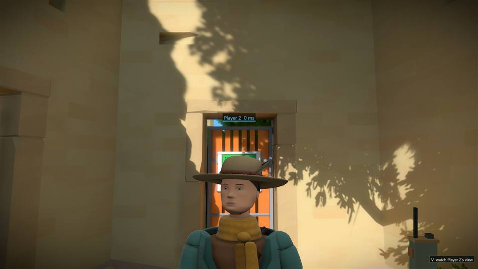
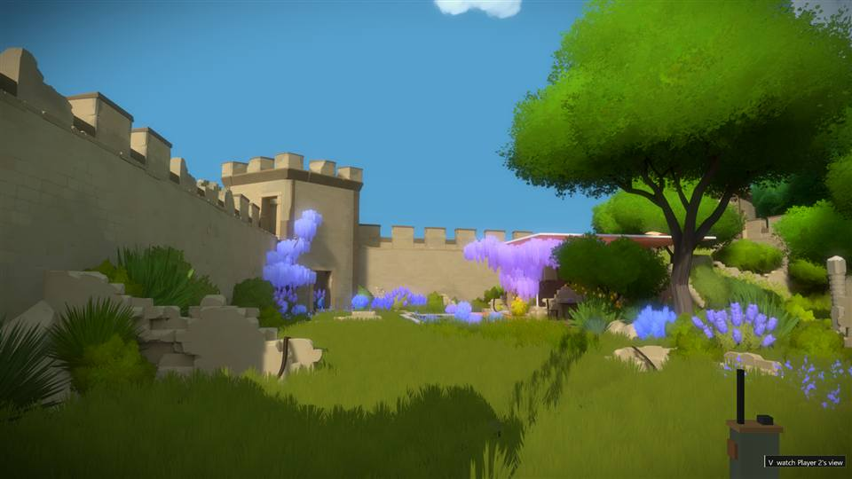
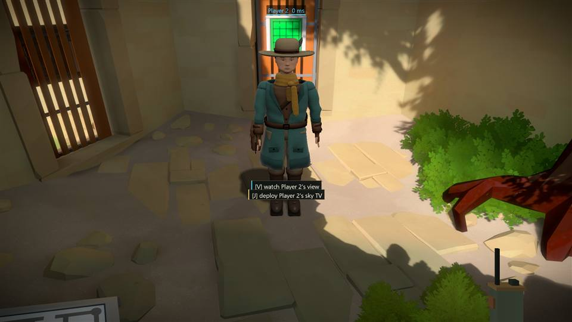
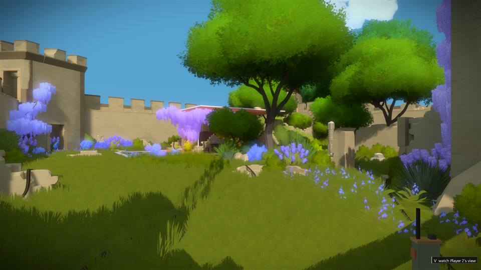
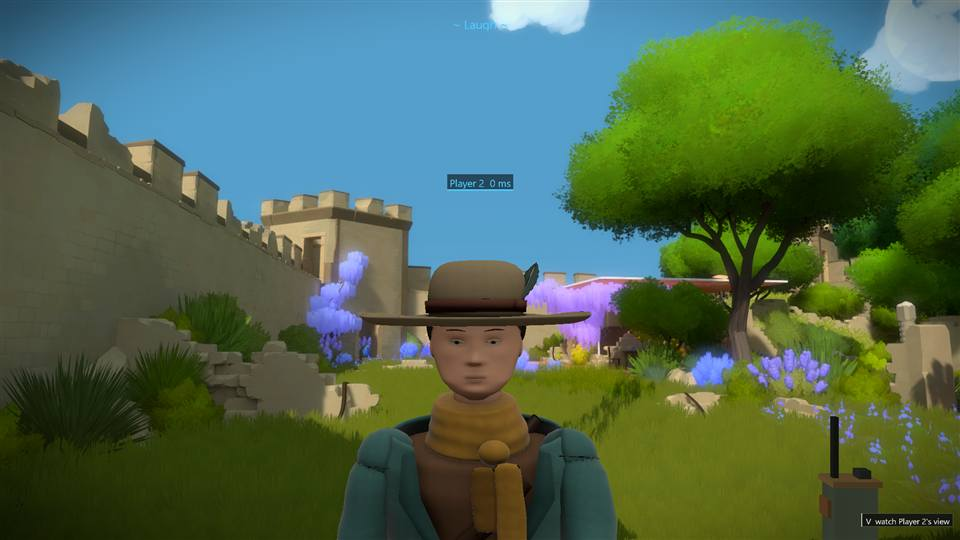

# The adventurer's life layer, shading and shadow


| The glance | A blink | The shadow | Settling the hat | Laughing |
|---|---|---|---|---|
|  |  |  |  |  |

Real pictures of the game with the mod (the `shot` command, two clients on one PC, 2026-10-30).

What a modern character does on its own, with no packet telling it to, and how it is lit. Everything here is
implemented in the proxy (`proxy/model/life.h`, applied in `proxy/model/model.cpp`, driven and drawn by
`proxy/model_gpu.cpp`) and in the Blender generator (`models/src/adventurer.py`). The game-free checks are in
`proxy/model/tests/life_test.cpp`; `make -C proxy/model test` runs them with their mutants.

## What the figure does by itself

| Behaviour | How | Driven by |
|---|---|---|
| Blinks | Each upper eyelid is a shell on its own bone (`lid.L`, `lid.R`); a blink scales the bone along its length by `lid_close` (the sidecar value, 1.5). The lid's vertices are weighted so its top row stays, its edge lands on the lower lid in every column and the eye corners do not move. 75 ms to close, 120 ms to open, every 2 to 6 s, sometimes twice. | A timer per player; a glance often begins with a blink |
| Glances at you | When the local camera is within 7 m and in front of the figure (within 100 degrees of its facing), the figure looks at it for 2 to 4 s (longer when very near), then looks away for 3 to 7 s. The eyes lead (a 20 rad/s spring), the head follows (5.5 rad/s), 65 % head and 35 % neck, yaw clamped to 60 degrees (25 while walking), pitch to -29/+23 degrees. Somebody who has just come near is looked at within a second. | The viewer's position relative to the puppet's head, from the model matrix |
| Carries its head where its player looks | Between glances the head pitch follows 70 % of the remote player's own view pitch (`RemotePose.ang[1]`), clamped to -34/+20 degrees: a player reading a panel on the ground bows their head. | The pose packet (already sent; no protocol change) |
| Saccades | Small eye movements (up to 4 degrees) every 0.6 to 3 s. | A timer |
| Breathes | The chest tilts back and forth 0.7 degrees (the neck and head counter it so the gaze stays level) at 13 breaths a minute at rest. Running (above 2.2 m/s) builds exertion over 6 s; it fades over 18 s and raises the rate to 46 a minute and the depth 2.6 times: a player who has just sprinted up is out of breath. | The measured speed |
| Swings its scarf and gear | The scarf tails hang from chains of bones (`scarf_a.1-3`, `scarf_b.1-2`), the canteen and satchel from one each. Each segment is a damped pendulum driven by the body's acceleration (from the smoothed position), the gait's bounce (two steps a cycle), the air at speed (it lays hanging things back) and a little wind. Angles are clamped so the tails never swing into the coat. | Position, speed, the clip's phase |
| Swings its coat | The coat's skirt hangs from three hem bones at the waist (front left, front right, back); below the waist the cloth's weight shifts from the torso and thighs to them over 25 cm. Each front panel follows the leg on its side forward (95 % of the thigh's swing, read from the pose) and the back panel follows whichever leg trails, with a 60 ms follow so the cloth stays ahead of the leg, and a slow pendulum on top for the lag and sway of heavy wool. Standing still it hangs as built. | The thighs' swing in the applied pose, the body's acceleration, the wind |
| Fidgets | After 6 to 16 s of standing still a clip named `fidget_*` plays once, then the next is due 8 to 22 s later. Four are bundled: a weight shift onto the left leg (the right heel lifts), a look round, settling the hat with the right hand, and a rub at the back of the neck with the head bowed (the two reaches are solved on the real rig at build time, and the hand is checked to reach without entering the head). Walking off or an emote ends a fidget at once (with the usual 200 ms cross-fade); a seated or emoting player never starts one. | `wm::Avatar`'s scheduler, seeded by the player id |
| Lets an emote have the head | While a gesture owns the head or neck, the glance fades out over 250 ms and comes back after. | The gesture layer's weights |
| Acts with its face | The brows sit on bones of their own (`brow.L`, `brow.R`, inner end to outer). Sad and Thinking draw the inner ends up (Thinking lifts the right brow alone), Laugh, Celebrate, Cheer and Panic raise both, Facepalm and No knit them, Shrug lifts them a little; 120 ms response, back to rest when the emote ends. | The emote id from the social layer |
| Moves its mouth when its player speaks | The lower lip sits on a bone (`lip_lower`) over a dark mouth patch that is a hairline when shut. While the player's proximity voice is active (the same activity that lifts the talking hand) the lip drops up to 4.5 mm and flutters at about five syllables a second, unevenly; it closes within 40 ms of silence. | The social layer's smoothed speech activity |
| Reaches for the panel it is tracing | While the player's line on a panel is still being drawn (the shared line is not final and was updated within 1.5 s), the puppet's right arm swings toward the line's tip (forward and across, from the shoulder, with a slight elbow bend), blended in over 250 ms and out again when the tracing stops; an emote or the talking hand keeps the arm. | The shared-lines state and the panel's pose in this game |
| Turns head first | The body's heading lags the player's view (a first-order lag, 12/s: a 90 degree turn is 95 % done in 250 ms) and the head turns ahead of it toward the view, up to 57 degrees, the eyes completing the look. | `wm::Avatar` keeps the view and the body apart |
| Walks sideways and backwards | A player walking more than 60 degrees off their view turns the body half way toward where they are going; beyond 110 degrees (70 to come back) the body keeps facing the view and the walk cycle runs in reverse: backing away from a panel looks like backing away. | The heading of the last datagram's step |

Order of the pose layers: the sampled clips (idle / walk / run / fidget, cross-faded), the emote gestures, the radio
arm, then the life layer (`wm::PoseLayers`, `JointMatricesBlendEx`). The rig part (which node is the head, which local
axis turns it left, which axis swings a scarf bone forward) is found once per model by `LifeRig::Bind` from the bind
pose, so the layer does not depend on the exporter's axis conventions: a probe rotation about each local axis is
measured in model space.

`no_model_life=1` is the test mutant that turns the whole layer off.

## Footsteps

Each walk or run cycle plants the left foot at phase 0 and the right at 0.5 (the generator's planted-foot trajectory). The render
thread reports each plant (`voice/footsteps.h`: `FootstepTracker`, forwards or in reverse, never on the first frame of a walk) and
the voice playback thread renders it beside the voices as a short synthesized footfall (`Foley`: a soft low-passed thud with a
crisp scuff at the start, 2 ms attack, a decay of 170 ms walking and 215 ms running, a run landing harder) placed like a proximity
voice: inverse distance, panned to the walker's side, gone beyond the voice range (`ComputeMix`), never clipping the output.
`footsteps=0` silences them (the test mutant), `footstep_volume=` scales them. `voicestat` reports `footsteps N footsteps_dropped M`.
The playback thread runs even with voice chat off, so the steps are heard whenever the mod can open a playback device.

Game-free: `make -C proxy/voice test` (15 footstep checks; mutants `FS_NO_STEPS`, `FS_NO_DISTANCE`, `FS_NO_PAN`, `FS_NO_DECAY`).
Live: `tools/win/wmodel.py` counts the mixer's footsteps across the 1.2 s walk (at least two); `MUTANT: adventurer footsteps off`
must fail that check.

## Shading

The puppet is lit in linear light, with the result converted back to the game's display values:

- The colour atlas (2048, JPEG) stays as it was; a tangent-space normal map and a material map (R occlusion, G roughness,
  B metalness; both 1024, PNG) are baked beside it from the same procedural materials (cloth folds and grain at scales the
  map can hold; the fine weave stays in the colour, where it was). Blender's glTF exporter writes them as `normalTexture`
  and `metallicRoughnessTexture`; the loader reads the first textured material's three images.
- The normal map is applied through a cotangent frame from screen-space derivatives (the vertices carry no tangents). Sign
  convention: the frame's bitangent follows increasing glTF `v` (down the image), and the sampled green is negated, which is the
  same resolution the Khronos glTF Sample Viewer makes (its bitangent is `cross(n, t)`, pointing up the image, with the green
  unflipped): both read a glTF normal map's +Y as "up the image". Blender bakes OpenGL-style +Y-up maps and its exporter
  leaves the image alone while flipping `v`, so the bundled map follows the glTF convention. The map's strength is 0.75 and it
  fades out at grazing angles, where the screen-space frame degenerates.
- The sun (`model_sun`, default 0.55, warm white) with wrapped diffuse (skin wraps further and gets a warm band at the
  terminator), GGX specular with Schlick Fresnel and Smith geometry from the map's roughness and metalness, a sky/ground
  hemisphere (`model_ambient`, default 0.30) times the baked occlusion, and a sheen on wool and knit (coat, scarf, trousers).
- Metal (brass, the canteen) reflects its own colour. Eyes and nails are glossy; cloth is rough.
- `model_shading=0` restores the old flat shading for comparison; the palette tints still apply in linear light.

## The sun shadow

After the figure is drawn, it is drawn again flattened along the light onto the plane of its feet, into a mask the size of
the screen. A second pass lays the blurred mask (5x5 taps) on the game's own geometry: a pixel is darkened only where the
scene's depth puts it within 0.25 to 0.6 m of the feet's height (a ledge or a wall is not shadowed) and where none of our own
figures is in front of that ground (our depth buffer is read back, so the shadow never darkens the boots it falls behind).
The pass runs in the projected bounding rectangle of the flattened figure only. `model_shadow=` sets its darkness (default
0.55; 0 turns it off, which is the test mutant). An occlusion query counts the shadow's pixels for the tests (`lifestat`).

## Readouts and verification

`modelstat` now also logs `lifestat: blinks N blink B glancing G head_yaw Y head_pitch P breath R exertion E scarf S fidgets F
fidgeting X shadow_px Q shading M` for the last player drawn. `lifeblink` makes every drawn figure blink at once, six times slower
than a real blink (1.2 s), so a picture can catch the eyes closed.

Game-free (seconds, no slot):

```sh
make -C proxy/model test          # model-test (254 checks, 15 mutants) and life-test (14 mutants)
python3 tools/test_gestures.py
python3 tools/check_model.py assets/models/adventurer.glb
python3 tools/check_appearance_asset.py assets/models/adventurer.glb
```

The life test loads the bundled model and checks: the lid bones close the eye (the edge drops 7 to 13 mm, the top row and
corners stay, the lid does not stand off the face), blinks happen 3 to 12 times in 20 s and are short, a viewer to the
front-left is glanced at (the face turns, measured on the skinned eye joints) and let go of when they leave, a viewer behind
is ignored, a viewer at 96 degrees is followed only to the 60 degree clamp, an emote takes the head, a downward view pitch
lowers the eyes, breathing moves the neck's base 1.5 to 20 mm at 13 a minute and more than twice as fast after a run, a push
swings the scarf tip more than 12 mm, bounded, and it settles within 8 s, a forward push leaves the tail behind, a minute of
standing fidgets at least once and returns to the idle, walking never fidgets and ends one within 45 frames, an emote
prevents one, and every fidget clip returns to its own first frame close to the idle's and moves the body 3 cm to 1.3 m.
It also checks that one frame after a 90 degree turn of the view the body has turned only a little and the head has the rest
to do, that a second later the body faces the view, that a forward walk runs the cycle forward with the body on the view, that a
backward walk keeps the body on the view and runs the cycle in reverse, and that a sideways walk turns the body about 45 degrees
and the head back toward the view. It also measures the brows on the skinned vertices: Sad lifts the inner ends 2.5 to 12 mm above the outer ones on both sides,
Laugh raises both brows 3.5 to 12 mm evenly, Facepalm lowers them with the inner ends below the outer, Thinking lifts the right
above the left, and the face is back within half a millimetre after the emote. Mutants: `NO_BLINK`, `NO_LOOK`, `LOOK_UNCLAMPED`,
`NO_BREATH`, `NO_CLOTH`, `CLOTH_UNDAMPED`, `NO_FIDGET`, `FIDGET_MOVING`, `NO_BODY_LAG`, `NO_BACKWALK`, `NO_BROWS`, `NO_HEM`, `NO_LIPS`, `NO_REACH`
(the reach check: the arm points within 25 degrees of a target in front and to the right, hangs again after the tracing, and stays with an emote)
(the speech check: talking drops the lower lip 2.5 to 8 mm with at least a millimetre of flutter, silence brings it back within 0.3 mm).
The coat check walks the cycle in 16 steps, lets the hem settle on each frame's leg swing, and measures the hem's clearance from the
leading thigh's centre line (front panel) and the trailing thigh's (back panel) between knee and hip: more than 5 cm throughout (the
thigh is 10 cm across); `NO_HEM` (a passive skirt) fails it, which is why the skirt is driven and not simulated alone.

With Blender, `models/build.sh adventurer` rebuilds the asset (the generator checks the lid stretch, the hat-touch reach,
that every fidget returns to its start, and that the normal map is not flat) and writes previews including `blink_front`,
`halfblink_front`, `look_front` and the three fidgets.

Live (two clients, `tools/qa.sh model`): `tools/win/wmodel.py` now also checks that a standing figure blinks at least twice
in 12 s, that it casts a shadow on the tunnel floor (shadow pixels from the query) and that a figure 2 m away, face to face,
is glancing. `MUTANT: adventurer life layer off` (`no_model_life=1`) must fail the first and the third; `MUTANT: adventurer
shadow off` (`model_shadow=0`) must fail the second.
