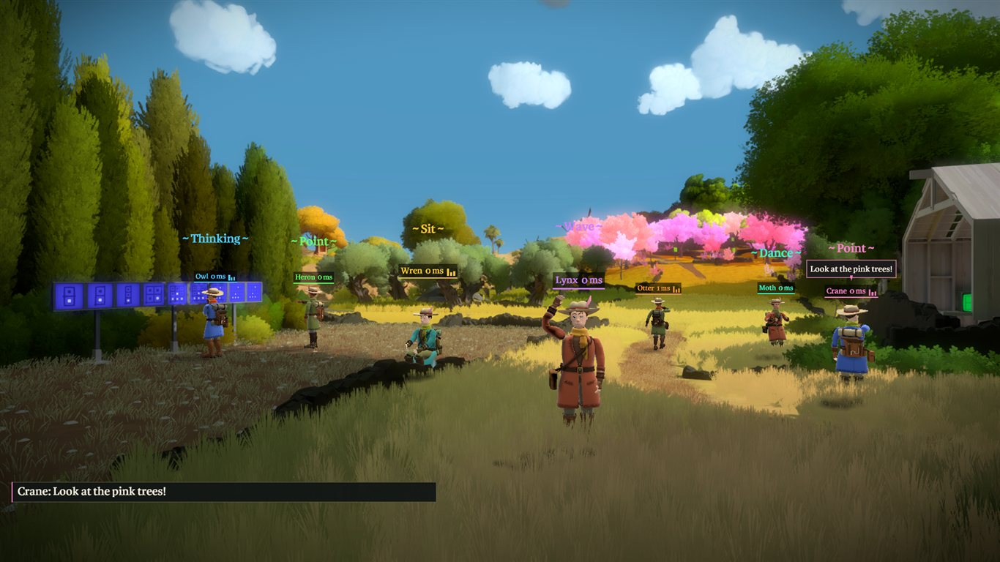

# The Witness Co-op v0.2.0-beta.1

A co-op mod for The Witness. You and your friends walk the same island, see each other, and share progress: when one
of you solves a panel it's solved for everyone, and the doors, bridges, elevators and water it sets going move in every game.
You can talk, chat, point at things and emote, or race each other instead.

## Getting started

1. Download **`Witness-Coop-Setup.exe`** below and run it. It finds the game, checks its version and installs.
2. Press Play on The Witness in Steam. The co-op launcher opens: host a game, or join a friend's.

Everyone needs their own copy of the game and the same version of the mod. Hosting, joining, the keys and the
controller setup are in the [README](https://github.com/TommoDotCommo/witness-coop#readme), and there are more pictures
in the [showcase](https://github.com/TommoDotCommo/witness-coop/blob/main/docs/SHOWCASE.md).

## What you need

- **The Witness on Steam, the current version** (build 11370412). GOG and Epic copies aren't supported yet.
- **Windows**, or Linux and Steam Deck through Proton: run `install-linux.sh` from the zip.
- Vortex and Mod Organizer 2 users: the plug-ins for both are attached below
  ([how to use them](https://github.com/TommoDotCommo/witness-coop#mod-managers)).

## Known issues

- **Windows may say "Windows protected your PC"**, because the files aren't code-signed yet. Click More info, then
  Run anyway.
- A mod that replaces DirectSound completely won't work alongside co-op.

## It's a beta

Please tell us what goes wrong. Press **F2** when it happens, then **Send diagnostics** on the launcher's About tab,
and attach the zip to a [bug report](https://github.com/TommoDotCommo/witness-coop/issues/new?template=bug.yml).

If you tried the alpha, run the new Setup.
