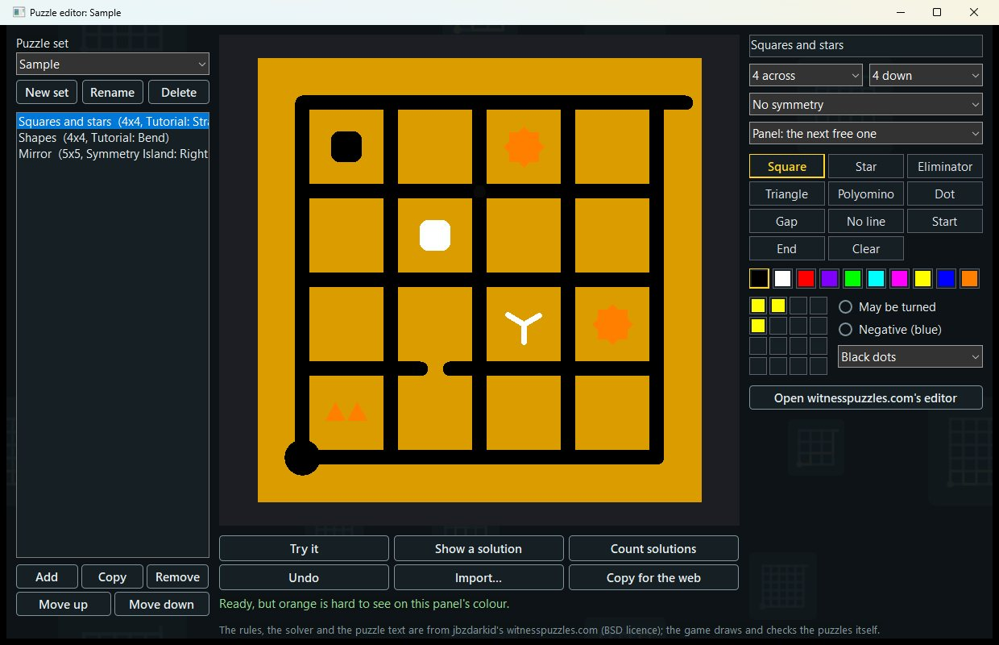

# The Witness Co-op v0.3.0-beta.1

A co-op mod for The Witness. You and your friends walk the same island, see each other, and share progress: when one
of you solves a panel it's solved for everyone, and the doors, bridges, elevators and water it sets going move in every game.
This beta adds new puzzles for the island: randomizers built into the launcher, and an editor for making puzzles of your own.

## Getting started

1. Download **`Witness-Coop-Setup.exe`** below and run it. It finds the game, checks its version and installs.
2. Press Play on The Witness in Steam. The co-op launcher opens: host a game, or join a friend's.

Everyone needs their own copy of the game and the same version of the mod. Hosting, joining, the keys and the
controller setup are in the [README](https://github.com/TommoDotCommo/witness-coop#readme), and there are more pictures
in the [showcase](https://github.com/TommoDotCommo/witness-coop/blob/main/docs/SHOWCASE.md).

## New in this beta

- **Randomizers, built in.** The launcher's new **Randomizers** tab makes new puzzles for the island when the game
  starts: Sigma's Witness Randomizer (Normal and Expert), Variety, Ascension, Despair, the Symbol Shuffler's modes, the
  Star Randomizer and the Tutorializer. Each has a seed you can share. In a lobby the host's choice is everyone's, so you
  all play the same puzzles. The tab names each randomizer's authors.
- **Make your own puzzles.** Choose **Your puzzles** on the Randomizers tab and press **Open the puzzle editor**. Draw a
  puzzle on a grid of up to 7 by 7 with the game's symbols: squares and stars in the game's colours, eliminators,
  triangles, shapes (turnable or negative), dots, gaps and missing lines, start and end points, and symmetry. Pick the
  panel it goes on, or let it take the next free one. The editor shows the puzzle in that panel's own colours and tells
  you when a symbol would be hard to see there.
- **Try them before you play.** **Try it** lets you draw a line as on a panel; **Show a solution** and **Count solutions**
  tell you whether it can be solved and how many ways. The rules are those of witnesspuzzles.com, and in the game the
  panels judge your lines the same way.
- **Share them.** In a lobby the host's puzzles are sent to everyone before the game starts. **Import** takes a puzzle
  from [witnesspuzzles.com](https://witnesspuzzles.com), and **Copy for the web** gives you the text to put there.
- **Continue as you left it.** A continued game keeps the puzzles it was started with, even after you change your set in
  the editor.
- **The Witness Trainer's options**, for your own game only: walking speed, field of view, a noclip key, no time limit in
  the challenge, and an overlay that shows the environmental puzzles.
- **A friend's solved line stays, in their colour.** When someone else solves a panel, their line stays on it in their
  own colour, so you can see who solved what. Before, the line could vanish if you were watching while they solved it.

## Good to know

- **Everyone in a lobby needs this version.** The lobby now sends puzzle sets, so this launcher can't join a lobby of an
  older version, or the other way round. The launcher says so.
- Your own puzzles go on ordinary grid panels of the Tutorial, the area outside it, Symmetry Island, the Quarry, the
  Swamp and the Town; every other panel keeps the game's own puzzle.
- A start point must be on a corner of the grid, not in the middle of a line, and a gap must be on a line, not on a
  corner. The editor tells you.

## What you need

- **The Witness on Steam, the current version** (build 11370412). GOG and Epic copies aren't supported yet.
- **Windows**, or Linux and Steam Deck through Proton: run `install-linux.sh` from the zip.
- Vortex and Mod Organizer 2 users: the plug-ins for both are attached below
  ([how to use them](https://github.com/TommoDotCommo/witness-coop#mod-managers)).

## Known issues

- **Windows may say "Windows protected your PC"**, because the files aren't code-signed yet. Click More info, then
  Run anyway.
- A mod that replaces DirectSound completely won't work alongside co-op.

## It's a beta

Please tell us what goes wrong. Press **F2** when it happens, then **Send diagnostics** on the launcher's About tab,
and attach the zip to a [bug report](https://github.com/TommoDotCommo/witness-coop/issues/new?template=bug.yml).

If you have an earlier version, run the new Setup.
