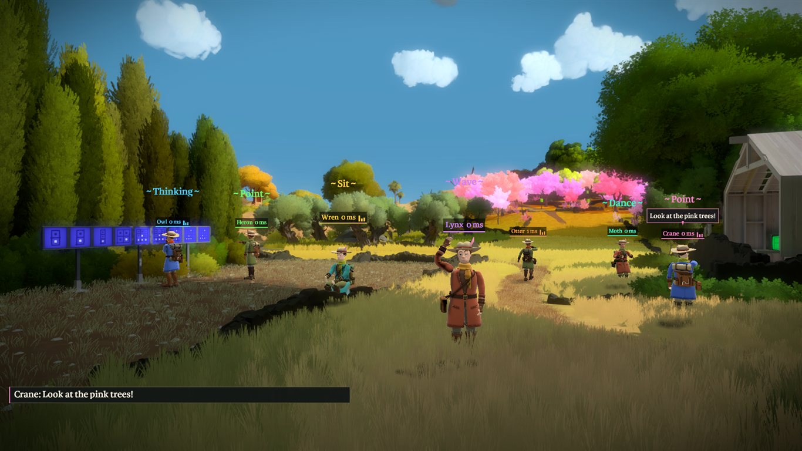
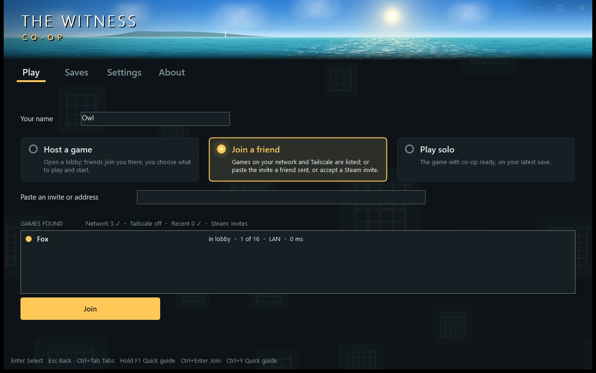
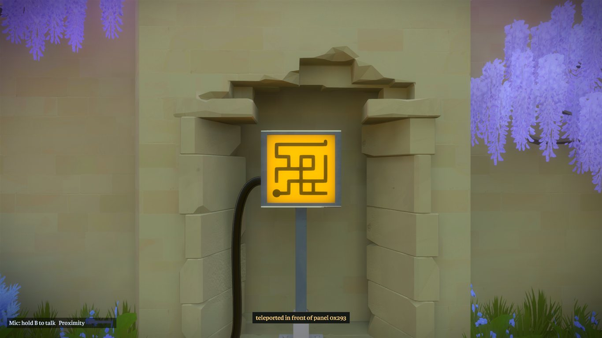
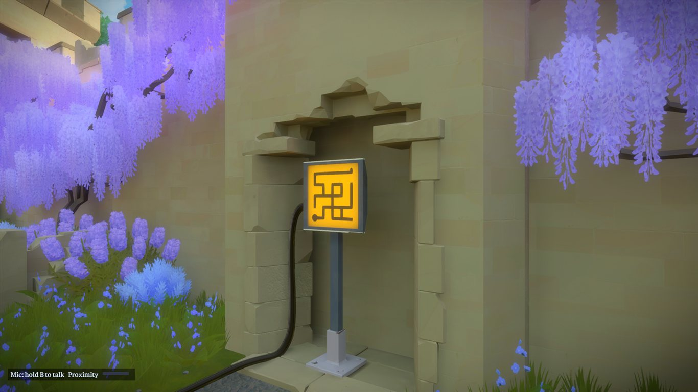
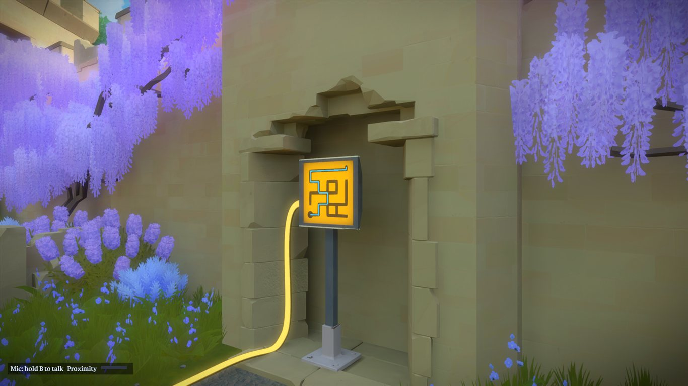

# Showcase

Co-op for **The Witness**: you and your friends in the same world, seeing each other, talking, drawing and racing. These are pictures of the game
running with the mod, up to eight players at a time. [How to install and play](../README.md) · [All features](../features.md)

Eight players in the orchard, each in their own coat, scarf, hair and skin colours (Settings > Players and interface).

## The launcher

The launcher has four tabs: Play, Saves, Settings and About. It is drawn in the look of the game: a sunny sea as the banner, faint puzzle panels behind the pages, the game's typeface and its yellow for the main button and the selection.

**Play** has your name, three tiles (Host a game, Join a friend, Play solo) and one button that says what it does. Here Host a game is chosen, through Steam or direct, and the
button reads *Open lobby*.

**Join a friend** lists the games it finds on every network of this PC, on Tailscale and among the hosts you joined before, each source named with a tick when it is done; a row says
the host, *in lobby*, the players of 16, how it was reached and the ping. The box above takes whatever a friend sent (the invite message, the link, the WIT- code, a Steam lobby number,
an address or a name) and says what it recognised before Join.

Hosting or joining turns Play into the **lobby** (the tab is called Lobby). Three columns: who is here (a lit dot beside the name of whoever is talking, an amber one for a player who has
said they are ready, *Mute me* and *Deafen* below), the chat, and **Friends can join by** (Steam, Same network, Tailscale, Internet, Windows Firewall, each with its check and, when it
needs a look, the fix) with the WIT- invite and *Copy invite* above *What to play*,
which the host chooses: co-op or a race, a new game, parts of the map already done. The host's *Start game* starts it when everybody is ready; when the games end everybody is back in
the lobby.

**Saves** lists each save with the players who were in the game and how far it got, with the picture of the save, and has *New game*, *Back up*, *Move to backup folder*, *Open folder*
and *Refresh*.

*New game*: tick the parts of the map that are done; the window says how many panels that is and what else the game needs first, and the game starts with exactly those solved.

**Settings** has the sections Co-op rules, Players and interface, Voice and sound, Controls, Display, Network and Launcher. A setting is saved when it changes, and *Reset section*
puts a section back.

| | |
|---|---|
|  |  |
| Players and interface: your name, the adventurer's colours (skin, hair, eyes, coat, scarf, trousers, boots, gear), see-through players, the third-person view when emoting, the developer menu. | Voice and sound: voice chat (here Push to talk), the push-to-talk key by pressing a key, volumes, hearing range. |
|  |  |
| Controls: every co-op key by pressing a key, and the pad's View-button layer on or off, with what each press does. | Display: the game's own Launcher.variables (full screen, resolution, frame limit, quality) and the options that live inside a save (brightness, field of view, reticle, vignetting). |
|  |  |
| Network: the lobby and game ports and the address friends reach this PC at. | About: version, *Check for updates*, the quick guide, *Send diagnostics*, project page, release notes, the game folder (a generic path replaces this PC's in the picture) and credits. |

## In the world

Every player is drawn as the adventurer, with a name tag in the player's own colour and the ping (round trip to that player). The bars beside a name show who is talking.
The text of the co-op overlay is in the game's own typeface.

### See-through players

| Another player, three metres away | The same player in the camera player's body |
|---|---|
|  |  |

A player who overlaps your body fades to a ghost, so the view is not blocked; a step away and it is drawn normally again.

### Shared panels and lines

| The maze, unsolved | Player 2 draws, player 1 watches | Solved in both games |
|---|---|---|
|  |  |  |

Player 2 draws the cable-driving maze with real mouse input (through the game's own input path); player 1, standing at an angle in front of it, sees the blue line grow on the
panel while it is drawn. When the line is finished the panel is solved in both games and the cable lights up: panel and power state travel as reliable events, lines are drawn from
what the other game sends.

### Chat, typing dots, pings

Players speak: each line floats over its player and is in the log at the bottom left (`T` opens the chat, Enter sends). The player with the three dots over the head is typing.
The poles with a name and a distance are pings, in the sender's colour; the arrow at the bottom is a ping behind the camera. The line at the bottom left is this player's own
microphone (`hold B to talk`).

A notice ("Fox joined"), the chat lines and a chat line being typed, in the game's typeface.

### The player panel

Holding Tab opens the player panel: one row per player with the colour, name, ping, speaking light and distance, and the buttons Watch, Mute and `-` `+` for the player's voice volume;
below, voice volume, name tags, partner picture and Leave. Releasing Tab closes it. The panel is for the mouse; its footer lists the keys (arrows, Enter, M, L, Esc).

*Watch* shows the other player's own screen in a box (streamed only because this game asked for it). The line under the box names the keys: `[` and `]` for the
next player, `F9` to make the box bigger or hide it, and hold `Tab` for the player panel, where Watch is a button.

### Emotes

Two players play an emote at the same moment, each with its name over the head (here Dance and Wave).

Hold `H` and move the mouse toward a slot (Dance is lit); release plays it. The wheel shows eight slots here: Wave, Shrug, Dance, Cheer, Yes, No, Bow, Spin.

When you play an emote yourself, the view moves back behind you and a little above, so you see your own adventurer; the other players see nothing different.

### Voice

Who hears you is the voice channel, shown in the microphone line at the bottom left. `Y` steps through the channels. Proximity (the default) is heard in the world, louder when close,
and turns into a radio sound far away. The bars beside a name are the players who are talking.

| Open line | Private |
|---|---|
|  |  |

Open line: everybody hears you as you sound, as loud far away as next to you. Private: only the named player hears you (the label says *Private: Owl*); the voice is not sent to anybody
else.

### Drawing

`X` draws under the cross-hair, `Z` turns the mouse into a pen; the ink is put on the surface under the pen and drawn as ribbons in the world, in the player's colour. Everyone sees it
as it is drawn.

### The quick guide

Hold `F1` for the quick guide, in the game and in the launcher: your keys as they are bound now (a second key on the same row), the controller layer, playing together, hosting and joining, and troubleshooting.

### The pause menu

| Playing | Paused |
|---|---|
|  |  |

While the game's pause menu is open the mod draws nothing over it: no player, name tag or line.

## The shared keys

The keys are the same in every co-op mod, and every one can be changed in the launcher (Settings, Controls; the guide above shows the bindings in use). In these pictures: `T` text chat,
`V` or the middle mouse button ping, `B` (or the mouse side button) push to talk, hold `H` the emote wheel, hold `Tab` the player panel, `[` and `]` watch the previous or next player,
`Y` the next voice channel, hold `F1` the quick guide.

## On a gamepad

With the pad layer on, the View button is the co-op button: tap to ping, hold for the player panel, and while it is held the D-pad opens the emote wheel (up), chat (down) and watches the
previous or next player (left, right).

| Hold View: the player panel | View + D-pad up: the emote wheel | View + RB: quick chat |
|---|---|---|
|  |  |  |

The panel's footer reads *Right stick: point, RT or A: click, Let go of View: close*. The wheels say *right stick picks, let go of View plays* (emotes) and *let go of View sends*
(quick chat: Ready, Wait for me, Come look at this, Over here, Thanks).

## A race

A game for two or more where nothing is shared: everybody plays their own copy of the world, sees the others, and chats and talks, but a panel one player solves is not solved in
anybody else's world. Everybody waits until all the worlds are loaded, then a countdown ends in the same GO for all. The clock, the goal (here: solve three panels) and the standings
are on screen; the first to the goal wins, and the banner shows the winner and the time while the other player is still racing. The host chooses the race in the lobby (*Game*,
*Race goal*).

## Experimental (off by default)

Two feature families are behind options that are off by default and apply at the next start: the back TV family (TV, sky TV, audience seats) and the handheld radio with its voice channel.
They are not shown in pictures here. The options are in the launcher under Settings, Launcher:

The same page has *Show the launcher at start*, *Check for updates when the launcher starts* and *Updates to offer* (full releases, or pre-releases too). The two keys of the experimental families (R and J, K)
are listed in Controls with "only with Experimental" under them.

## The character

Everyone plays as the adventurer, a character made for this mod and released into the public domain ([credits](../assets/models/CREDITS.md)). You can change its colours in the launcher.
